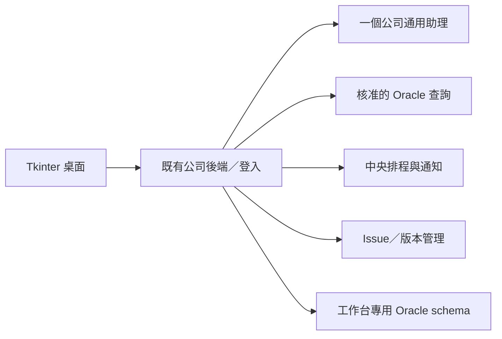

# 既有後端、AD、Oracle 與助理介接

## 1. 架構決策

沿用公司既有後端框架，不把 FastAPI 或其他新框架當先決條件。前端透過後端 API 工作；達哥與 Oracle secrets 留在後端。若現有後端不是 Python，可把目前已成功的 Python 助理呼叫包為內網 adapter，但仍由同一後端統一授權。

初期一個後端應用及一個背景 worker 足夠；只按量測增加 worker。排程與任務權威資料在 Oracle，桌面 SQLite 只作原資料遷移、草稿及公司允許的快取。不能把共享磁碟 SQLite 當中央資料庫。

## 2. 身分沿用既有服務

桌面啟動現有登入流程，沿用該平台已核准的 session/token 發放方式，不另定 AD 帳密端點。後端從經驗證 session 得到穩定 subject，映射員工工號、單位與在職狀態；不得信任桌面自填的 subject／role／unit_id。

每次業務請求檢查：有效登入＋員工仍在職＋指定單位＋使用名單 active＋資源 owner／查詢授權。員工狀態可快取最多 5 分鐘；應用名單停用每次檢查、立即生效。身份源失效且快取過期時拒絕新工作，不擴權。工號與 AD 帳號若不同，由公司映射，不猜相等。

首版不重新保存 AD 密碼，也不把它用於排程。排程記錄擁有者，每次跑前重驗其授權，使用服務端受限連線。桌面秘密儲存沿用公司機制；沒有核准儲存就 session-memory，不回退明文。

## 3. Oracle 查詢

需 DBA／資料 owner 提供：Oracle 版本及連線方式、三項常用問題、主表／View、欄位定義、join key、單位與時區、日期口徑、使用範圍、人工核對樣本。帳密在公司設定，不放進此包。

每個模板保存 `query_id, version, name, description, parameter_schema, server_sql, output_columns, scope_rule, timeout_seconds, max_rows, max_bytes, enabled`。版本發布後不可原地改 SQL；新增版本並停用有問題版本。首版模板由開發者以受控 query catalog 部署，maintainer 核准啟用，不另建可任意編 SQL 的管理介面。

助理只看已授權模板的名稱、語意與参数規格，不取得整個公司 schema 或連線憑證。其回覆限 `answer / clarify / query_request / rewrite / summarize / unsupported / plan_draft`；`query_request` 只帶 query_id、version、parameters。後端獨立驗證且拒絕原始 SQL。

正常流程：身份授權 → 模板與參數 schema → 由 server 注入使用者單位範圍 → bind variables → 唯讀查詢 → 保存結果 snapshot → 返回表格。使用者／模型不能覆蓋 `scope_unit_id` 等系統參數，模板不得改寫業務資料。參數值使用 bind，table/column 由核准模板固定。[Oracle driver 的 bind 文件](https://python-oracledb.readthedocs.io/en/stable/user_guide/bind.html)

服務帳號只授權核准 View 的 SELECT，不給 ANY TABLE／DDL／業務寫入權限。工作台 schema 的應用寫入連線與業務唯讀連線分開；runtime 不使用 schema owner。依連線池重用時清理任何 session context，避免沿用上個人的 scope。

預設單次查詢 timeout 30 秒、最多 1,000 列且序列化後 ≤ 2 MiB。取上限＋1 判斷截斷，結果標 truncated；模型不得以截斷內容宣稱全量統計。需要全量合計时由另一個已核准 aggregate 模板計算。表格分頁與匯出都基於同一 snapshot，不每頁重新查移動中的資料。

## 4. 助理 adapter

沿用公司初版的 OpenAI 套件、已成功呼叫方法、公司 base_url 與 assistant 設定，先建立去識別化契約測試。不因用了套件就假定是 OpenAI Responses／Assistants 端點，禁止自動 fallback 至公共 OpenAI。

應用的 `AssistantAdapter.respond(context, allowed_queries, text, parsed_attachment)` 輸出 `AssistantDecision`；它是自有介面，不是廠商 schema。依 kind 使用 schema 中的欄位，不是所有分支都有相同欄位；plan_draft 僅為候選，不含任何批准或可執行權限。公司 API 若不保證 JSON，parser 驗證後最多要求修正一次；仍不合法就提示改用查詢條件表單，不猜指令。

能力採 supported/unsupported/unknown：text、streaming、structured_response、session_isolation、cancel、request_status、usage、native_side_effects。只啟用已驗證能力。每位使用者／對話隔離 provider session；無法證明隔離時不能共用遠端 session，需使用公司證實的無狀態路徑或阻擋正式多人發行。

上下文只包含該使用者對話必要內容、授權資料與所需結果。固定最大輪數 6 次助理呼叫／一次需求，不允許自由工具迴圈；完成實際查詢後可再呼叫助理解讀。排程只重跑固定 query，不每天讓模型重新選 SQL。

助理 native plugins 若可能有寫入，不能把整個 API 當純讀而重試；需要文件確認。純文字失敗可有限重試，未知遠端副作用回「需確認」並記 request ID。

## 5. 自有 API 與 DTO

以下 `/unit-helper/v1` 是**要加在既有後端的產品 API**，不是達哥端點。沿用公司錯誤格式；若無標準，使用 `{code, message, retryable, trace_id}`。所有列舉 API 只回授權範圍，cursor 分頁，limit ≤ 100。

| Method／path | 契約 |
|---|---|
| GET /me | subject、工號、單位、role、可用 query IDs、policy_version |
| GET/POST /conversations | 私有清單／建立；POST 帶 client_request_id |
| GET /conversations/{id}/messages | 分頁讀取原文與候選，不跨 owner |
| POST /conversations/{id}/requests | text、mode(auto/rewrite/summarize/query)、interaction_mode(normal/plan，預設 normal)、upload_id?、query_ref?/parameters?（mode=query 時成對提供）、date_selection?、client_request_id；202 task_id |
| POST /uploads | 單 TXT/CSV，server 重驗格式／上限，回 upload_id、preview、expires_at |
| GET /tasks/{id} | state、clarification?、question_form?、plan_id?、answer?、query_result?、error?、version |
| POST /tasks/{id}/input | typed values 或 QuestionForm 的 InputSubmission 二擇一，expected_version、client_request_id；詳見 Plan 契約 |
| POST /tasks/{id}/cancel | 停止本機任務派發／等待；不偽稱遠端已停 |
| GET /queries | 只給核准且已授權的名稱、版本、參數 schema、output_columns 與 display metadata，不回 server_sql |
| POST /queries/{id}/runs | version、parameters、date_selection?、client_request_id；同樣回 task_id |
| GET /tasks/{id}/result；GET /tasks/{id}/export | 同一結果 snapshot 的分頁／安全 CSV |
| GET/POST /schedules | 列表／從成功 query task 建草稿；source_task_id、rule、parameter_bindings、notify_rule |
| PATCH /schedules/{id} | 停用／編輯，expected_version；更改內容重看預覽 |
| POST /schedules/{id}/enable；POST /schedules/{id}/run-now | 確認啟用／獨立手動觸發；client_request_id |
| GET /schedules/{id}/runs | occurrence、狀態及結果 |
| GET /notifications；POST /notifications/{id}/read | 個人提醒／標讀，不刪除執行證據 |
| GET/POST /issues | 我的回報／提交；include_context 須列明 refs |
| GET /issues/{id} | 本人或 maintainer 可看 issue 專屬內容 |
| GET /admin/issues；PATCH /admin/issues/{id} | 分類、狀態、合併目標、修正版本；optimistic version |
| POST /admin/releases | 僅 maintainer，發布已簽章 release；不開放 client 自簽 |
| GET /desktop/releases/latest | client version、platform、channel；回 signed manifest＋signature 或無新版 |
| GET /desktop/releases/{id}/package | 限目前使用名單，可下載指定不可變更新包 |

所有 POST 使用 `client_request_id` 作 owner+operation 範圍的去重。持久物件保存該 key 和 canonical request hash；相同 key／相同內容回原結果，不同內容回 409。獨立修改命令的去重紀錄至少 7 天，過期 key 不再承諾可重播，UI 重试不得悄悄換 key。

TaskState：queued、running、waiting_input、succeeded、failed、cancelled。query／chat task 包含 owner、kind、query version/params、deadline、attempt、remote_request_ref、result_json、error_code、request_hash。終結狀態不可被晚到回覆改回 running；重跑建立新 task。

QueryResult：query_ref、columns(name/type/label?/copy_as_text?)、rows、row_count、truncated、parameters_display、fetched_at_utc、source_label、scope_description。Decimal 以字串保精度；date/time 用明確 ISO 格式，缺值為 null。

## 6. 資料隔離與後端假設

維持既有框架、路由、登入與監控標準。詳細 Oracle 資料表及索引見 [database/ORACLE.md](database/ORACLE.md)。本規格不以新增 OIDC、Redis、Kafka 或另一套後端平台作條件。

company AD／API／Oracle 版本未知的部分在公司 repo 盤點，而非自行換系統。可繼續做的工作：MockAdapter、純 schema、UI、參數驗證、排程時間測試、issue 流程及更新演練。正式登入與真實資料驗收需公司環境證據。

## 7. v2.1 Plan 與選項

[PLAN-AND-CHOICES.md](PLAN-AND-CHOICES.md) 定義新增 /plans 與 schedule-offer API、QuestionForm、InputSubmission、確認交易及 PlanState。TaskState 沿用不增加 ready；ready 是 PlanState。planning task succeeded 只表示草稿已生成，不能顯示執行成功。task 新增 kind=plan，並以 plan_id/plan_revision/phase(planning/execution) 連結；執行 task 的 kind 仍為 query/summarize/rewrite。

plan_draft schema 僅用來選配解析模型候選；後端從授權目錄產生固定表單與步驟也符合規格。QuestionForm 為後端 DTO，不是達哥 API／模型授權。mode 控制工作種類，interaction_mode 控制是否必須先確認，兩者不可混用；所有 tool dispatch 都必須驗證該需求的互動模式。計畫、輸入表單、來源、執行 task 的 owner 必須一致。新增 /me 回 capabilities.plan、capabilities.choice_forms，舊 client 無能力時不顯示新操作；不得降級成直接執行未批准計畫。

## 8. v2.2 引導查詢與複製

[GUIDED-QUERIES.md](GUIDED-QUERIES.md) 定義 display、date_range 及欄位 metadata。一般模式沿用 query runs；明確選模板的 Plan 用既有 requests 加 query_ref/parameters，不重新讓模型猜模板。保留原 client 不帶新增欄位的相容性。

成功 task 的結果 snapshot 不可原地修改；複製全部透過既有分頁讀取同一 task，不執行 SQL。顯示欄名、順序與 copy_as_text 保存於結果，不讀新版目錄覆蓋歷史。沒有新增 clipboard API、中央資料表或評分 API。
