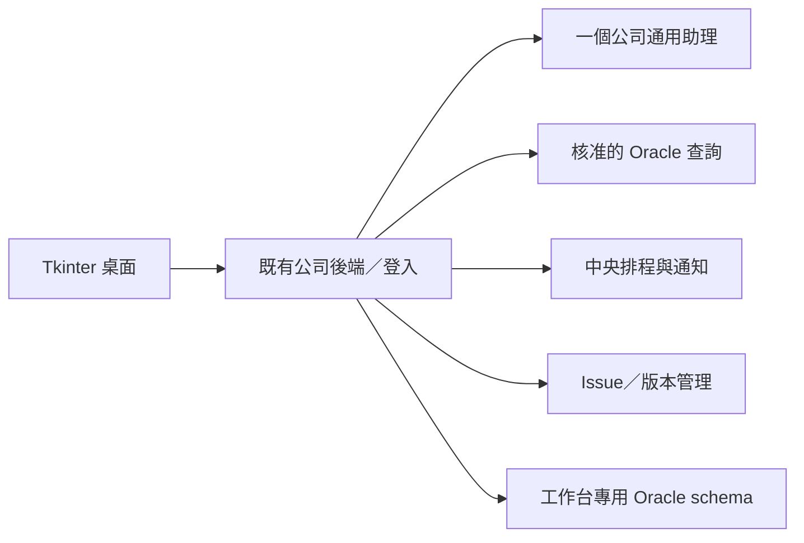

# 單位桌面小幫手完整規格 v2.2

日期：2026-09-26。由九份規格合併；本交付是文件與公司開發指令，非已完成應用程式。

---

來源：[SPEC.md](SPEC.md)

# 單位桌面小幫手規格 v2.2

## 1. 目標與已確認條件

為單位同仁提供一個簡單桌面入口，用白話查資料、整理內容、改写文字、設定排程並取得通知。使用者有不同的小需求，但產品先提供少量可重用能力，透過回饋逐步增加。

已確認：Windows、Tkinter 必須保留；初版已能呼叫公司智能助理 API、生成排程、自動上網取資料、SQLite 保存。公司已有全端後端及 AD 登入，資料庫使用 Oracle。Python `openai` 套件連的是公司／達哥服務；GPT 6 sol 是公司開發工具的模型。現在的軟體以複製 EXE／資料夾提供給同仁。

### 成功定義

同仁能自行完成一次查詢、看懂結果、存成排程；能整理文字或單一資料檔；能回報問題及更新軟體。開發者不用到每台電腦查 log、手動替換每次新版或為每個人重寫相同查詢。

## 2. 首版範圍

| ID | 能力 | 首版具體行為 |
|---|---|---|
| UH-01 | 登入與使用名單 | 沿用既有登入；限在職、指定單位、啟用名單內使用者 |
| UH-02 | 通用助理 | 個人對話、新對話、歷史與續問；缺條件時詢問，不虛構查詢成功 |
| UH-03 | Oracle 查詢 | 先三項常用模板，白話選模板／填參數，結果表格與 CSV 匯出 |
| UH-04 | 資料整理 | 貼文字或單一 TXT/CSV，上傳前預覽，取得摘要／分類／重點 |
| UH-05 | 文字修改 | 原文和候選修改分開，複製或另存 TXT；不覆寫原件 |
| UH-06 | 查詢排程 | 成功查詢轉排程，後端定時執行，啟停、立即查一次、歷史結果 |
| UH-07 | 通知 | 符合條件的結果或查詢失敗，站內通知＋桌面啟用時提示 |
| UH-08 | 回報與 issue | 回報問題／需求、追蹤、管理者分類合併、處理狀態與修正版本 |
| UH-09 | 軟體更新 | 手動點擊檢查、確認下載、驗證、關閉切換、重開；失敗保留可用版本 |
| UH-10 | 原版演進 | 保留原聊天、搜尋、排程與 SQLite 資料，遷移防重與備份可驗證 |
| UH-11 | 先規劃 Plan | 選擇先規劃、補條件、預覽有限步驟、修改或取消；確認目前修訂後才執行 |
| UH-12 | 選項確認 | 是／否、單選、多選與補充文字；版本驗證、防重及固定表單 fallback |
| UH-13 | 常用工作與引導查詢 | 三項授權查詢入口、用途／問法、日期與條件表單，不用提示詞也能查 |
| UH-14 | Excel 表格複製 | 同一結果全部／目前頁選取列、欄名開關、型態與公式防護指引 |

### 暫不實作

持續自主 Goal／自由任務圖、收藏查詢、Excel 自動操控／固定範本產檔、評分儀表板、產品內多 agent、跨人 agent 交辦、任意 SQL 生成執行、業務 DB 寫入、任意 Python/shell、Skill 安裝平台、郵件存取、OCR、多文件合併及 Office 原檔編修。已存在且核准的搜尋／排程保留，不因延後擴充而刪掉。

## 3. 畫面與操作

```text
單位小幫手   [使用者] [連線狀態] [通知] [回報問題] [軟體更新]
┌ 對話紀錄 ─┬ 對話 / 查詢結果 / 我的排程 ─────────────────┐
│＋新對話   │ 同仁：幫我查指定條件的資料                  │
│ 最近對話  │ 助理：顯示查詢摘要，或詢問缺少條件          │
│ 搜尋標題  │ [資料表] [匯出 CSV] [解釋結果] [設成排程]  │
│           │ [原文／修改預覽] [複製] [另存]            │
│           │ [一般／先規劃] [計畫卡／選項題目卡]       │
│           │ [輸入需求........................][送出]  │
│           │ [提供 TXT/CSV] [附件預覽／移除]            │
└───────────┴────────────────────────────────────────────┘
```

新對話顯示「查公司資料／整理內容／修改文字」入口；結果提供「複製全部結果／複製選取列／包含欄名」與「沒有解決我的問題」。完整行為見 [GUIDED-QUERIES.md](GUIDED-QUERIES.md)。

另有「我的回報」及設定對話框；管理者在既有全端平台看 issue 與版本頁，不另造大型桌面管理後台。

- 一個 Tk 主視窗，使用 ttk 分頁／分割區；主執行緒只負責 widget。HTTP、檔案讀取交背景工作，以 queue + `after()` 更新畫面，不讓請求鎖住 UI。
- 顯示公司連線或模擬模式；斷線時保留草稿與允許快取，不能假裝提交成功。
- Enter 送出、Shift+Enter 換行；繁中 IME 組字不誤送。長歷史每頁 50 則，表格每頁 100 列。
- 助理若 API 不支援串流，就顯示「處理中」並一次呈現結果；不製造假 streaming。
- 一般模式第一次提出需求可直接執行已授權的唯讀工具；模板與參數摘要保持可見，不每步重問。不明確日期／條件才詢問使用者。
- 原始資料與助理解讀分開標示。每次查詢顯示模板名稱／版本、條件、取得時間、筆數、是否截斷與錯誤編號。

## 4. 檔案與文字範圍

首版只接受單一 `.txt` 或 `.csv`，最多 2 MiB，UTF-8／UTF-8 BOM；文字最多 50,000 字元，CSV 最多 10,000 資料列、100 欄。超限明確拒絕，不截掉內容後假裝完整分析。若公司舊檔為 Big5，先請使用者轉為 UTF-8，不自動猜錯編碼。

TXT 預覽前 2,000 字；CSV 預覽前 20 列，逗號分隔、首列標題，重複／空白標題請補正。保留原檔名作顯示，用隨機 ID 儲存，先預覽再送出。禁止巨集、壓縮包或將檔案內容當指令執行。

數值合計、篩選與排序由程式做；助理解釋結果。超過已驗證模型 context 上限時要求縮小資料，不悄悄只讀前幾列。公司端點的附件能力未知，因此初版可在後端解析 TXT/CSV，再按已验证的文字介面傳入必要內容，不假設有廠商檔案 API。

原文存為來源訊息；改寫結果存為新訊息。文字修改區的複製只複製候選文字，另存預設新檔名；若使用者選同名，顯示標準覆寫確認。CSV 匯出預設 UTF-8 BOM，對可被試算表當公式的文字欄位加安全處理；數值欄保留型態。

## 5. 基本權限與故障

兩種應用角色：member、maintainer。兩者都需符合登入／單位／啟用名單。maintainer 可處理 issue、上架版本及管理查詢模板，但不自動取得他人完整對話或更多 Oracle 業務數據。

個人對話、上傳資料、查詢結果、排程、通知預設私有。跨人共享延後；回報只讓管理者看到使用者明確附上的內容。資料來源文字不能授予工具權限。

區分未登入、無權限、缺條件、查無資料、資料截斷、公司服務離線、查詢 timeout。空結果可成功；查詢失敗時不可產生似乎成功的答案。停止助理請求只表示本機不再等待，遠端取消以實際 API 能力為準。

## 6. 效能與資料保存預設

以下是待公司實測的驗收目標：4 核心／16 GB／SSD 的 Windows 電腦啟動 ≤ 5 秒，一般 UI 操作 p95 ≤ 200 ms；HTTP／檔案等待不得阻塞輸入。公司模型回應速度另量測，不設定假保證。

建議初始留存：對話／結果 90 天、issue 與更新紀錄 365 天、診斷 log 14 天；公司政策可覆蓋，試用上線前確認。上傳原檔在處理完成後最多暫存 24 小時，必要文字內容跟隨對話留存；使用者附到 issue 的副本以 issue 留存管理。後端刪除需涵蓋對應儲存物及快取失效。備份還原後要套用已刪除紀錄，避免復活。

本版不新增全公司平台、通用任務圖或外部通知整合。先讓指定單位可用，透過實際 issue 決定下一個能力。

## 7. 先規劃與選項確認

依 [PLAN-AND-CHOICES.md](PLAN-AND-CHOICES.md) 實作 UH-11／UH-12。Plan 先列目標、來源、條件與步驟，後端在確認前禁止業務工具派發；有原生工具副作用的助理若不能隔離，使用固定表單規劃。兩種模式都能以是非、單選、多選補條件。計畫確認與排程啟用是不同操作，舊修訂／舊按鈕不能代表新的同意。首版使用固定短流程，沒有持續自主 Goal。

## 8. 日常報表流程

依 [GUIDED-QUERIES.md](GUIDED-QUERIES.md) 實作 UH-13／UH-14。一般模式在條件摘要旁一次按查詢即可，Plan 才另需批准計畫；複製以已取得 snapshot 為準，CSV 保留。快速回報併入 UH-08，只開草稿不自動附資料或送出。成功定義增加：不會寫提示詞的同仁也能取得指定資料並貼進既有 Excel。

---

來源：[GUIDED-QUERIES.md](GUIDED-QUERIES.md)

# 常用工作、引導查詢與 Excel 複製（v2.2）

## 1. 目的與範圍

UH-13 讓不熟悉助理問法的同仁不用輸入提示詞，就能選工作、填條件並取得資料。UH-14 讓同仁將結果貼進既有 Excel 報表。快速回報沿用 UH-08。這些是現有工具的操作入口，不建立另一套助理或查詢引擎。

首頁／新對話提供「查公司資料」「整理內容」「修改文字」，保留自由輸入與一般／先規劃切換。「整理內容」「修改文字」分別打開既有輸入／預覽流程，不增加 Office 原檔編修。收藏查詢、Excel 自動操控、固定範本產檔與評分儀表板不在首版。

## 2. 常用查詢與引導操作

1. 點「查公司資料」取得 GET /queries，只顯示本人有權且 enabled 的三項核准查詢；按目錄 display_order 排列，同序以 query_id 排序。
2. 每項顯示工作名稱、用途、一個問法範例及預期欄位。真實名稱與口徑由公司補齊，示範占位不可正式啟用。沒有可用查詢時顯示說明與回報入口，不讓模型猜替代資料來源。
3. 根據模板參數產生日期／文字／單選／多選欄位；必填與錯誤就地提示。選項值只取自受控目錄且必須符合 parameter_schema，不能由模型臨時擴大範圍。單位等 server 注入參數不可顯示成可編輯欄位。
4. 同一表單底部顯示查詢名稱、固定版本、日期範圍與已填條件。一般模式按「查詢」直接送出，無第二層確認；先規劃模式按「產生計畫」，沿用 Plan 卡與確認端點，不能轉直接查詢規避確認。
5. 一般模式成功後顯示表格，可另按「解釋結果」。資料表可先獨立使用，不必等摘要成功才複製。Plan 若含摘要則沿用 query → summarize 行為。

日期欄位依公司核准口徑；只在目錄宣告 date_range 對應的參數上提供「今天／昨天／自訂」，不對任意參數猜日期。預設昨天，立即顯示轉換後的絕對日期與時區；自訂可改。後端重新計算與驗證相對日期；畫面跨日則刷新摘要，使用者再次按查詢／確認才送出，不靜默換日期。範圍採既有 inclusive-start/exclusive-end。

表單沿用既有 typed values 和 QuestionForm 的校驗服務；固定查詢表單可以一次顯示所有欄位，對話內選項仍遵守每卡最多三題。切換查詢清除不相容欄位並告知，不能把上一查詢參數偷偷帶到另一模板。送出中防雙擊並沿用 request ID；後端每次仍驗權與查詢狀態。

## 3. 查詢目錄與 API

GET /queries 新增可選 display 物件；沿用 name、description、parameter_schema、output_columns，禁止返回 server_sql、連線或 scope 內部設定。display 包含：

- purpose、example_prompt、display_order。
- parameters：以參數名稱為 key，值為 label、help、control(text/datetime/single_choice/multi_choice)、options（可選，[{label,value}]）。選項值必須與參數 schema 的型態及 enum 相符；multi_choice 只對 array 參數。缺省按 schema 型態顯示基本欄位，不自動猜選項。
- date_range（可選）：start_parameter、end_parameter、timezone、presets、default_preset；presets 首版只容許 today/yesterday/custom，default_preset=yesterday；只有起訖參數符合已核准日期語意才配置。

output_columns 擴充 label 與 copy_as_text（可選 boolean）；陣列順序即顯示與輸出順序。copy_as_text 用於識別碼、高精度數字等不可任意轉型欄位，不改來源資料型態。label 缺省 name。這些展示 metadata 固定於 query version，保存結果時一併保存；舊結果不隨新版目錄改欄序／標題。沒有新 metadata 的舊模板可用基本表單，原用戶端忽略新欄位即可。

一般模式仍用 POST /queries/{id}/runs；Plan 以既有 request 端點新增可選 query_ref、parameters 作為明確的查詢候選，mode=query、interaction_mode=plan。後端據此產生固定計畫並驗證目錄，不需 LLM 選模板，不把候選視為批准。query_ref 與 parameters 成對提供，且僅允許 mode=query；缺省時保留原自然語言流程。

日期快捷選擇在 runs／requests 增加可選 date_selection={preset,preview_local_date}；preset 為 today/yesterday/custom，日期字串 YYYY-MM-DD 是畫面預覽基準日。today/yesterday 由後端按目錄時區計算起訖，核對 client parameters 及當地日期；不一致回 409 date_preview_stale 並要求刷新，不執行。custom 使用明確起訖並驗證範圍，不因跨日拒絕固定日期；無此欄位視為原有明確參數。Plan snapshot 保存 date_selection，confirm 再驗相對日期基準。

GET /tasks/{id}/result 的 columns 加 label/copy_as_text，沿用 rows、cursor、row_count、truncated 等。snapshot 由成功 task ID 固定識別；同一 task 完成後結果不可原地替換，重跑建立新 task。不新增剪貼簿 API 或中央資料表；display 從受控 query catalog 載入，現有結果 JSON 保存欄位 metadata。

## 4. 複製結果

表格新增「複製全部結果」「複製選取列」及「包含欄名」勾選，預設包含。選取只限目前頁面，換頁清除選取並更新筆數；首版沒有跨頁選取或使用者重新排列欄位。複製全部表示同一 snapshot 已取得的全部列（最多既有 1,000 列），不是只複製畫面 100 列，也不宣稱取得被截斷的剩餘資料。

按鈕旁顯示準備複製的筆數。背景分頁取得同 task 的 snapshot，沿用授權／期限檢查；中途讀取失敗、撤權或過期不提交部分內容到剪貼簿，也不另跑 SQL。整批準備完成後回到 Tk 主執行緒寫剪貼簿。選取列複製前亦重新確認該 task 結果仍可讀；已複製出去的資料無法靠後續撤權收回。

複製格式為 Unicode TSV：欄間 Tab、列間 CRLF，不附 Markdown 圍欄或助理摘要。欄序取 snapshot，null 複製為空欄；空字串與 null 在貼上表格中均呈空白，來源 snapshot 仍保留差異。日期採來源 ISO 字串，Decimal／識別碼不經浮點轉換，沒有千分位／四捨五入／本地化重寫。

任何本次選取的欄名或值含 Tab、CR、LF、NUL 時，停止該次複製，提示改用現有 CSV 匯出，不悄悄刪字、不冒險拆成錯誤行列。檢查僅涵蓋此次要複製的資料。

文字欄經去除前導空白後若以 =、+、-、@ 開頭，於輸出原字串前加單引號，沿用 CSV 共用的公式防護服務；原 snapshot 不變。真數值欄只有通過型態驗證才按數值處理，不把任意字串當數值跳過防護。畫面提示已保護的儲存格數，不能默默宣稱貼上值完全未改。若公司既有 CSV 防護更嚴格則對照採用並記錄，不能降低本規格驗收。

涉及 copy_as_text 欄位時，顯示「貼上前請將 Excel 對應欄設為文字，避免工號／長數字改變」。是否保持內容須以公司實際 Excel 貼上驗證；不保證任意目標格式自動保留型態。高精度數字以文字保真；需要計算時由使用者按報表需求另行轉換。不操控 Excel、不覆寫活頁簿。

無資料或未選列時停用相應按鈕；truncated 時持續標示「僅複製已取得的 N 筆，結果非完整資料」。成功顯示筆數及是否含欄名，不把標題算資料列。剪貼簿被占用／寫入失敗要明示，可由使用者重試；不顯示假成功。CSV 匯出保留原入口。

## 5. 快速回報與驗收

結果旁「沒有解決我的問題」只打開既有 issue 草稿，預填問題類型及版本／功能／trace ID；描述由本人補充。資料／對話 refs 仍預設不勾選，沒有新的自動提交、模型評分、事件蒐集或統計表。

依 IMPLEMENTATION.md AT-22～AT-27 驗收。主要使用情境是同仁不打提示詞，透過工作名稱與選項完成一次查詢，將結果貼到公司既有 Excel。試用記錄實際卡點，之後再決定是否加入收藏查詢。

---

來源：[PLAN-AND-CHOICES.md](PLAN-AND-CHOICES.md)

# Plan 與選項確認（v2.1）

snapshot 的執行步驟只接受下列固定組合；「最多 3 步」是上限，不授權任意三步串接。

本文件定義 UH-11「先規劃」與 UH-12「選項確認」。這是桌面及既有後端新增的工作流程，不依賴達哥原生 Plan、Goal、function calling 或結構化輸出。首版不做持續自主 Goal、任意工具迴圈或多 agent。

## 1. 使用者流程與範圍

對話輸入區新增「一般／先規劃」切換，預設一般，送出時把模式保存到該次 request；切換只影響下一次需求，不把現有計畫視為已同意。

- **一般**：沿用目前流程；條件完整即可執行已授權唯讀查詢。不為每個查詢加一次多餘確認。
- **先規劃**：先整理目標、待補條件、使用的查詢／文字來源、步驟及預期產物；使用者確認整份計畫才執行。使用者可修改、取消或稍後回來。
- **選項確認**：兩種模式共用。用是／否、單選、多選及必要的文字欄位收集条件；按「提交」才生效。選定或預選不等於已送出。

範例：輸入「查昨天的資料並整理重點」→ 詢問資料類別 → 使用者選項提交 → 顯示「指定模板與日期→取得表格→整理重點」→ 確認執行 → 顯示結果。成功後可問「要設成每天查詢嗎？」；選「是」只打開排程草稿，仍須補齊時間、通知條件及未來三次預覽，再按排程的「確認啟用」。選「否」保留已有結果，不建立或啟用排程。

首版計畫最多 3 個順序步驟，只允許以下組合：

| 組合 | 執行內容 | 產物 |
|---|---|---|
| query | 一個已核准、版本固定的查詢 | 同一份表格 snapshot |
| query → summarize | 查詢後整理該 snapshot | 表格＋摘要；摘要失敗仍保留表格 |
| summarize | 對已選文字／單一 TXT/CSV 整理 | 可核對的摘要 |
| rewrite | 對已選文字／TXT 改寫 | 保留原文的候選內容 |

不支援的組合顯示原因並讓使用者調整；不自行拆成無上限任務。匯出、複製、另存、排程啟用、issue 送出、軟體更新沿用各自現有操作，不是計畫自動步驟。核准查詢可用固定日期或在确认時解析的「昨天」等語意；確認畫面必須顯示解析後的絕對日期，跨日重新預覽才能確認。

## 2. 桌面畫面

計畫卡顯示：目標、狀態、修訂編號、資料來源及範圍、缺少條件、步驟、預期產物、有效期限。按鈕為「修改計畫」「取消計畫」「確認執行」。條件缺漏、來源過期或後端判定不可用時，確認按鈕停用並顯示理由。

題目卡顯示完整問題與選項文字，yes_no 用兩個 RadioButton，single_choice 用 RadioButton，multi_choice 用 Checkbutton；boolean 選項穩定 ID 為 yes/no，提交值由 server 映射為 true/false。前端不能以顯示文字當命令。Tab／方向鍵可操作，必填與錯誤提示不能只靠顏色。

每張表單最多 3 題，每題 2～6 個選項；單選／是非題必須剛好一項，多選依 min/max 明確限制。可提供「補充說明」文字欄位（最多 2,000 字），但文字不取代必填選項或正式確認。一般條件可推薦／預選；執行、啟用等正式確認不能預選同意、不能倒數自動送出。Enter 在文字輸入時不觸發正式確認。

提交中鎖按鈕；網路錯誤保留答案和 request ID，重新讀取後端狀態再重送。多視窗、舊題目、已取消、已過期的卡片显示「已失效，請重新整理」。重新開啟桌面可讀回自己的計畫與待答題，後端才是權威。

## 3. 後端強制界線

Plan 允許保存自己的草稿／問答／稽核、讀取已授權模板說明及已明確提供的資料，並呼叫**已驗證無工具副作用的文字規劃介面**。確認前不執行 Oracle 業務查詢、不派發 legacy 搜尋／排程、不啟用排程、不發信、不覆寫檔案。此限制由服務端 action allowlist／dispatch gate 強制執行，不能只在 prompt 寫「請勿執行」。

如果公司助理可能自行查資料、排程或寫入，且無法證實能停用這些原生工具，Plan 不呼叫該介面。改用固定查詢精靈和程式產生的計畫，畫面標示「表單規劃」；一般模式也不得繞過既有授權界線。

模型只提出文字及結構候選。後端產生 ID、版本、expires_at、按鈕用途及核准範圍，驗證模板、參數與來源擁有者。不接受模型提供的 approved=true、權限、URL、SQL、命令、任意工具名稱或可執行 UI。計畫摘要必須由已驗證的步驟／參數產生或核對，不能顯示 A 卻執行 B。

公司 API 只回文字時，固定表單收集模板參數、程式組合上述固定流程；原生無 JSON 也能用。選擇啟用模型候選時，以新增的 plan_draft schema 驗證，失敗最多修正一次，再回固定表單，不能猜工具指令或無限重試。既有每次需求最多 6 次助理呼叫上限包含規劃、修正及執行解讀；用完後表單仍可填，摘要標示未完成。

## 4. 狀態、版本與確認

PlanState：draft → ready → executing → succeeded / failed / cancelled；draft/ready 也可 cancelled/expired。缺條件為 draft 並關聯 waiting_input task；ready 代表資料完整且可預覽。草稿／ready 計畫有效期預設自建立起 24 小時，若來源更早過期則取較早時間。等待使用者不持有 worker lease、DB transaction 或連線；沒有回覆不等於同意。

plan_revision 是執行內容的修訂；row_version 是每次狀態變更的樂觀鎖。修改來源、參數、目標或步驟會增加修訂、使舊確認失效，重新驗證後才回 ready；executing 不可原地修改。使用者按確認時送 plan_revision、expected_version、preview_hash、client_request_id。hash 是後端對 canonical 執行快照（模板版本、參數、來源 ID/hash、步驟、到期時間）的 SHA-256，不是授權憑證。

後端在同一短交易內驗證 owner／名單／期限／ready／版本與 hash，重新驗證模板授權及來源可用性，記 approved_by/at/revision/hash、建立唯一 execution_task_id 並將計畫改 executing。模板被停用、来源改變或日期已跨日時拒絕，要求新預覽，不靜默換模板／參數。立即查詢端點不能接受 plan_id 來繞過這個 gate。

雙擊或兩個視窗同時確認只能建立一個執行 task：唯一(plan_id, plan_revision)，相同 request key 回原資源；不同 key 再確認同一份則回既有 task 或 409，不建立第二份。queued 任務真正派發前仍驗權；worker 使用既有 lease/fencing。唯讀查詢可依原重試規則重試，但不承諾資料庫永遠只讀一次；只採用一份完成結果，不重複建立排程。

執行使用現有 task 流程，首版不建通用 DAG 引擎。execution deadline 預設確認後 5 分鐘，各工具仍用既有較短 timeout。表格已成功而摘要失敗時 task／plan 為 succeeded，result 標 summary_status=failed 並提示「表格已完成，摘要未完成」；不能聲稱全部完成。查詢本身失敗則 failed。取消禁止後續步驟與晚到結果改狀態，已完成結果保留；遠端 API 未支援 cancel 時明確顯示可能仍在處理。重新執行需建立新草稿並確認，不恢復舊批准。

## 5. 選項與輸入契約

自有 QuestionForm：id、task_id、plan_id?、plan_revision?、form_version、purpose(collect_parameters/offer_schedule)、state(open/submitted/expired/cancelled)、expires_at、questions[]。server 綁定 owner，client 不可指定。每題 id、type(yes_no/single_choice/multi_choice)、prompt、required、options[{id,label}]、min_selections、max_selections、allow_note。必填題至少選一項；yes_no 的 ID 必須剛好 yes/no；ID 不重複。選項對應的 typed value 由後端保存，不信任 client 自填值。

InputSubmission：form_id、form_version、plan_revision?、expected_version（GET task 的 version，即 task row_version）、answers[{question_id,selected_option_ids,note?}]、client_request_id。拒絕未知題目／選項、重複題目／選項、數量違規、過期、跨 owner 及舊版本；重送同一 key 同一內容回原結果，成功後表單標為 submitted（已消耗），不重複套用。答案入庫、task 恢復及 plan 修訂更新在同一交易。答案只可補參數／開草稿，不可被解讀成任意動作授權。

計畫「確認執行」使用獨立確認端點，不用 QuestionForm 中一句「是」或聊天文字猜測批准。一般模式補完條件可依原唯讀請求繼續；Plan 補完條件只轉 ready，等待正式確認。offer_schedule 綁定已成功且有權的 query task；yes 建立或回傳該表單唯一的 disabled 排程草稿並導向設定，no 關閉提問。不複製尚未執行的計畫來啟用排程。

純文字條件輸入仍可用原 missing_fields typed values；與 form 回覆是互斥的 input payload，兩者都需 expected_version 及 client_request_id。後端不把未匹配到欄位的自由文字直接當有效條件。

## 6. 自有 API 補充

路徑沿用 /unit-helper/v1，所有資源須逐筆驗 owner。既有 POST 的去重規則也適用於此。

| Method／path | 契約 |
|---|---|
| POST /conversations/{id}/requests | 保留 mode(auto/rewrite/summarize/query) 作工作種類，新增 interaction_mode(normal/plan)，缺省 normal；202 task_id，Plan 規劃 task 建立或連結 plan_id |
| GET /tasks/{id} | 原欄位外新增 plan_id?、question_form?；規劃 task 完成後回 plan_id，不表示計畫已執行 |
| POST /tasks/{id}/input | typed values 或 InputSubmission 二擇一；補條件回 202 task_id；offer_schedule 回 200 form_id、result_ref（草稿 ID 或 null），重送回同一結果 |
| GET /plans?conversation_id=…；GET /plans/{id} | 私有分頁清單／計畫快照、revision、row_version、preview_hash、有效期、approval 與 execution_task_id |
| PATCH /plans/{id} | goal/source_refs/parameters/允許步驟的修改候選＋expected_version；只限 draft/ready，回新修訂；原規劃 task 若已終結則建立新 task，用量累計仍屬同一需求 |
| POST /plans/{id}/confirm | plan_revision、expected_version、preview_hash、client_request_id；202 execution_task_id；409 stale/conflict、410 expired、403 forbidden、422 invalid |
| POST /plans/{id}/cancel | expected_version、client_request_id；draft/ready 取消，executing 轉交 task cancel 並協調狀態，終結狀態不被重寫 |
| POST /tasks/{id}/schedule-offer | 成功 query 的「設成排程」可取得後端固定 yes_no 表單，回 form_id；提供這個快捷問題而不啟用排程 |

執行 task cancel 和 plan cancel 共用一個服務，不能讓兩邊終結狀態不同。QuestionForm 用既有 task input 端點回答，offer_schedule 可掛於 succeeded query task，但回答只更新 form／建立 disabled 草稿，不把已終結 query task 改回 running。

## 7. 資料與維護

沿用 Oracle schema 新增 UH_PLANS、UH_QUESTION_FORMS，欄位見 database/ORACLE.md。計畫與問答跟對話保存 90 天、原檔仍最多暫存 24 小時；計畫 ready 不延長附件保留。來源已刪／過期必須重新提供，不在確認後找不到來源才假裝成功。新增欄位與資料表採相容 migration；舊 client 未送 interaction_mode 預設 normal。

桌面關閉不取消已確認的後端工作；等待回答則保持待答直到到期。預設不每隔幾秒催覆或自動批准；到期由讀取／確認及後端清理共同判斷。Plan 與選項狀態記錄可供問題追查，原文、選項答案及來源副本仍需使用者選取後才附到 issue。

正式開放前使用 AT-16～AT-21 驗證。這一版只增加「先想清楚再執行」與方便回答的介面，不承諾自主追逐目標直到成功。

## 8. v2.2 引導入口相容

常用工作入口依 [GUIDED-QUERIES.md](GUIDED-QUERIES.md) 產生固定表單。已選 query_ref/parameters 的 Plan 可以由程式建立計畫，不需模型猜測。一般模式在表單摘要旁按查詢即執行；Plan 按產生計畫只取得計畫卡，仍需原 confirm gate。複製結果及快速回報不是計畫自動步驟，不能藉此自動提交 issue。

---

來源：[BACKEND.md](BACKEND.md)

# 既有後端、AD、Oracle 與助理介接

## 1. 架構決策



沿用公司既有後端框架，不把 FastAPI 或其他新框架當先決條件。前端透過後端 API 工作；達哥與 Oracle secrets 留在後端。若現有後端不是 Python，可把目前已成功的 Python 助理呼叫包為內網 adapter，但仍由同一後端統一授權。

初期一個後端應用及一個背景 worker 足夠；只按量測增加 worker。排程與任務權威資料在 Oracle，桌面 SQLite 只作原資料遷移、草稿及公司允許的快取。不能把共享磁碟 SQLite 當中央資料庫。

## 2. 身分沿用既有服務

桌面啟動現有登入流程，沿用該平台已核准的 session/token 發放方式，不另定 AD 帳密端點。後端從經驗證 session 得到穩定 subject，映射員工工號、單位與在職狀態；不得信任桌面自填的 subject／role／unit_id。

每次業務請求檢查：有效登入＋員工仍在職＋指定單位＋使用名單 active＋資源 owner／查詢授權。員工狀態可快取最多 5 分鐘；應用名單停用每次檢查、立即生效。身份源失效且快取過期時拒絕新工作，不擴權。工號與 AD 帳號若不同，由公司映射，不猜相等。

首版不重新保存 AD 密碼，也不把它用於排程。排程記錄擁有者，每次跑前重驗其授權，使用服務端受限連線。桌面秘密儲存沿用公司機制；沒有核准儲存就 session-memory，不回退明文。

## 3. Oracle 查詢

需 DBA／資料 owner 提供：Oracle 版本及連線方式、三項常用問題、主表／View、欄位定義、join key、單位與時區、日期口徑、使用範圍、人工核對樣本。帳密在公司設定，不放進此包。

每個模板保存 `query_id, version, name, description, parameter_schema, server_sql, output_columns, scope_rule, timeout_seconds, max_rows, max_bytes, enabled`。版本發布後不可原地改 SQL；新增版本並停用有問題版本。首版模板由開發者以受控 query catalog 部署，maintainer 核准啟用，不另建可任意編 SQL 的管理介面。

助理只看已授權模板的名稱、語意與参数規格，不取得整個公司 schema 或連線憑證。其回覆限 `answer / clarify / query_request / rewrite / summarize / unsupported / plan_draft`；`query_request` 只帶 query_id、version、parameters。後端獨立驗證且拒絕原始 SQL。

正常流程：身份授權 → 模板與參數 schema → 由 server 注入使用者單位範圍 → bind variables → 唯讀查詢 → 保存結果 snapshot → 返回表格。使用者／模型不能覆蓋 `scope_unit_id` 等系統參數，模板不得改寫業務資料。參數值使用 bind，table/column 由核准模板固定。[Oracle driver 的 bind 文件](https://python-oracledb.readthedocs.io/en/stable/user_guide/bind.html)

服務帳號只授權核准 View 的 SELECT，不給 ANY TABLE／DDL／業務寫入權限。工作台 schema 的應用寫入連線與業務唯讀連線分開；runtime 不使用 schema owner。依連線池重用時清理任何 session context，避免沿用上個人的 scope。

預設單次查詢 timeout 30 秒、最多 1,000 列且序列化後 ≤ 2 MiB。取上限＋1 判斷截斷，結果標 truncated；模型不得以截斷內容宣稱全量統計。需要全量合計时由另一個已核准 aggregate 模板計算。表格分頁與匯出都基於同一 snapshot，不每頁重新查移動中的資料。

## 4. 助理 adapter

沿用公司初版的 OpenAI 套件、已成功呼叫方法、公司 base_url 與 assistant 設定，先建立去識別化契約測試。不因用了套件就假定是 OpenAI Responses／Assistants 端點，禁止自動 fallback 至公共 OpenAI。

應用的 `AssistantAdapter.respond(context, allowed_queries, text, parsed_attachment)` 輸出 `AssistantDecision`；它是自有介面，不是廠商 schema。依 kind 使用 schema 中的欄位，不是所有分支都有相同欄位；plan_draft 僅為候選，不含任何批准或可執行權限。公司 API 若不保證 JSON，parser 驗證後最多要求修正一次；仍不合法就提示改用查詢條件表單，不猜指令。

能力採 supported/unsupported/unknown：text、streaming、structured_response、session_isolation、cancel、request_status、usage、native_side_effects。只啟用已驗證能力。每位使用者／對話隔離 provider session；無法證明隔離時不能共用遠端 session，需使用公司證實的無狀態路徑或阻擋正式多人發行。

上下文只包含該使用者對話必要內容、授權資料與所需結果。固定最大輪數 6 次助理呼叫／一次需求，不允許自由工具迴圈；完成實際查詢後可再呼叫助理解讀。排程只重跑固定 query，不每天讓模型重新選 SQL。

助理 native plugins 若可能有寫入，不能把整個 API 當純讀而重試；需要文件確認。純文字失敗可有限重試，未知遠端副作用回「需確認」並記 request ID。

## 5. 自有 API 與 DTO

以下 `/unit-helper/v1` 是**要加在既有後端的產品 API**，不是達哥端點。沿用公司錯誤格式；若無標準，使用 `{code, message, retryable, trace_id}`。所有列舉 API 只回授權範圍，cursor 分頁，limit ≤ 100。

| Method／path | 契約 |
|---|---|
| GET /me | subject、工號、單位、role、可用 query IDs、policy_version |
| GET/POST /conversations | 私有清單／建立；POST 帶 client_request_id |
| GET /conversations/{id}/messages | 分頁讀取原文與候選，不跨 owner |
| POST /conversations/{id}/requests | text、mode(auto/rewrite/summarize/query)、interaction_mode(normal/plan，預設 normal)、upload_id?、query_ref?/parameters?（mode=query 時成對提供）、date_selection?、client_request_id；202 task_id |
| POST /uploads | 單 TXT/CSV，server 重驗格式／上限，回 upload_id、preview、expires_at |
| GET /tasks/{id} | state、clarification?、question_form?、plan_id?、answer?、query_result?、error?、version |
| POST /tasks/{id}/input | typed values 或 QuestionForm 的 InputSubmission 二擇一，expected_version、client_request_id；詳見 Plan 契約 |
| POST /tasks/{id}/cancel | 停止本機任務派發／等待；不偽稱遠端已停 |
| GET /queries | 只給核准且已授權的名稱、版本、參數 schema、output_columns 與 display metadata，不回 server_sql |
| POST /queries/{id}/runs | version、parameters、date_selection?、client_request_id；同樣回 task_id |
| GET /tasks/{id}/result；GET /tasks/{id}/export | 同一結果 snapshot 的分頁／安全 CSV |
| GET/POST /schedules | 列表／從成功 query task 建草稿；source_task_id、rule、parameter_bindings、notify_rule |
| PATCH /schedules/{id} | 停用／編輯，expected_version；更改內容重看預覽 |
| POST /schedules/{id}/enable；POST /schedules/{id}/run-now | 確認啟用／獨立手動觸發；client_request_id |
| GET /schedules/{id}/runs | occurrence、狀態及結果 |
| GET /notifications；POST /notifications/{id}/read | 個人提醒／標讀，不刪除執行證據 |
| GET/POST /issues | 我的回報／提交；include_context 須列明 refs |
| GET /issues/{id} | 本人或 maintainer 可看 issue 專屬內容 |
| GET /admin/issues；PATCH /admin/issues/{id} | 分類、狀態、合併目標、修正版本；optimistic version |
| POST /admin/releases | 僅 maintainer，發布已簽章 release；不開放 client 自簽 |
| GET /desktop/releases/latest | client version、platform、channel；回 signed manifest＋signature 或無新版 |
| GET /desktop/releases/{id}/package | 限目前使用名單，可下載指定不可變更新包 |

所有 POST 使用 `client_request_id` 作 owner+operation 範圍的去重。持久物件保存該 key 和 canonical request hash；相同 key／相同內容回原結果，不同內容回 409。獨立修改命令的去重紀錄至少 7 天，過期 key 不再承諾可重播，UI 重试不得悄悄換 key。

TaskState：queued、running、waiting_input、succeeded、failed、cancelled。query／chat task 包含 owner、kind、query version/params、deadline、attempt、remote_request_ref、result_json、error_code、request_hash。終結狀態不可被晚到回覆改回 running；重跑建立新 task。

QueryResult：query_ref、columns(name/type/label?/copy_as_text?)、rows、row_count、truncated、parameters_display、fetched_at_utc、source_label、scope_description。Decimal 以字串保精度；date/time 用明確 ISO 格式，缺值為 null。

## 6. 資料隔離與後端假設

維持既有框架、路由、登入與監控標準。詳細 Oracle 資料表及索引見 [database/ORACLE.md](database/ORACLE.md)。本規格不以新增 OIDC、Redis、Kafka 或另一套後端平台作條件。

company AD／API／Oracle 版本未知的部分在公司 repo 盤點，而非自行換系統。可繼續做的工作：MockAdapter、純 schema、UI、參數驗證、排程時間測試、issue 流程及更新演練。正式登入與真實資料驗收需公司環境證據。

## 7. v2.1 Plan 與選項

[PLAN-AND-CHOICES.md](PLAN-AND-CHOICES.md) 定義新增 /plans 與 schedule-offer API、QuestionForm、InputSubmission、確認交易及 PlanState。TaskState 沿用不增加 ready；ready 是 PlanState。planning task succeeded 只表示草稿已生成，不能顯示執行成功。task 新增 kind=plan，並以 plan_id/plan_revision/phase(planning/execution) 連結；執行 task 的 kind 仍為 query/summarize/rewrite。

plan_draft schema 僅用來選配解析模型候選；後端從授權目錄產生固定表單與步驟也符合規格。QuestionForm 為後端 DTO，不是達哥 API／模型授權。mode 控制工作種類，interaction_mode 控制是否必須先確認，兩者不可混用；所有 tool dispatch 都必須驗證該需求的互動模式。計畫、輸入表單、來源、執行 task 的 owner 必須一致。新增 /me 回 capabilities.plan、capabilities.choice_forms，舊 client 無能力時不顯示新操作；不得降級成直接執行未批准計畫。

## 8. v2.2 引導查詢與複製

[GUIDED-QUERIES.md](GUIDED-QUERIES.md) 定義 display、date_range 及欄位 metadata。一般模式沿用 query runs；明確選模板的 Plan 用既有 requests 加 query_ref/parameters，不重新讓模型猜模板。保留原 client 不帶新增欄位的相容性。

成功 task 的結果 snapshot 不可原地修改；複製全部透過既有分頁讀取同一 task，不執行 SQL。顯示欄名、順序與 copy_as_text 保存於結果，不讀新版目錄覆蓋歷史。沒有新增 clipboard API、中央資料表或評分 API。

---

來源：[OPERATIONS.md](OPERATIONS.md)

# 排程、通知與問題回報

## 1. 從成功查詢建立排程

只讓已成功、未撤銷且使用者仍有權的 query task 出現「設成排程」。複製 query_id/version、參數與欄位定義，不複製一段待 agent 再解釋的自然語言作 executable。

草稿必填：名稱、固定模板版本、參數綁定、頻率、時區、通知條件。預覽顯示未來三次時間、日期條件將如何變動及執行位置；確認才 enabled。首版 daily/weekly，Asia/Taipei 為預設；選定時間由後端轉 UTC 保存，不依桌面時鐘。

參數分 `literal` 和 `relative_date`。日期支援 today、previous_day、last_n_days(1..90)，以該次 scheduled_for 對應的當地日期計算 `[start_inclusive,end_exclusive)`；不得用 retry 當下時間改變同一 occurrence 的範圍。草稿要顯示「每天查昨天」與「每天重查同一日期」的差別。非日期參數預設固定。

rule/params/notify 修改需 expected_version，保存新版本，已執行紀錄不變；停用不取消正在跑的 task，可另選取消。run-now 是有獨立去重 key 的手動工作，不消耗下次固定 occurrence。

## 2. 可靠性與舊排程切換

一個中央 worker 每 30 秒掃描到期排程，使用 DB 交易 claim。`(schedule_id,scheduled_for_utc)` 唯一，建立 occurrence、對應 task 與更新 next_fire 在同一交易內。worker lease 60 秒、每 20 秒續租；失去 lease 的 worker 不可提交結果，寫入必須檢查 lease token。

預設 overlap=skip：上次還沒結束則新 occurrence 記 skipped_overlap。停機漏跑採 24 小時內 coalesce_latest：只補最新一次，較早的記 missed；24 小時以前不補跑。空結果屬成功，不當錯誤。公司改時區時遇 DST 不存在時間跳過、重複時間取第一個 occurrence，需測時間轉換。

query 純讀失敗最多 2 次重試（總共 3 attempts），每次遵守原 deadline；重新讀到新 snapshot 可接受，只有持有 lease 的最終成功結果被採用。查詢成功之後的助理解讀失敗不讓 Oracle 查詢重跑；保留表格與「說明未完成」。助理若可能帶原生副作用，timeout 不自動重送，保留待查核 request ID。

同一 occurrence 最多產一個 task；retries 是同 task 的 attempt。通知與 result commit 同交易，唯一 notification_key（task:<task_id>:<kind>）防止 worker 重啟重複提醒；issue 通知使用 issue:<event_id>:<recipient_subject>，避免 NULL task 欄位造成去重歧義。不宣稱對所有外部操作 exactly-once。

舊排程每筆盤點來源、下次時間、時區、是否有副作用。中央匯入先 disabled → 停用舊 runner 的那筆工作 → 保存最後 occurrence watermark／migration map → 啟用中央版本。新舊 runner 不得同時執行同一工作。沒有映射的舊排程先留舊系統運作並標記管理位置，不自動全刪。

本機桌面關閉不影響中央排程；若中央服務尚未上線，畫面必須說明舊本機排程仍依賴原 runner，不能宣稱已背景常駐。

## 3. 通知規則

第一版提供兩種結果規則：

- `nonempty_on_change`（預設）：本次非空且結果 hash 與上次成功不同才通知；第一次成功非空也通知。模板需固定排序與 result key；忽略 fetched_at 等執行 metadata，避免每天無意義提醒。
- `threshold_crossing`：在管理者允許的單值數值指標上設定比較符號與 threshold；由 false/unknown 轉 true 才通知，持續 true 不重複。不可在截斷的明細上計算全量門檻。

查詢最終失敗每 occurrence 產一筆通知，重試中的失敗只記進度。首次成功空結果不提醒，歷史保留成功／0 列。首版不加 Email／Teams；桌面登入時補抓未讀通知，開啟期間每 60 秒查新通知（另提供重新整理），點擊回到可授權的 task。

每次執行前檢查 owner 在職、單位及名單、模板與資料權限。撤權時停用排程，不用管理員身分代跑；站內只回無敏感資料的停用原因。AD 密碼不存於排程。

## 4. 同仁回報

入口 A：回答／查詢結果旁「這個結果有問題」；入口 B：固定「回報問題／提建議」。表單：type(answer/query/app/schedule/update/feature)、title、description、expected_result；title ≤ 120 字、description ≤ 5,000 字。提交後有穩定 issue 編號，網路中斷可用同一 request ID 重送，不建重複 issue。

自動帶入 app_version、功能、時間、error_code、trace_id；不自動附上 SQL、密碼、檔案、對話原文或完整數據。附上內容必須先預覽，由使用者勾選具體訊息／結果／附件，server 驗證其 owner，再保存 issue 專用 snapshot。未附的原對話不得因 maintainer 點擊 trace_id 而變可讀。預設 issue 內容包括本人說明，無跨人公開。

離線回報保留本機草稿，顯示「尚未送出」；重新連線由使用者重送。首版不做不可見的背景資料上傳。

## 5. Issue 管理

在既有全端平台加一張列表與详情頁，無須導入外部 issue 平台。欄位含分類、priority(P1/P2/P3)、狀態、reporter、建立時間、app_version、assigned_to（預設維護者）、target_version、resolution、duplicate_of。

狀態：new 待確認 → planned 預計處理 → in_progress 處理中 → verifying 待驗證 → resolved 已完成；new/planned 可 not_planned 不採納且必填原因。resolved 可由本人要求重開、maintainer 確認後回 new。合併重複標 duplicate 並指向主 issue，不刪原回報。

使用者能看自己的 issue 的狀態與回覆；主 issue 屬別人時僅顯示「已併入相同問題」及處理狀態，不暴露其描述。maintainer 可看 issue 附件與管理紀錄，不等於有權看來源所有內容。狀態變更皆有 event、操作者與時間，樂觀鎖避免互相覆蓋。

resolved 必填解法；若需要軟體修正，填入已發布 release_id，否則用 `configuration / data / explanation` resolution_type。發布版本列修正 issue IDs，對不同收件人只產其可看的通知。工作台更新不是自動修改程式；issue 是你的開發待辦。

## 6. 後端資源上限

初始同時最多 2 個 Oracle query、2 個助理呼叫（每 user 各最多 1 個），其餘排隊，limits 可由管理者設定。所有 task 有 deadline；長時間 idle connection 不占用 DB query pool。執行帳號、企業 proxy／CA 與 existing platform 配額在公司核對，不擅自安裝額外 scheduler／消息平台。

## 7. Plan 與排程的銜接

計畫本身不會定時執行，也不能以尚未執行的計畫建立已啟用排程。僅成功 query task 可透過固定 yes/no 題打開 disabled 排程草稿；原有未來三次時間、日期綁定與通知條件預覽仍必須完成。選「是」不等於啟用，詳見 [PLAN-AND-CHOICES.md](PLAN-AND-CHOICES.md)。計畫／題目也能回報問題，但 issue 附加仍須使用者明確選取。

## 8. v2.2 快速回報

結果旁「沒有解決我的問題」只開原 issue 表單，預填 type、版本、功能及 trace ID；使用者補描述並提交才建立 issue。對話／結果／附件仍預設不勾選，不因入口位置自動帶入。首版不另外記錄滿意度或建立評分儀表板。

---

來源：[UPDATES.md](UPDATES.md)

# 複製分發與「軟體更新」規格

## 1. 首次導入與固定目錄

目前同仁使用複製版。第一次仍需提供一次新的完整程式資料夾，加入固定 Launcher 與獨立 Updater；原本完全沒有更新能力的 EXE 不能靠遠端自行長出此功能。

```text
<使用者可寫的安裝目錄>/
  UnitHelperLauncher.exe
  UnitHelperUpdater.exe
  trusted-release-key.json        # 只含發布公鑰，不含私鑰
  current.json                   # 目前版本／上一可用版本／pending
  versions/0.1.0/                # 不可變的完整程式 bundle
  staging/                       # 尚未驗證／安裝成功的套件
%LOCALAPPDATA%/Company/UnitHelper/
  desktop.sqlite                 # 草稿／允許快取及更新紀錄
  backups/
  logs/
```

安裝目錄與資料目錄分離；禁止從暫存 ZIP 直接執行。安裝目錄不可寫、缺空間或 policy 禁止更新時顯示原因，不自動提權。初版不支援 network share 作安裝目錄。

## 2. 使用者更新流程

1. 按「軟體更新」，沿用登入向後端查詢適合 Windows 架構／stable channel 的 release。
2. 驗證 manifest 簽章，顯示目前／新版、更新內容與下載大小。沒有新版明確顯示，使用者確認後才下載。
3. 下載到 staging 的 `.partial`，完成後驗證長度、SHA-256 及 ZIP 限制；失敗不碰現有程式。首版斷線可重新下載，不需要分段續傳。
4. 保存草稿，等待本機工作與 SQLite 寫入結束；可取消更新。中央排程继续，桌面不得因更新重新提交未完成 task。
5. UI 將本機待安裝路徑與 update_id 經受限 IPC 交 Updater；不透過命令列傳 token／密碼。主程式關閉後 Updater 取得更新鎖並重新驗證套件。
6. 解壓到新的 versions 子目錄，寫 pending 狀態，atomic replace current 指標，經 Launcher 啟動新版。
7. 新版載入本機資料、開出主畫面後，用專屬 nonce 回報健康。60 秒內成功才標 last_good；失敗回上一個已驗證版本並提示原因。

公司 API 離線本身不算新版啟動失敗；本機資料不能讀／程式崩潰才觸發回復。健康 nonce 綁定 update_id、版本及子程序；舊程序不能誤報新版健康。網路共享後端資料不因 client 回復而倒退。

## 3. Manifest 與信任

自有 release manifest 欄位：format_version、release_id、app_id、version、release_sequence（遞增整數）、platform、channel、package_path、size_bytes、sha256、unpacked_bytes、min_launcher_version、min_backend_api、local_data_schema_min/max、notes、published_at、expires_at。

使用 Ed25519 detached signature，對實際下載的 UTF-8 manifest **原始位元組**簽章。下載端先驗簽，再解析且拒絕重複 JSON keys，驗證 app/platform/channel、expiry、版本範圍與非降版。JSON 重排或換行也需重新簽；不能解析後重新序列化來驗簽。公鑰在 bootstrap 中固定，私鑰只留發布端核准存放處；不接受 manifest 自帶任意新公鑰。

範例 manifest 未簽章、標記 example_only，正式 client 必須拒絕。有 SHA-256 只表示內容一致，不表示來源可信，不能取代發布簽章。傳输使用公司 HTTPS／CA，禁止關閉 TLS 檢查。

package_path 必須為同一核准公司更新 host 的相對路徑；redirect 不得轉送憑證至另一 host。release ID、版本和套件內容不可原地變更。client 保存最高接受 sequence，拒絕重播更舊 release；自動回復僅允許本機記錄的已驗證 last_good，不用伺服器任意低版本繞過檢查。

可信公鑰／Launcher／Updater 的升級第一版採受控 bootstrap 整包替換；min_launcher_version 不符合時提示下載新的 bootstrap，由使用者／IT 完成一次替換，不嘗試自我覆寫尚在執行的 Updater。

## 4. 安裝限制與中斷恢復

- 一次一個 updater，主程式雙開須全部退出；只等待經 launcher 記錄的程序，不用寬泛 kill 所有 Python 程序。
- ZIP 禁止絕對路徑、`..`、symlink／reparse、ADS、裝置名稱、重複目標、大小寫碰撞與覆寫安裝根外檔案；檢查 entry 數量、解壓總量與 manifest 大小上限。
- 首版只接受完整應用包，不能含資料庫快照、私鑰或替換 trusted key／bootstrap 的入口。
- current 指標更新具舊值 backup；下載／解壓中斷時保留舊版，切換後未健康時 Launcher 依 pending journal 回復。
- 僅清理本次 staging 與至少保留「現版＋上一可用版」之外的已知程式版本；從不遞迴清理使用者資料目錄。

## 5. 資料與版本相容

client 更新包不得包含中央 Oracle migration。先在 staging 驗證後端向前／向後相容；伺服器發布需同時支援目前 client 與上一個可用 client 的 v1 API。

本機 SQLite migration 前使用一致性 backup，驗 hash／可開啟。首版自動更新只允許向後相容的新增欄位／表；若無法同時讓 last_good 讀新 schema，擋自動更新，改走明確維護流程，不默默恢復旧備份丟掉新資料。

安裝健康確認前不開放使用者輸入新資料，以便必要時安全還原剛建立的本機 backup。中央 task/排程/issue 已提交結果不隨 client rollback 撤回。

## 6. 發布與驗收

由你在受控 Windows 建置環境產完整 bundle → smoke 與相容測試 → 產 hash/manifest → 私鑰簽章 → 將不可變套件放公司更新儲存 → maintainer 上架。第一版手動發布，不建自動修 code／全公司派送平台。

必測：正常升版、同版本、降版重播、篡改 manifest、錯簽章、錯平台、錯 hash、無網路、下載中斷、磁碟不足、ZIP path escape、雙開、每個 pending 階段斷電、主程式還在使用、啟動失敗回復、本機 migration 不相容、更新後排程不重複。目標是同仁點按鈕就能更新已核准的新應用版本，且失敗時保有可用版本與資料。

---

來源：[database/ORACLE.md](database/ORACLE.md)

# 工作台 Oracle schema 設計草案

這是供 DBA／開發者核對的設計，不是已部署資料庫。沿用公司 Oracle，不引入 PostgreSQL。假設至少 Oracle 19c、Unicode 可完整保存繁中；公司實際版本與 driver 支援需在 M0 核對。不使用 23ai 專用 JSON／SQL BOOLEAN。

## 1. 帳號與資料邊界

- 建議獨立 `UNIT_HELPER` schema，名稱由 DBA 核准；不改既有員工／業務表。
- schema owner 僅部署用；runtime account 只具工作台表必要 DML。
- 業務查詢另一唯讀帳號，只對三項 query 使用的核准 View 有 SELECT。
- 不存 AD 密碼、助理 API key 或 Oracle 密碼。資料庫只放 secret reference／連線名稱，實際秘密沿用公司存放機制。
- 本表的 member 是應用授權補充，不取代 AD 或員工在職主檔。

## 2. 共通型別與規則

ID 使用由應用產生的 UUID `VARCHAR2(36 CHAR)`；時間 `TIMESTAMP(6) WITH TIME ZONE` 並以 UTC 寫入；狀態 `VARCHAR2(32 CHAR)`＋CHECK；flags 用 NUMBER(1)＋0/1 CHECK；可修改記錄有 NUMBER(10) row_version。

JSON 使用 CLOB＋`IS JSON` CHECK，應用再做 schema validation；Oracle 官方支援以 CLOB 保存 JSON 並建議加 JSON 檢查。[Oracle 19c JSON 文件](https://docs.oracle.com/en/database/oracle/oracle-database/19/adjsn/json-in-oracle-database.html)

所有表有 created_at，變更表有 updated_at；FK 欄位與主要查詢條件建索引，禁止一般 cascade 刪除整串稽核紀錄。大小上限由 API＋應用驗證，不能以 CLOB 無上限無限制寫入。

## 3. 表與欄位

| Table | 主要欄位（除通用欄位） | 限制與用途 |
|---|---|---|
| UH_MEMBERS | subject VARCHAR2(255)、employee_id VARCHAR2(64)、unit_id VARCHAR2(64)、role、active、allowed_queries_json CLOB | subject 為 PK；role member/maintainer；worker 執行前仍核對員工來源 |
| UH_CONVERSATIONS | id、owner_subject、title VARCHAR2(200)、provider_session_ref VARCHAR2(500)、archived NUMBER(1) | FK owner→members；owner+updated_at index |
| UH_MESSAGES | id、conversation_id、sequence_no NUMBER、role、content CLOB、source_message_id、status | UNIQUE(conversation_id,sequence_no)；原文與改寫另存 |
| UH_UPLOADS | id、owner_subject、storage_key VARCHAR2(500)、display_name VARCHAR2(255)、mime、size_bytes NUMBER、sha256 CHAR(64)、expires_at、state | metadata；原檔在後端受限目錄，過期清除；不得直接以原檔名寫路徑 |
| UH_QUERIES | query_id VARCHAR2(64)、query_version NUMBER、name、description CLOB、sql_text CLOB、params_json CLOB、columns_json CLOB、scope_rule VARCHAR2(64)、timeout_seconds、max_rows、max_bytes、enabled | 複合 PK(query_id,query_version)，版本發布後不可改內容；預設 disabled |
| UH_TASKS | id、owner_subject、conversation_id?、kind、state、request_json CLOB、result_json CLOB、error_code、trace_id、query_id?、query_version?、attempt_no、deadline、lease_token、lease_until、remote_request_ref、plan_id?、plan_revision?、phase? | kind chat/query/rewrite/summarize/legacy/plan；query refs 成對 FK；owner+created_at、state+lease_until index |
| UH_SCHEDULES | id、owner_subject、name、query_id、query_version、rule_json CLOB、bindings_json CLOB、notify_json CLOB、timezone、enabled、next_fire_at、previous_success_hash CHAR(64)、previous_condition NUMBER(1)?、previous_success_task_id? | FK query version；enabled+next_fire index；每次執行驗證 query 還有效 |
| UH_OCCURRENCES | id、schedule_id、scheduled_for_utc、schedule_version、state、task_id?、lease_token、lease_until、reason | UNIQUE(schedule_id,scheduled_for_utc)，task_id UNIQUE；state pending/running/succeeded/failed/missed/skipped_overlap |
| UH_NOTIFICATIONS | id、owner_subject、task_id?、issue_id?、notification_key VARCHAR2(500)、kind、title、body CLOB、read_at | notification_key NOT NULL UNIQUE 防重；owner+read_at+created_at index；不得含來源無權資料 |
| UH_ISSUES | id、reporter_subject、type、title、description CLOB、expected_result CLOB、context_json CLOB、app_version、feature、trace_id、priority、status、duplicate_of?、resolution CLOB、resolution_type、fixed_release_id? | 自參照 duplicate_of，不允許指自己／循環；status 見 OPERATIONS；context 限使用者同意副本 |
| UH_ISSUE_EVENTS | id、issue_id、actor_subject、event_type、public_text CLOB、changes_json CLOB | append-only；reporter 可看公開處理說明，管理內文隔離 |
| UH_RELEASES | id、version VARCHAR2(32)、release_sequence NUMBER、platform、channel、manifest_bytes BLOB、signature_bytes BLOB、storage_key、sha256 CHAR(64)、size_bytes、published_at、status | UNIQUE(version,platform,channel)，UNIQUE(release_sequence,platform,channel)；發布後內容不可變 |
| UH_REQUEST_KEYS | owner_subject、operation VARCHAR2(100)、request_id VARCHAR2(64)、request_hash CHAR(64)、resource_type、resource_id、status、expires_at | 複合 PK(owner_subject,operation,request_id)，至少 7 天留存；建立資源與 key 同交易 |
| UH_AUDIT | id、actor_subject、action、target_type、target_id、result、trace_id、safe_metadata CLOB | append-only；不放 credentials、原始對話／完整 query rows |
| UH_PLANS | id、owner_subject、conversation_id、state、plan_revision、goal CLOB、snapshot_json CLOB、preview_hash CHAR(64)、expires_at、approved_by?、approved_at?、approved_revision?、approved_hash?、execution_task_id?、assistant_call_count | state 見 Plan 契約；row_version；UNIQUE(execution_task_id)；snapshot 含來源 ID/hash、固定步驟／參數；owner+updated_at index |
| UH_QUESTION_FORMS | id、owner_subject、task_id、plan_id?、plan_revision?、form_version、purpose、state、expires_at、questions_json CLOB、value_map_json CLOB、answers_json CLOB?、submitted_at?、result_ref? | row_version；state open/submitted/expired/cancelled；owner+state+expires_at index；result_ref 指唯一 disabled 排程草稿等已完成結果 |

? 表 nullable。中央 FK（notifications→issues→releases）以建表後加 constraint 的 migration 處理，按依賴先建 releases、issues 再加引用；避免直接照表格列序執行。issues 的 fixed_release_id FK references releases，不用自由文字版本混淆。

本 schema 不加入 agent_nodes、角色市場、Skill 發布、向量索引、多人專案 ACL 等延後功能。對話只支援個人隔離，單位名單與 query grants 先以 member 欄位保存。

## 4. 重要交易與一致性

### 提交請求

驗證身份與參數後，在同一交易 insert request key＋task＋必要 message；撞 unique 時查既有 hash，相同回 resource，不同 409。不可先派出公司 API 再補去重紀錄。完成結果與相關 message/notification/audit 同交易 commit。

### Claim 與排程

Oracle row lock 或等價 CAS 保護 claim，不能 SELECT 後在另一無鎖交易 UPDATE。worker claim 時寫 lease token；完成提交的 WHERE 要包含相同 token＋合法 state。不要在持有 DB transaction lock 時等待 LLM／Oracle 業務查詢；先 claim commit，再外部工作，再驗 lease commit 結果。

建立 occurrence＋task＋next_fire 為一個短交易。skip/missed occurrence 無 task 也可保存；通知源為 task 時保證 owner 一致。Task cancelled 不被晚到結果復活。

### 權限與刪除

每個 object read/export/list 都包含從 session 得到的 owner 範圍；不能只靠列表過濾卻讓 get-by-ID 漏資料。member 停用後取消未開始工作、停用 schedule，保留歷史稽核。刪除帳號採停用，不用 FK cascade 清掉 issue、排程與結果。

## 5. SQLite 舊資料遷移

原 DB 唯讀盤點＋一致性 backup → 脫敏 schema mapping → dry-run 產筆數／附件／排程時間報告 → 先匯入停用的中央項目 → 核對 → 切換。migration map 記 source_install_id、source_entity、source_id、target_id，匯入重跑不重複；若 existing platform 無此表，另建 `UH_IMPORT_MAP`（前三欄複合 PK）。

舊 source owner 無法確認時歸待確認，不批次公開給單位所有人。舊資料格式未知，開發 agent 必須先讀公司 schema，不能依此規格臆造舊 column。回退時需先停新 scheduler，再恢復舊 runner，避免新舊雙跑。留存原 DB backup，不在桌面更新時回滾中央資料庫。

## 6. v2.1 計畫與表單交易

UH_TASKS.plan_id FK 指 UH_PLANS，UH_PLANS.execution_task_id 反向 FK 指 tasks；採先建表後補 FK。task phase 僅 planning/execution；UNIQUE 約束的條件索引只對 phase=execution 的 (plan_id,plan_revision) 生效，planning 可有多個 task。execution task 的 plan_id/revision/phase 必須一組非空，owner 必須一致；query 的原固定版本 FK 保留。UH_QUESTION_FORMS 的 task、plan FK 與 owner／修訂一致性由服務及交易檢查。

plan_revision 只因內容修訂增加；row_version 因任何修改增加。批准檢查與寫入 approval、execution task、request key 及 executing 狀態同交易。回答表單的 CAS＋保存答案＋更新參數／修訂或取得唯一 disabled schedule 草稿同交易；表單 submitted 後不再套用答案。Plan 執行副作用不能先於確認 commit。worker 重啟只領取已批准的 execution task，取消／完成提交需 lease 及合法狀態。

資料保留與 private owner 規則同對話；附件期限不延長，confirmed snapshot 不含憑證。詳細狀態與錯誤見 [Plan 契約](PLAN-AND-CHOICES.md)。此處依然是 DBA 待核對的設計，不是已部署 DDL。

## 7. v2.2 展示資料

此版不新增中央資料表。query display 從受控查詢目錄載入，仍跟隨 query version；結果原有 result_json 保存欄位 label／copy_as_text／順序。舊 snapshot 缺 label 時用 name，copy_as_text 缺省 false，但識別碼／高精度欄位須於公司模板核對後設定。一般既有文字型態的公式防護不因旗標缺省而取消。

---

來源：[IMPLEMENTATION.md](IMPLEMENTATION.md)

# 公司端實作、驗收與交付

## 1. 實作順序

本次交付是 spec＋開發指令，沒有公司原碼、秘密或服務連線。下列程式工作由公司端 agent 執行；此文件不聲稱已完成。

| 階段 | 工作與產物 | 結束條件 |
|---|---|---|
| M0 盤點 | 讀初版 Tkinter、SQLite、排程、成功助理呼叫及既有後端／AD；列 current-state、三項查詢清單（含工作名稱、欄位及日期口徑）、migration mapping | 能說明原功能與整合點；不確定項具體列出，不猜程式結構 |
| M1 跑通核心 | 保留初版，抽出桌面 API client 與背景工作；接既有登入、私有對話、查詢表格；用 Mock 先串完一般／Plan 切換、固定選項表單與確認 gate、常用工作入口 | 同仁完成「問題→選項補條件→計畫預覽→確認→表格」，未確認不派發查詢且一般模式仍可用 |
| M2 真實資料與文字 | Oracle 三項模板、公司助理 adapter、TXT/CSV 預覽／整理、文字修改／複製／另存、查詢結果貼入 Excel | 真實查詢與人工結果一致；權限、缺資料及截斷都正確；驗證 Plan 文字介面的副作用隔離，無法證明時採固定表單 |
| M3 排程與回饋 | 中央 scheduler、通知、旧排程防雙跑、issue 提交與既有管理頁 | 可設定查詢排程、重啟不重複，回報有編號與狀態 |
| M4 分發與更新 | Launcher/Updater、內網版本發布、簽章、回復、乾淨 Windows 試用 | 複製安裝可用，按更新成功；錯誤情境不毀資料 |

沒有 API／Oracle 內部資料，只阻擋對應 real integration；Mock、schema、UI、參數驗證與 fault tests 可繼續。先交能操作的垂直流程，不為 M4 建一大堆尚未用到的抽象。

## 2. 輕量模組界線

沿用公司 repo 風格；新增邏輯可對應 desktop(ui/api_client/local_store)、backend(routes/services/auth_adapter)、assistant_adapter、query_service、scheduler、issues、releases、updater。不是要求重建這些資料夾或換框架。

Tk callback 不直接查 Oracle；後端 schema 不包含 Tk widget；助理不能直接接 SQL credentials。優先用既有 logging、migration、測試與發行工具，新增依賴才鎖定公司核准版本。

同一開發 agent 即可順序完成。若 Copilot 可用 subagents，Coordinator 最多委派兩個互不寫同檔的工作包，自己負責契約、根設定與整合。開發分工不意味產品 runtime 要實作多代理。

## 3. 驗收矩陣

| AT | 需求 | 真正要證明的行為 |
|---|---|---|
| AT-01 | UH-01 | 有效 AD、錯單位、不在名單、停用、離職及過期快取；只有符合條件者可新建工作 |
| AT-02 | UH-02 | 兩位同仁的 session／歷史隔離；斷線／取消不假稱完成；未提供工具時不虛構查詢 |
| AT-03 | UH-03 | 三項模板各至少三組條件，與人工 Oracle 結果一致；缺條件會問；模型 SQL 字串被拒 |
| AT-04 | UH-03 | 參數注入、偽造單位 scope、越權 query、查無資料、timeout、truncated、Decimal／日期／null、CSV 公式注入 |
| AT-05 | UH-04 | UTF-8/BOM TXT/CSV、預覽／移除、錯格式、編碼錯、超大小／列數／context、無資料；不偷偷部分分析 |
| AT-06 | UH-05 | 原文保留，改寫預覽可複製／另存；同名覆寫有確認；不聲稱支援 DOCX/XLSX 原檔 |
| AT-07 | UH-06 | 草稿三次預覽、固定日期 vs 滾動日期、enable/disable、run-now、每日／每週、時間轉換 |
| AT-08 | UH-06、UH-07 | 雙 worker claim、失去 lease、重啟、漏跑、overlap；同 occurrence 一個 task、一個結果通知；撤權停用 |
| AT-09 | UH-07 | 首次非空、無變化、變化、門檻越界、空結果、失敗；桌面離線後補看，不重複通知 |
| AT-10 | UH-08 | 本人可回報／追蹤，其他人不可看；重送不重複；未勾附加的對話不外送；重複 issue 不洩露另一人內容 |
| AT-11 | UH-08 | 管理者分類、合併、狀態／原因、修正 release 關聯；解決後可追蹤版本，審計不含 secrets |
| AT-12 | UH-09 | 乾淨 Windows 複製啟動，從 0.1.0 更新 0.1.1；成功切換、草稿／歷史／排程一致 |
| AT-13 | UH-09 | 錯簽章／hash／platform、降版、過期、ZIP escape、斷線、滿碟、雙開、切換各點終止、啟動失敗回復 |
| AT-14 | UH-09、UH-10 | 不相容 migration 被擋；舊 SQLite backup 可還原；匯入防重；local→central 排程切換不雙跑 |
| AT-15 | 全部 | 高 DPI 100/150/200%、繁中 IME、長歷史分頁、後台查詢時 UI 可用；無 credentials 進 logs／zip／prompt |
| AT-16 | UH-11 | Plan 建立／修改／補條件時 Oracle、legacy 工具、schedule enable 呼叫數為 0；惡意模型輸出不能越過 dispatch gate；一般模式既有唯讀流程仍可用 |
| AT-17 | UH-11 | 確認只執行畫面同一修訂／hash／日期；雙擊、雙視窗、斷線重送只建一個 execution task；修改／跨日／過期／撤權／來源刪除後拒絕舊確認 |
| AT-18 | UH-12 | 是非／單選／多選、選取數與 required、補充文字、鍵盤／IME；預選不提交、執行不預選同意；拒絕未知或重複選項、跨人、過期及舊 form_version |
| AT-19 | UH-11、UH-12 | 純文字無 JSON 的 bot 可走固定表單；結構候選錯誤只修正一次再 fallback；工具副作用未知時 Plan 不呼叫該 bot；不用原生 Plan 也完成預覽流程 |
| AT-20 | UH-06、UH-11、UH-12 | query 成功後回答「是」只取得唯一 disabled 排程草稿，「否」不建立；仍需原排程預覽及確認啟用；Plan 確認不能代替排程批准 |
| AT-21 | UH-11、UH-12 | 桌面／worker 重啟可恢復待答、計畫和已批准 task；等回覆不占 lease、不自動同意；取消及晚到結果不復活；摘要失敗保留表格且明確標示；總呼叫及執行 deadline 有界 |
| AT-22 | UH-13 | 不輸入提示詞完成指定查詢；只列 enabled 且本人授權模板；缺展示 metadata 的舊模板可用基本表單，無可用查詢有明確說明 |
| AT-23 | UH-13、UH-11、UH-12 | 日期預設與自訂、必填／格式錯誤、跨日刷新、換模板不殘留條件；一般模式一次查詢、Plan 仍需 confirm；偽造候選不能越權 |
| AT-24 | UH-14 | 全部跨頁／目前頁選取、換頁清選、欄名開關、固定欄序及筆數；相同 task snapshot，複製不跑新 SQL；中途失敗不複製部分資料 |
| AT-25 | UH-14 | 公司實際 Excel 貼上中文、前導零、長識別碼、高精度值、日期、空值與公式樣式文字；依文字欄指引保真、危險文字不執行且來源不變 |
| AT-26 | UH-14 | 空結果、無選列、truncated、Tab／CR／LF／NUL、快照過期／撤權、剪貼簿被占用；明確拒絕或提示，不假成功，CSV 入口仍可用 |
| AT-27 | UH-08 | 「沒有解決我的問題」只開草稿，未提交無 issue；未勾選的內容不附加；本人可用既有去重提交，不新增自動滿意度蒐集 |

每項保存日期、環境、實際步驟／命令、結果、必要截圖／trace ID。狀態使用 not_started、in_progress、mock_passed、real_passed、blocked；不能將 Mock 或文件檢查當公司環境通過。

## 4. 驗收資料与測試方式

使用 deterministic fake clock 與合成資料測排程，不真的等隔天。查詢契約先用 fixture；公司 real tests 再以唯讀帳號執行三項查詢。更新測試使用測試專用 signing key 和獨立 sandbox 目錄，不能用正式私鑰或替換現有軟體。

測試重点是權限與結果、排程防重、更新失敗保護；不為每個 getter 或按鈕文字大量寫無意義測試。QA 不能聲稱「看程式應該可以」等於真 GUI／Oracle／更新實測。

先給你本人，再給少量指定同仁試用。每個人完成查詢、文字整理、排程、回報及更新各一次，記錄實際卡住處；MVP 的改善優先順序以 issue 與使用情況決定，不自動加入延後功能。

## 5. 公司端需要補齊的資料

| 必要資料 | 用途 | 未知時可以繼續什麼 |
|---|---|---|
| 原碼入口、依賴、SQLite schema、舊 runner | 相容改造、遷移與回歸 | 建契約／Mock，不捏造舊資料格式 |
| 既有後端框架與登入接法 | 真正重用 AD／session | AuthAdapter contract，不能自建密碼庫 |
| Oracle 版本、三項查詢的表／欄／join／口徑／授權 | 填 QUERY-CATALOG、真實結果校對 | 三個 disabled slots 與合成資料 |
| 公司助理成功呼叫樣例、session／能力／plugin 副作用 | Adapter 與隔離、重試策略 | Mock 與錯誤映射 |
| 內網更新來源、簽章密鑰管理、安裝目錄規範 | Launcher/Updater 真實發布 | 測試 key／本機測試 server 演練 |
| 使用名單、留存、結果可送助理的範圍 | 資料與上線控制 | 預設拒絕未授權資料 |

上述資訊回公司核對，不要求在這個對話交出秘密。實作前建立 `docs/current-state.md` 與 `docs/implementation-status.md`（由開發 agent 建立），每個 blocker 列出影響範圍。

## 6. 交付要求

公司端最終交付原碼、鎖版依賴、實際測試紀錄、後端 migration／rollback、查詢目錄、發行包、簽章發布步驟、第一版 bootstrap 分發說明及已知限制。重點是讓一人可維護：沿用既有服務、三項查詢、兩種角色、簡單管理頁、一條可驗證的更新路徑。

## 7. v2.1 契約與相容交付

先定義 [PLAN-AND-CHOICES.md](PLAN-AND-CHOICES.md) 的 server DTO／gate，再接 Tkinter 計畫卡與選項卡；不先靠 prompt 模擬限制。migration 為新增表與可空欄位，舊請求 interaction_mode 缺省 normal；舊 client 與新後端須回歸。Planner／表單可沿用 service 層，不要求安裝 agent framework。公司端必須用呼叫紀錄或 spy 證明「未确认不執行」，不能只測按鈕是否停用。

## 8. v2.2 實作與試用

先以既有 query catalog 補展示資料及表單，再實作 snapshot 複製與快速回報。依 AT-22～AT-27 保存 Mock／實際 Excel／公司查詢證據；Excel 版本、目的欄格式與實際貼上步驟要列明。不以產生 TSV 字串代替真實貼上驗收。三項公司的工作名稱與欄位未確認時維持 disabled，只做合成範例。

---

來源：[SOURCES.md](SOURCES.md)

# 需求與參考來源

查核日期：2026-09-25。本規格是自有產品設計，不是宣稱廠商已有這些 API。

## 需求依據

- [最初分享對話](https://chatgpt.com/share/6ab674fd-2100-83ee-8420-f3f85f145d8d) 已在前次交付讀取。
- 本次使用者確認精簡範圍：單位小幫手、Tkinter、公司已有 AD／後端、Oracle、OpenAI 套件接公司端點、常用查詢＋白話、文字潤飾、TXT/CSV、排程通知、issue、點擊軟體更新。
- 使用者確認本次只交「更新規格包＋AGENTS.md，回公司實作」，不在此製作公司應用程式或可執行原型。
- DSE bot 是使用者對現有助理／流程的稱呼；本包不臆造其獨立產品 API，實際公司呼叫以原碼為準。

## 官方資料

| 參考 | 僅用來核對 |
|---|---|
| [達哥官方介紹](https://dvcbot.net/archives/1) | DaVinci 平台識別與公開能力介紹；不推論公司實例權限 |
| [Python Tkinter](https://docs.python.org/3/library/tkinter.html) | 事件迴圈與 thread 邊界；UI 仍需實測 |
| [OpenAI SDK 文件](https://developers.openai.com/api/docs/libraries) | 套件存在；本案實際方法與公司端點按已成功原碼適配 |
| [Oracle bind variables](https://python-oracledb.readthedocs.io/en/stable/user_guide/bind.html) | 参数值绑定；不把使用者值拼成 SQL |
| [Oracle 19c JSON](https://docs.oracle.com/en/database/oracle/oracle-database/19/adjsn/json-in-oracle-database.html) | CLOB JSON 與 IS JSON 約束的版本相容設計 |
| [Microsoft Windows Authentication](https://learn.microsoft.com/en-us/aspnet/core/security/authentication/windowsauth?view=aspnetcore-10.0) | 既有 AD 身分可整合應用；本案不更換已存在登入 |
| [VS Code custom agents](https://code.visualstudio.com/docs/agent-customization/custom-agents) | 開發角色檔及可選模型設定；公司功能依版本和政策 |
| [VS Code subagents](https://code.visualstudio.com/docs/agents/run/subagents) | 可選的開發分工；AGENTS.md 自身不啟動 agent |
| [Ed25519 文件](https://cryptography.io/en/latest/hazmat/primitives/asymmetric/ed25519/) | 簽署／驗證位元組的介面；不是現成桌面更新框架 |

版本號、時限、資料量、表名、API 與更新 layout 是本案設計預設。公司端已存在且合理的實作可在不降低驗收條件下對照沿用，不須照名稱重建所有模組。

## 2026-09-26 範圍增補

使用者選定「Plan＋選項確認」並要求修改規格。v2.1 增加自有桌面／後端流程，沒有宣稱達哥原生支援這些能力；持續自主 Goal 未納入。本次沒有新增廠商能力查核，原官方參考保留原查核日期。

## v2.2 使用情境確認

使用者確認主要痛點為同仁不知道怎麼問助理，常見工作是查資料後做日常報表，結果貼進既有 Excel。依核准計畫補常用工作、引導条件與表格複製；快速回報沿用原 issue。未新增廠商能力宣稱。

