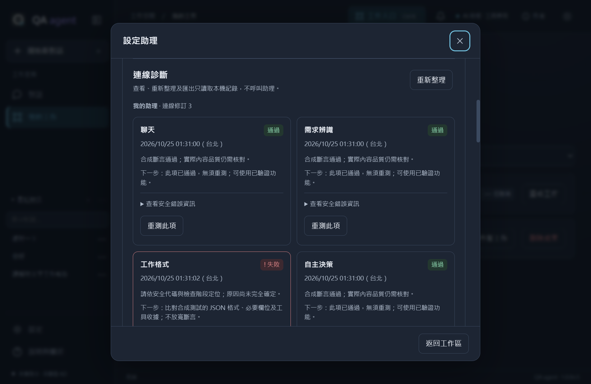

# QA agent

**0.13.0 · Windows x64 · Python 3.10.4 · Tkinter 桌面工作區**

用一個桌面入口與公司助理對話、整理文字、查詢資料及安排本機排程。UI 與本機流程已完成；預設使用明確標示的合成資料，公司 chatbot、AD 與 Oracle 接線仍需公司資訊及實測。

目前驗證：以完整離線套件包建立全新 Python 3.10.4 環境，364 項完整回歸全部通過，包含 Windows 剪貼簿讀回。詳見 [驗證紀錄](docs/VALIDATION.md)。



## 開始使用

Clone 後，在專案根目錄指定公司核准的 Python **3.10.4** 完整安裝版（含 Tcl/Tk）：

```powershell
.\scripts\setup.ps1 -PythonExe 'C:\Python3104\python.exe'
.\scripts\test.ps1
.\start-app.bat
```

已有專案 `.venv` 時，直接雙擊 **start-app.bat**。需要桌面捷徑可雙擊 **create-shortcut.bat**；環境有問題使用 **diagnose.bat**。安裝、離線套件、公司 CA 與診斷詳見 [開發指南](docs/DEVELOPMENT.md)。不隨 Git 提供 Python、虛擬環境、金鑰或使用者資料。

第一次使用：**試查一筆資料 → 送出 → 確認查詢**，在原對話看到合成表格。這個範例不用 API key；原處可複製、匯出、整理或建立自動工作。側欄主要為對話、助理團隊、我的待辦、自動工作、活動紀錄及通知；查詢工具與進階紀錄在「更多工具」。

## 用 Groq 試用真正 AI

在專案根目錄的 `.env` 填 `GROQ_API_KEY=你的金鑰`，雙擊 **[start-trial.bat](start-trial.bat)**。預設選取 Groq 試用助理，可直接聊天、整理文字及改寫；建議先按「整理一段文字」，核對虛構會議筆記再按 Enter。

試用固定連線 Groq，資料保存在獨立 `groq-trial` 子目錄，不載入公司設定或歷史。`.env` 為本機明文檔且被 Git 忽略，請勿分享；只使用個人測試資料。免費額度取決於 Groq 帳戶方案，超限會提示，不自動重試或升級。查詢仍是合成資料，公司模式繼續使用原本 start-app.bat。完整步驟見 [試用手冊](docs/USER-GUIDE.md#groq-外部-ai-試用)。

試用日報：輸入「每天早上八點查昨天 A 類數量合計，整理日報」→ 原對話補齊／核對條件 → 勾選每日範圍與資料傳送授權 → 確認啟用。接著按「現在測試一次」即可在原處看結果，不用等隔天。程式計算合計，Groq 整理文字；只用合成查詢，App 必須保持開啟。詳見 [日報操作](docs/USER-GUIDE.md#groq-日報排程)。

## Plan mode 與多助理協作

開啟 start-trial.bat，在對話上方選「規劃工作」。輸入：

> 查昨天 A 類數量合計，請分析助理整理，再交覆核助理檢查，最後產生日報。先試跑，成功後我再設每天八點。

主代理會討論需求、追問條件並提出最多六步分工。在「分工進度」核對步驟、負責助理與資料範圍，按一次「確認執行」即授權本版指定資料傳送並依序完成；不會自動批准後續修訂。成功後可按「設為自動工作」，確認持續執行授權後測試、暫停及查看成果。排程使用批准過的版本，不每次重新規劃；異常會暫停並通知。

側欄「助理團隊」可搜尋、查看用途與分工角色、新增公司助理或選擇主代理。側欄預設圖示＋文字，可收合成窄圖示列；滑鼠停留可查看名稱。公司接線者先處理 API 格式與能力驗證，一般同仁再輸入個人金鑰與 assistant ID，沿用這套工作畫面。

Groq 是同一測試模型的四個隔離角色，並非公司真實多 assistant ID。公司只需沿用流程與畫面，對照成功 API 接上 profiles 的 workflow_call，完成各助理能力與 session 隔離驗收後啟用。未驗證的助理不自動加入流程；目前支援文字、表格與唯讀 RAG，不含生圖或任意工具。

## 目前可以做什麼

- 個人待辦看板：選取對話文字加入、開始／完成、到期日及來源對話。
- 三張常用工作卡片，文字草稿自動保存並可於重開後恢復。
- 多助理對話、歷史與搜尋批次刪除；Enter 送出、Shift+Enter 換行。
- Plan 預覽、修改、批准及選項確認；未批准不執行。
- 單一 TXT／CSV 預覽、文字摘要／改寫、選定資料預覽後轉交。
- 三項合成查詢、表格分頁、CSV／Excel 複製、本機排程與通知。
- 本機問題回報、離線手冊、深淺主題與 Windows DPI 顯示處理。
- 側欄常駐通知與紅色未讀徽章；新通知在桌面右下角彈出，可直接查看結果。

開啟後看頁首提示即可體驗。示範回覆不是真正 AI 分析；排程只在程式開啟時執行；問題回報只存本機。此版沒有中央協作、遠端更新或 EXE 打包。

## 找到需要的文件

| 你要做的事 | 入口 |
|---|---|
| 使用桌面、了解資料保存及刪除 | [使用手冊](docs/USER-GUIDE.md)、[資料說明](docs/DATA-USAGE.md) |
| 帶回公司交給 GPT 6 sol／Copilot | [公司接手工作單與可貼指令](COMPANY-HANDOFF.md) |
| 修改或維護專案 | [AGENTS.md](AGENTS.md)、[開發指南](docs/DEVELOPMENT.md) |
| 看架構、功能界線與驗證狀態 | [產品與架構](docs/PROJECT.md)、[驗證紀錄](docs/VALIDATION.md) |

舊規格、候選圖示及視覺稿保存在 [清理前版本 c13e583](https://github.com/Li-Syuan/unit-helper-spec/tree/c13e583)，不再混入目前工作目錄。Git 歷史未改寫；整理減少的是目前檔案，完整 clone 仍包含歷史。
