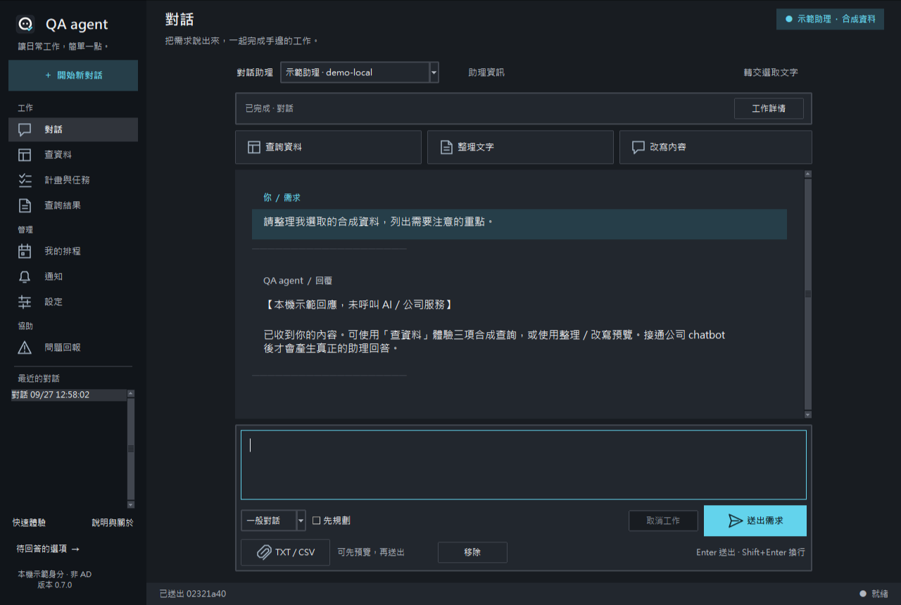

# QA agent — 本機可執行版 0.7.0

Windows x64 / **Python 3.10.4** / Tkinter / SQLite / OpenAI SDK。
這個 repo 現在包含可執行程式，不只是 spec。預設示範身分、示範助理與合成資料，**沒有連到公司服務**。

## 先體驗，不用設定

啟動後選「先體驗，不用設定」，在獨立視窗完成查詢 → Plan → 自行批准 → 選取資料 → 預覽轉交。全部是合成資料，不需要公司 API key，不會混入個人歷史。略過後仍可從側欄「快速體驗」重開。



## 日常使用

- 「設定」管理共用 endpoint、Windows keyring API key，以及多個助理名稱／assistant ID／備註。新 API 映射尚未確認時保持停用。
- 每段對話固定助理；切換開新對話。查詢結果及選取文字可明確預覽後轉交。
- Enter 送出、Shift+Enter 換行，Ctrl+Enter 保留。中文輸入法最終人工驗收仍待完成。
- 「說明與關於」提供離線手冊、資料使用限制、第三方授權及診斷。深淺主題可在設定切換。
- 正式採用 A 圖示。雙擊 create-shortcut.bat 建立／更新 QA agent 桌面捷徑；既有 start-app.bat 可繼續使用。

[使用手冊](docs/USER-GUIDE.md) · [資料使用說明](docs/DATA-USAGE.md) · [介面實際畫面](docs/UI-DESIGN.md) · [公司多助理接線](docs/ASSISTANT-INTEGRATION.md)

## Clone 後開始

公司已有 Python 3.10.4 時，指定其完整路徑建立獨立環境：

```powershell
git clone https://github.com/Li-Syuan/unit-helper-spec.git
cd unit-helper-spec
.\scripts\setup.ps1 -PythonExe 'C:\公司核准的Python310\python.exe'
.\scripts\test.ps1
.\scripts\run.ps1
```

私人 repo 須使用有權限的 GitHub 帳號。路徑是範例，請替換；不需 activate，不改系統 PATH。PowerShell 腳本若被公司政策阻擋，交由 IT 核准，不要求更改永久 ExecutionPolicy。也可依 [ENVIRONMENT.md](ENVIRONMENT.md) 直接用 Python 指令。

環境建立完成後，直接雙擊根目錄的 **`start-app.bat`** 即可開啟桌面應用，不會留下命令列視窗。啟動器固定使用旁邊的 `.venv`，啟動器使用相對位置；專案搬移後仍應重建虛擬環境。環境不存在或版本不符會顯示錯誤。

## 公司接手準備包（0.4.0）

- **動態查詢表單**：依模板定義產生欄位，Plan、結果與排程沿用相同定義；[欄位契約](docs/QUERY-CATALOG.md)。
- **串接測試工具**：共用 SDK／查詢斷言、合成樣本及公司實測骨架；[測試工具包](docs/ADAPTER-TEST-KIT.md)。
- **一鍵診斷**：雙擊 `diagnose.bat`，保存可分享的環境檢查報告，不呼叫公司服務。
- **離線安裝**：準備完整套件包並驗證完整性，再於公司建立乾淨環境；[離線操作](docs/OFFLINE-INSTALL.md)。
- **資訊工作單**：公司先提供 API、AD、三項核准查詢的必要規格；[待填清單](docs/COMPANY-INPUTS.md)。

實測狀態分開記錄：本機通過不代表公司服務已驗收。`scripts/company_check.py` 預設只列尚未測試，不會自動連線。

## 可以操作

- 對話歷史、背景請求、取消；公司模式使用 `openai` Chat Completions 相容連接器。
- 一般／先規劃、是非／單選／多選；服務層批准、修訂、防重與取消。
- 單一 TXT／CSV 預覽、文字整理／改寫候選、保留原文、複製／另存。
- 三項合成查詢、條件引導、100 列分頁、全部／當頁選取列複製、CSV 匯出。
- 從成功查詢建立每日／每週本機排程；預覽啟用、立即執行、歷史與站內通知。
- 問題草稿及本機回報編號；沒有送出至管理平台。

示範助理只產生明確標示的示範文字／計數；**接上公司 chatbot 後才有真正 AI 摘要與改寫**。查詢用固定模板與表單，任意 SQL、自然語言自由產生 SQL 均未開放。

排程只在程式開啟時運作。設定／資料預設放 `%LOCALAPPDATA%\UnitHelperLocal`，不寫入 Git checkout；可透過 `UNITHELPER_DATA_DIR` 指定獨立目錄。不同 Windows 使用者自然使用各自目錄；這不是 AD 授權或多租戶安全隔離。

## 公司接手

1. [COMPANY-HANDOFF.md](COMPANY-HANDOFF.md)：六個接線工作包，含位置、內部資訊、驗收與命令。
2. [GPT6-SOL-HANDOFF.md](GPT6-SOL-HANDOFF.md)：可直接貼給公司開發 agent。
3. [LOCAL-SPEC.md](LOCAL-SPEC.md)：**本次已核准的本機實作範圍**。
4. [VALIDATION-LOCAL.md](VALIDATION-LOCAL.md)：實際測試證據與未驗收部分。
5. [docs/USER-GUIDE.md](docs/USER-GUIDE.md)：同仁操作說明。

本次不含 AD 真實登入、Oracle 真實資料、集中管理 API、遠端更新或 EXE 打包。`CompanyIdentity`／`OracleQueries` 未接線時直接拒絕使用。

## 規格歷史

`SPEC.md`、`BACKEND.md`、`OPERATIONS.md`、`UPDATES.md`、`IMPLEMENTATION.md`、`FULL-SPEC.md` 與 `Unit-Helper-Spec-v2.2.zip` 保留原規劃。其中中央排程、管理平台及更新系統是後續階段，不是 0.3.0 已完成內容。
`MANIFEST.sha256` 對應目前 repo 的交付檔；歷史 ZIP 內的 manifest 仍對應該 ZIP 的 v2.2 內容。

## 從 0.5.0 升級

本版新增 keyring 與其依賴。維護者依新 requirements.lock 更新專案環境，或指定新的 .venv 名稱重建；setup 不覆寫既有環境。使用者資料路徑不變。SQLite 首次開啟會先保留 pre-v2 備份，再交易式升至 schema 2；舊對話因無可靠助理歸屬只讀，需要續談時選內容轉交。不要以舊版程式開啟已升級資料庫。

實測環境為 .venv、全新 .venv-verify060 及全新離線 .venv-offline060；舊驗證環境保留，不作本版基準。

## 0.7.0 新版畫面與開發方式

[離線 HTML／CSS 視覺稿](docs/design/workspace.html) 可直接用瀏覽器開啟，切换深淺主題與五種合成狀態；正式應用仍由 start-app.bat 啟動 Tkinter。視覺稿按鈕不呼叫助理。

聊天加入分層訊息、整合輸入框、真實任務狀態及工作詳情；對話與資料處理規則保持相容。寬視窗側欄與小視窗詳情會依尺寸切換。

捷徑測試與環境檢查改為固定腳本，防毒是否不再提示仍待核對，詳見 [Norton 與開發說明](docs/NORTON-DEVELOPMENT.md)。本版未新增依賴，不需重新建立離線包。三個既有 Python 3.10.4 環境各 150 tests 通過；公司驗收與 IME 人工測試仍另列。
