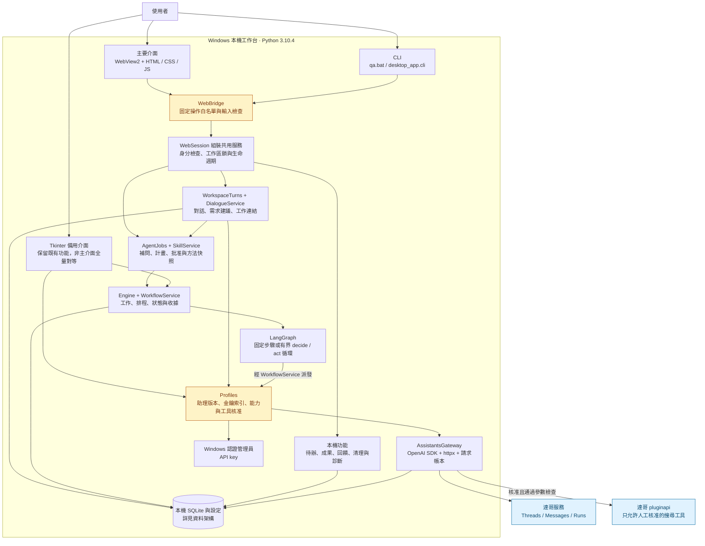
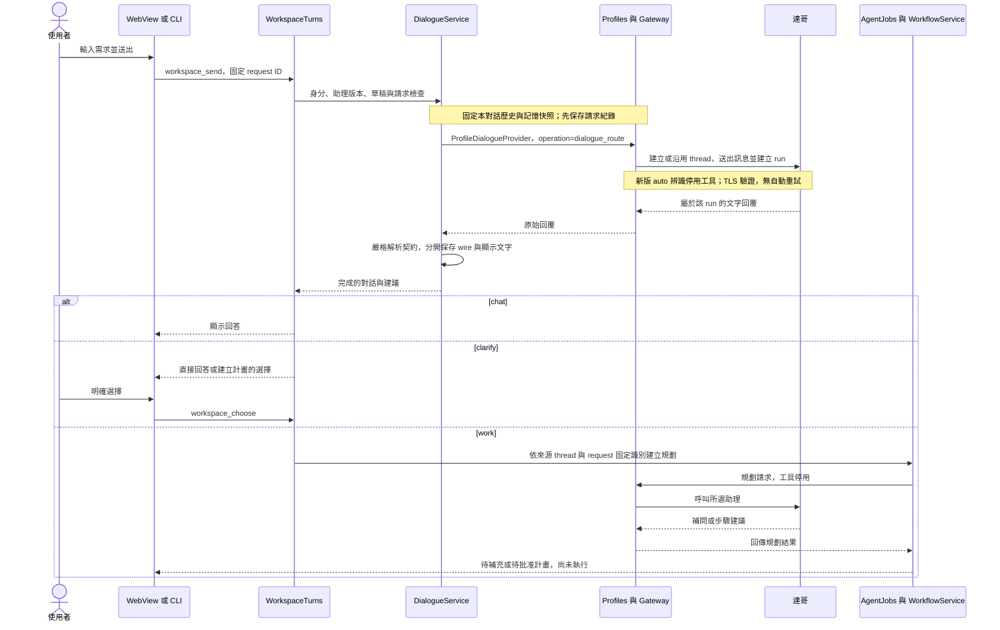
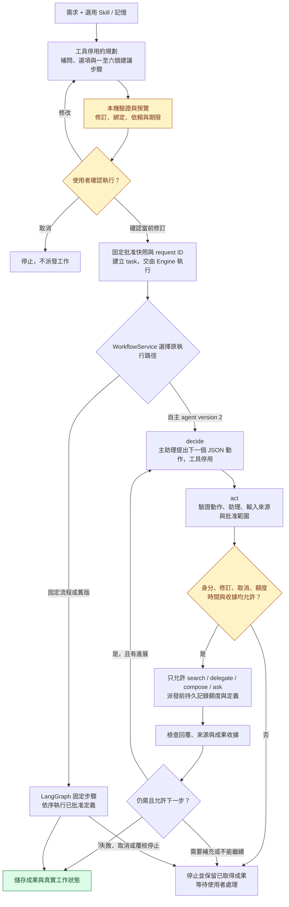
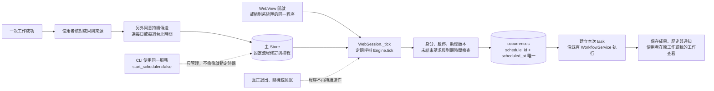
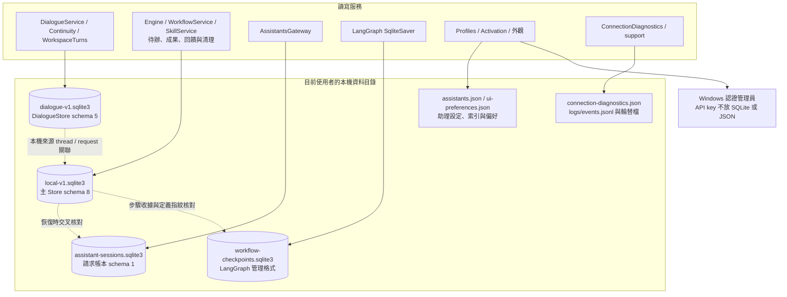
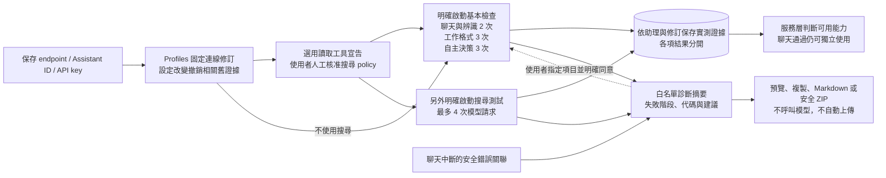

# QA agent 系統架構圖

偏好圖文閱讀可開啟 [架構說明 HTML](ARCHITECTURE.html)。下載後用瀏覽器離線閱讀，包含深淺主題、可展開的工作流程與列印；本頁保留詳細 Mermaid 圖與程式對照。

這份文件以 **1.0.0rc5** 的現有程式為準，於 2026-10-27 核對，程式基準為 `aae9836`。圖中呈現已存在的實作與接線邊界；實作存在不代表已通過現場驗收。實際測試狀態見[驗證紀錄](VALIDATION.md)。

先看總覽，再依需要閱讀對話、代理、排程、資料與診斷六張圖。GitHub 可直接顯示各圖。實線表示現有路徑；虛線表示選用、核對或待接線關係，節點文字會註明差別。

## 1. 系統總覽

QA agent 是在 Windows 本機運作的工作台。畫面負責操作，Python 服務決定是否允許執行，達哥負責模型回覆與核准的遠端搜尋。沒有另行部署的 QA agent API server，也沒有把 Hermes 核心嵌入程式。

總覽合併了相關模組，箭頭表示主要呼叫與資料使用關係。`WebSession` 負責組裝服務，並不是第二套工作引擎。Tk 自行組裝既有服務，不經 WebBridge，也不保證提供全部新版對話功能。

主要程式入口為 [web_session.py](../desktop_app/web_session.py)、[web_bridge.py](../desktop_app/web_bridge.py)、[ui.py](../desktop_app/ui.py) 與 [cli.py](../desktop_app/cli.py)。

## 2. 對話如何變成待確認工作

新版主對話 `mode=auto` 的同一次模型回覆包含顯示文字與 `chat / clarify / work` 建議。普通問答沒有額外的背景分類請求；真正需要工作計畫時，才進入規劃服務。

`clarify` 選工作時也沿同一個規劃入口。模型建議不能批准自己，使用者仍須核對計畫並確認執行。工作卡、查詢表格與工具成果不因顯示在對話內，就自動加入聊天歷史。

原對話在助理及連線版本有效時沿用遠端 thread。切換對話只切換讀取與輸入目標；關閉 App 不主動刪遠端 thread。原始 wire 與 UI 文字分開，不能把解析後文字拿去改寫遠端歷史。

舊 `mode=chat` 保留原契約；只有明確啟用聊天搜尋且已有核准 policy 時，才可能用搜尋工具。舊 `mode=task` 只保存未啟用草稿，`task_drafts.enabled` 固定為 0，不能當成排程入口。新版 auto 辨識與工作規劃仍停用工具。

對照 [workspace_turns.py](../desktop_app/workspace_turns.py)、[dialogue_service.py](../desktop_app/dialogue_service.py)、[dialogue_provider.py](../desktop_app/dialogue_provider.py) 與 [dialogue_routing.py](../desktop_app/dialogue_routing.py)。

## 3. Plan、自主決策與多助理的關係

使用者可以不選 Skill，直接交辦給一位助理。Skill 是可版本化的工作方法資料，不是 Python 外掛或任意命令。規劃完成後，批准快照固定需求、選入資料、Skill、記憶、助理版本、搜尋工具與限額。

這張圖描述業務流程。實際自主 LangGraph 的節點只有 `decide` 與 `act`，核對和派發由 `AutonomousRun` 與 `WorkflowService` 完成，不是另外建一套圖中每格一個節點的引擎。

| 動作 | 真正做的事 | 限制 |
|---|---|---|
| `search` | 呼叫選定達哥助理，允許既有核准搜尋工具。 | 工具名稱、參數與來源範圍受批准快照及 policy 限制。 |
| `delegate` | 把指定輸入交給本次選入且已驗證的文字角色。 | 目前依序執行，不是同時啟動多個子代理。 |
| `compose` | 將指定前置成果整理成最終文字。 | 不能補造來源；資料與格式檢查不等於證明所有敘述正確。 |
| `ask` | 回報仍缺哪些資訊，交回使用者處理。 | 不能自行擴大目標或批准範圍。 |

主助理負責提案與決策，本機服務負責授權和執行。單一 Assistant ID 可以分階段工作，但這不是獨立多模型覆核。不同階段的遠端上下文依既有 session 規則隔離，只傳指定輸入。

預設上限為 6 個動作、12 次模型請求、600 秒。決策及工具結果續答均計入請求額度，恢復不重置。`requires_action` 只允許核准搜尋，經同源 `/pluginapi` 執行後提交 tool outputs；模型提供的 URL 或命令不會變成新的工具。

執行核對主 task、步驟收據、遠端請求帳本及 checkpoint。checkpoint 不是成功證明，也不是 exactly-once 保證。已知 run 或快取可沿原識別檢查與恢復，未知 POST 不換 ID 重送，取消後的晚到回覆不變成功。

對照 [agent_jobs.py](../desktop_app/agent_jobs.py)、[skills.py](../desktop_app/skills.py)、[workflows.py](../desktop_app/workflows.py)、[autonomous.py](../desktop_app/autonomous.py)、[graph_runner.py](../desktop_app/graph_runner.py)、[assistants_gateway.py](../desktop_app/assistants_gateway.py) 及 [search_tools.py](../desktop_app/search_tools.py)。

## 4. 排程與系統匣如何運作

WebSession 的排程迴圈約每三秒檢查一次，資料庫保存 UTC，使用者看台北時間。每次排程注入當次日期，不沿用首次試跑的相對日期。漏跑沿現有類型規則處理，不保證準點，也不大量補跑；工作流程中斷、未知結果或待人工恢復不能以重新排程繞過。

系統匣只保留原程序，不是 Windows service。真正退出會停止新派發、保存草稿、取消並等待真實請求收尾，最後釋放工作區鎖。Tk 備用也沿用 `Engine.tick`，但沒有新增 WebView 的系統匣流程。

WebView、Tk 與 CLI 不能同時開啟相同工作區。CLI 可操作共用服務，但預設不啟動排程器。舊單助理日報走 `AssistantBriefings`，舊查詢與 Groq 報告沿原處理器；它們共用 Engine 的工作及排程基礎，不另開背景排程服務。

對照 [web_session.py](../desktop_app/web_session.py)、[web_app.py](../desktop_app/web_app.py)、[tray.py](../desktop_app/tray.py)、[core.py](../desktop_app/core.py)、[assistant_briefings.py](../desktop_app/assistant_briefings.py) 與 [work_orders.py](../desktop_app/work_orders.py)。

## 5. 資料保存、記憶與登入邊界

| 保存位置 | 內容及責任 |
|---|---|
| `dialogue-v1.sqlite3` | 主對話與訊息、送出請求、raw wire、工作建議、草稿與閱讀位置、標題及資料夾、記憶與對話固定快照、聊天及辨識證據。舊任務草稿仍未啟用。 |
| `local-v1.sqlite3` | 進階對話、Plan、task、流程版本及步驟、Skill 修訂與能力證據、交辦連結、排程及 occurrences、通知、待辦、回報、品質回饋和本機表單。 |
| `assistant-sessions.sqlite3` | 助理 session 對應、遠端 thread 和 run 識別、歷史與請求內容、寫入狀態、回覆及工具收據。這是私人帳本，不是可直接分享的安全日誌。 |
| `workflow-checkpoints.sqlite3` | LangGraph 的控制位置、識別與指紋。業務完成狀態仍以主 Store 和成果收據為準。 |
| `assistants.json` | endpoint、助理 ID 與版本、金鑰索引、工具 policy 及相關能力設定。沒有明文 API key，但檔案仍含私人連線資訊。 |
| `config.json`、選用 `deployment.json` | 部署與啟動設定。啟動設定可位於資料根目錄或明確指定位置，不保證與登入後的使用者子目錄相同。 |
| `ui-preferences.json` | 深淺主題、配色、側欄等個人偏好。 |
| 診斷摘要與 `logs/events.jsonl` | 白名單錯誤代碼、階段、時間及安全編號；不保存原始 HTTP body、對話或憑證。 |

預設資料根目錄是 `%LOCALAPPDATA%\UnitHelperLocal`，可由 `UNITHELPER_DATA_DIR` 指定。選用組織登入時，`LoginSession.directory` 依穩定 subject 雜湊建立 `users/<SHA256>` 工作區。這是應用資料隔離，不宣稱等同 Windows ACL 或遠端多租戶授權。

`identity_mode=company` 先經原生登入視窗與 `company_auth.authenticate`，成功後才建立 Store 與排程器。AD hook 目前是待接線介面，未配置即拒絕登入；不能用示範身分冒充 AD。一般本機模式不要求部署 AD。對照 [authentication.py](../desktop_app/authentication.py)、[company_auth.py](../desktop_app/company_auth.py)、[login_view.py](../desktop_app/login_view.py) 與 [config.py](../desktop_app/config.py)。

長期記憶是使用者明確保存的筆記，預設同助理隔離。新對話採固定記憶快照；Skill 只使用明確選入並納入預覽的內容。它不是向量資料庫，也不是自動學習所有對話。原文接續、摘要及匯出都有明確操作邊界，見 [continuity.py](../desktop_app/continuity.py)。

主 Store 與 DialogueStore 升級前使用 SQLite backup，再交易遷移。多個資料庫檔案之間不保證斷電原子性，還原須在 App 關閉後使用一致備份。刪除也不宣稱撤回遠端歷史、其他獨立副本或既有備份，見 [資料使用說明](DATA-USAGE.md) 及 [data_cleanup.py](../desktop_app/data_cleanup.py)。

## 6. 啟用檢查與診斷不等於授權

圖中的搜尋設定必須先固定，避免測完才修改 policy 使能力證據過期。核准工具不是實測成功，metadata 成功也不是聊天成功。能力仍讀取原本的 activation、routing、Skill 與助理驗證紀錄，`connection-diagnostics.json` 不能解鎖功能。

每位助理只保留最近兩個修訂的各項最後診斷，最多 128 位助理與 128 筆匿名對話錯誤關聯。重開後未結束的檢查顯示未完成，不補造成功。重測受到未知送出、真正仍執行的 future、目前修訂及登入狀態限制。

對照 [activation.py](../desktop_app/activation.py)、[company_readiness.py](../desktop_app/company_readiness.py)、[connection_diagnostics.py](../desktop_app/connection_diagnostics.py)、[assistant_errors.py](../desktop_app/assistant_errors.py) 與 [support.py](../desktop_app/support.py)。

## 7. 其他功能放在哪裡

| 功能 | 現有責任與程式入口 | 目前界線 |
|---|---|---|
| 自建 Skill 與分享 | [skills.py](../desktop_app/skills.py)、[格式說明](SKILLS.md) | Markdown 作為資料，匯入先預覽；沒有程式碼載入。 |
| 成果、數值比較與品質回饋 | [outcomes.py](../desktop_app/outcomes.py) | 讀取已保存快照與本機評價，不背景呼叫模型；比較受來源及條件資格限制。 |
| 個人待辦與舊對話草稿 | [local_work.py](../desktop_app/local_work.py) | 使用者控制狀態；待辦不是 AI 執行 task。主對話草稿另由 DialogueStore 管。 |
| 本機查詢、表格與 CSV | [gateways.py](../desktop_app/gateways.py)、[query_schema.py](../desktop_app/query_schema.py)、[files.py](../desktop_app/files.py) | 合成查詢可用，正式 Oracle adapter 仍停用待接線。主對話無夾檔，既有文字與檔案工具留在進階入口。 |
| 舊同頁操作及選項表單 | [conversation_actions.py](../desktop_app/conversation_actions.py)、[choices.py](../desktop_app/choices.py) | 沿舊資料與批准契約保存；不取代新版 WorkspaceTurns。 |
| 舊每日搜尋交辦 | [work_orders.py](../desktop_app/work_orders.py)、[assistant_briefings.py](../desktop_app/assistant_briefings.py) | 相容入口，共用原 Engine，未啟用草稿不自動變排程。 |
| 個人 Groq 試用 | [trial.py](../desktop_app/trial.py)、[report_engine.py](../desktop_app/report_engine.py) | 明確選用、獨立資料區；只此試用入口讀專案 `.env` 的 Groq key。真實服務失敗不切換到它。 |
| 作者、手冊與回報 | [about.py](../desktop_app/about.py)、[experience.py](../desktop_app/experience.py)、[support.py](../desktop_app/support.py) | 作者三欄白名單、離線手冊、本機回報與安全匯出；沒有中央 issue 後台。 |
| 顯示與外觀 | [WebView 入口](../desktop_app/web_assets/index.html)、[theme.py](../desktop_app/theme.py)、[display.py](../desktop_app/display.py) | WebView 主介面，Tk 保留品牌、主題及 DPI 處理；不是網頁遠端下載 UI。 |

資料輸出與畫面 HTML 由 [web_render.py](../desktop_app/web_render.py) 處理 Markdown 和清理。模型回覆、Skill 與匯入內容都視為資料，不能呼叫任意 bridge 方法、shell 或本機路徑。

## 8. 部署與尚未完成的部分

GitHub 提供原始碼、設定範例及 `offline-app/packages` 中的 69 個鎖定 wheels。離線安裝器先核對 manifest、lock 與檔案雜湊，再用核准的 Python 3.10.4 建立 `.venv`，不連外補件或覆寫既有環境。Python、WebView2 與 .NET 仍由部署者準備，不能把 wheelhouse 當成完整作業系統安裝包。

日常入口是 `start-app.bat`，備用入口為 `start-tk.bat`，開發與整合入口是 `qa.bat`。程式碼可從 GitHub 下載，私人設定、憑證、使用者資料及 `.venv` 不隨 Git 交付。[離線說明](../offline-app/README.md) 與 [開發指南](DEVELOPMENT.md) 包含實際操作。

`.github` 的開發角色、prompt 及 `qa-map / qa-fix / qa-review` 是給 Copilot 的接手流程，不是 App 裡的助理，也不在執行時載入 pstack。App Skill 與開發 Skill 必須分開理解。

| 邊界 | 現況 |
|---|---|
| 達哥 API adapter | 已有 Threads、Messages、Runs、核准 pluginapi、帳本及恢復實作；現場多 ID、格式與搜尋來源品質仍須驗收。 |
| AD 與 Oracle | 有介面及保護，實際內部驗證函數與核准 SQL 待部署者接線。 |
| Hermes | 採用受限代理工作方式，仍用現有 QA agent 與 LangGraph 核心；不是完整 Hermes。 |
| SMTP、任意 shell、任意檔案工具、MCP、並行子代理 | 尚未實作，不因出現在指令或文件裡就開放。 |
| 中央協作平台、遠端更新、常駐服務 | 不屬於目前本機部署。App 退出後沒有另一個 QA agent 程序替它執行排程。 |
| 操作流程精簡改版 | [SOL 6.1 工作單](UX-SIMPLIFICATION.md) 已提供，尚未因文件交付而改動 UI。 |

功能缺口見 [Hermes 相容性清單](HERMES-COMPATIBILITY.md)。接手修改從 [TO-AGENT](../TO-AGENT.md) 開始，現場資料與完成條件見 [組織接手工作單](../COMPANY-HANDOFF.md)。本架構圖不改變候選版及未測事項。
