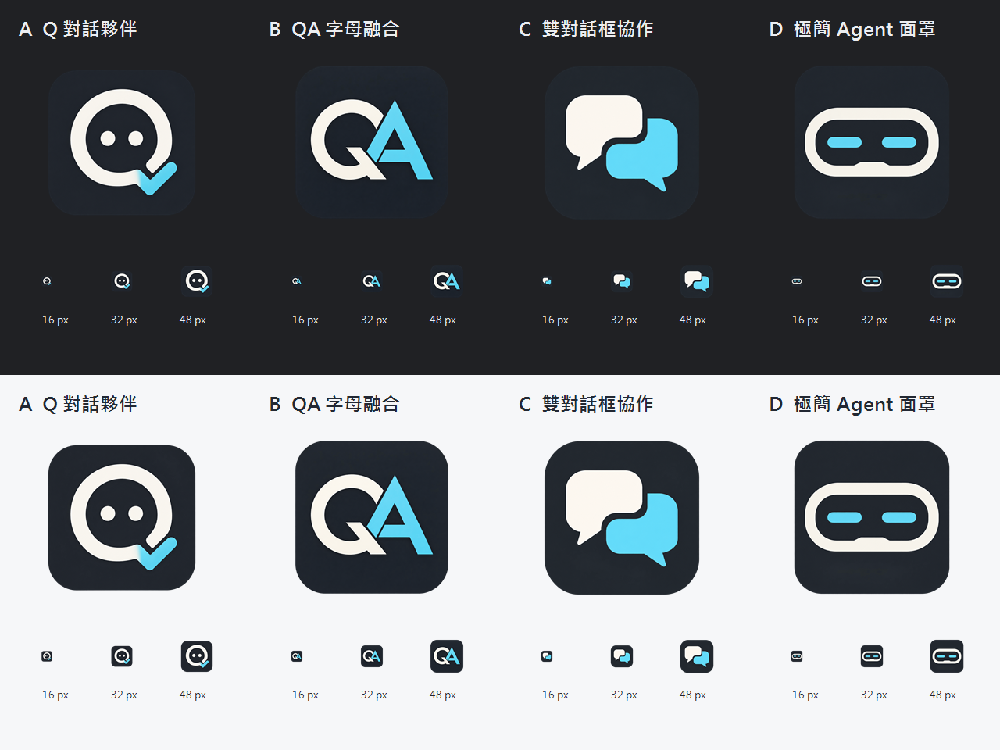

# QA agent 候選圖示 — 0.5.0

正式圖示目前仍為既有綠色 Q 夥伴。以下四款供使用者選擇，沒有更換視窗或桌面捷徑，沒有提前匯出候選 ICO。

| 編號 | 方向 | 原圖 |
|---|---|---|
| A | Q 對話夥伴：眼點與確認勾 | [PNG](../desktop_app/assets/candidates/A.png) |
| B | QA 字母融合：企業工具字標 | [PNG](../desktop_app/assets/candidates/B.png) |
| C | 雙對話框：協作與交接 | [PNG](../desktop_app/assets/candidates/C.png) |
| D | 極簡面罩：專注的 AI Agent | [PNG](../desktop_app/assets/candidates/D.png) |

2026-09-27 使用 Codex 內建 imagegen 分別生成四款；皆為 1254×1254 RGBA PNG，四角透明。完整生成提示詞與 C 的背景修整提示詞保存在 [prompts.json](../desktop_app/assets/candidates/prompts.json)。C 初稿有背景斑點，經同一 imagegen 編輯移除；其餘保留生成原圖。未使用公司金鑰、未採用外部品牌圖示。

scripts/export-icon-candidates.ps1 只用 Windows System.Drawing 縮放及編排比較，不創作／改畫符號，也不增加 runtime 套件。輸出各款 16／32／48／224 px PNG；比較圖上下分別為深／淺背景，小圖按照原像素尺寸顯示。檢視後四款輪廓可辨；16px 的眼點／確認勾細節自然較小，32／48px 更清楚。

選定 A／B／C／D 後，才將候選變成正式品牌、建立 16／24／32／48／64／128／256 ICO 並更新捷徑。本轮不影響資料、偏好與正式資源。
