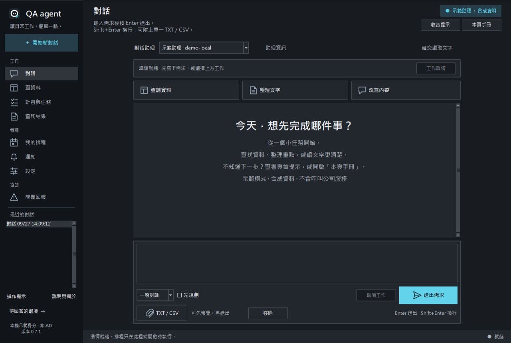
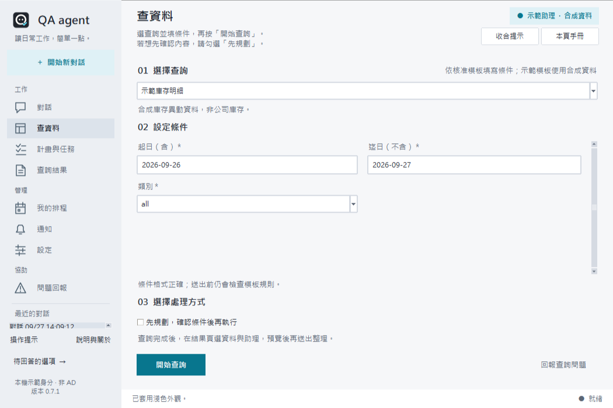
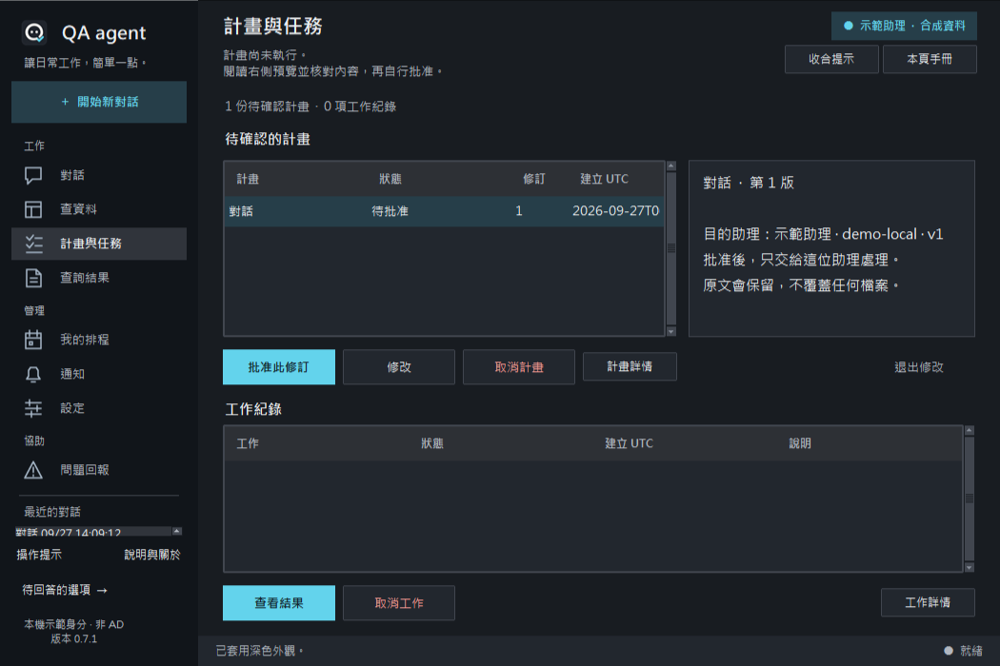
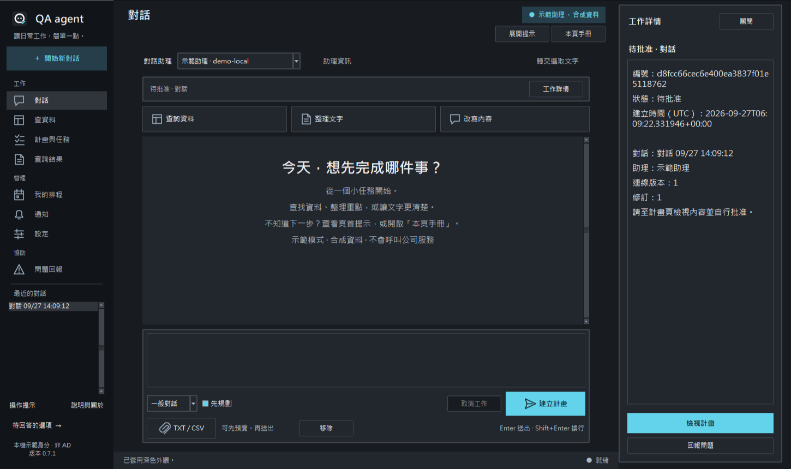
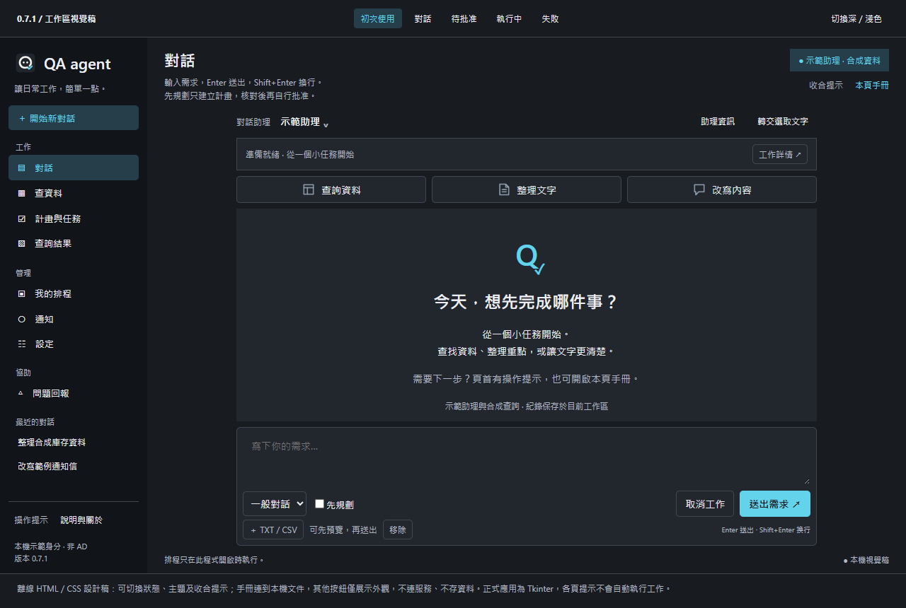

# QA agent 0.7.1 工作區

正式桌面保留 Tkinter／ttk。新版採原創線條 PNG、分組側欄、訊息層次、統一閱讀寬度、整合輸入框及真實工作狀態。A 正式圖示與深淺主題沿用。

## 0.7.1 原地操作提示

開啟即進入正常工作區，不再出現歡迎彈窗，也不另外開啟五步體驗。八頁沿用現有頁首說明區，加入目前狀態與下一步的簡短提示；右側可收合及開啟對應手冊。側欄「操作提示」切換當頁顯示，各頁選擇分別記住。

提示切換只更新說明，不重建頁面；草稿、附件、選取、捲動、Plan 修訂與工作狀態應保持不變。示範／身分標示、錯誤與確認操作一直可見。示範助理及合成查詢依然可用，直接在正常個人歷史保存。

本輪以真 Tk 控制項操作並擷取自身合成視窗，涵蓋深淺八頁 1050×700、1280×860 聊天及 1450×860 詳情。檢視聊天、查詢、Plan、設定、回報與收合畫面，主要按鈕保持可見。原始 20 張 Tk 截圖保存在忽略目錄 artifacts/v071-preview。以下為本次實際畫面；舊圖保留歷史。

更新後 HTML／CSS 已用本機 Chrome headless 渲染並檢視深色 1280×860 画面；不等於正式 Tk 或瀏覽器人工驗收。

## 0.7.0 工作區截圖（歷史）

以上為本應用真 Tk 視窗，資料與助理回覆均為合成。本機完整截圖放在忽略目錄 artifacts/v070-preview，選取代表畫面隨 repo 交付。未以修改圖片的方式製造介面結果。

## HTML／CSS 視覺稿

[開啟離線視覺稿](design/workspace.html)。已加入頁首操作提示，可切換深淺、五種狀態及收合提示，不連網、不存資料、不呼叫公司服務，亦不嵌入正式應用。以下圖片為 0.7.0 Chrome headless 的歷史渲染。

文字樣式、圓角及原生控制項略有差異；以桌面操作及驗證為正式交付。UI 不宣稱增加 API 能力、持續 Goal 或自動多助理分工。

## 核對界線

0.7.0 的三環境完整回歸、程式操作真 Tk 與自身截圖有歷史紀錄；0.7.1 的實際結果以 VALIDATION-LOCAL.md 為準。原生中文輸入法、公司 API／AD／Oracle／Excel 仍待現場驗收。防毒成效獨立記錄於 NORTON-DEVELOPMENT.md，沒有因測試通過便宣稱 Norton 不再警告。
