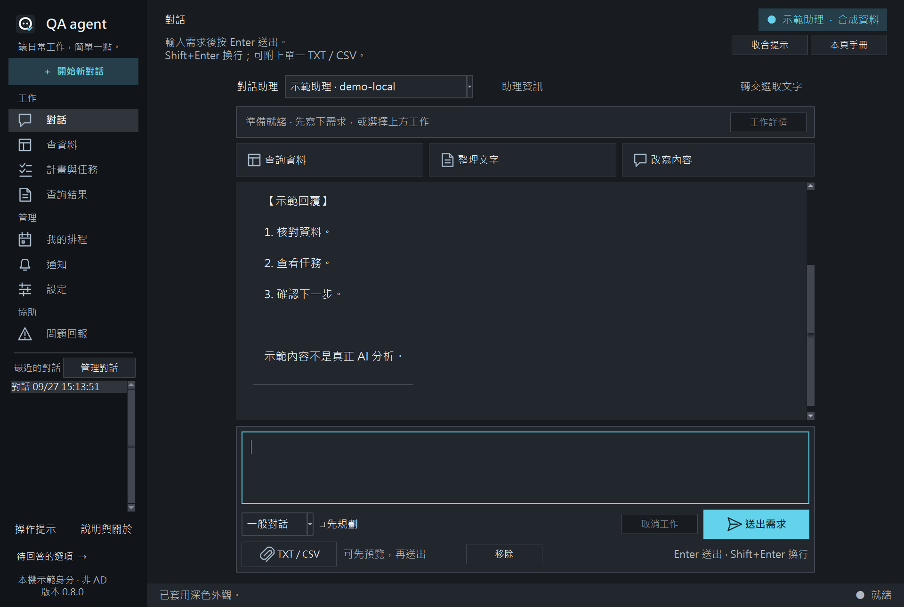
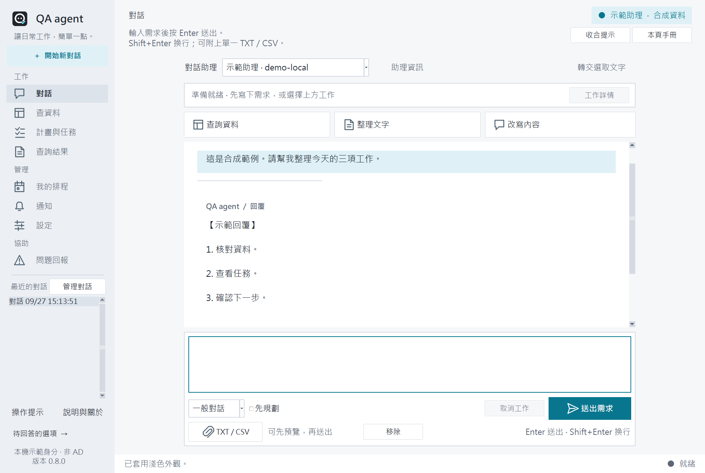
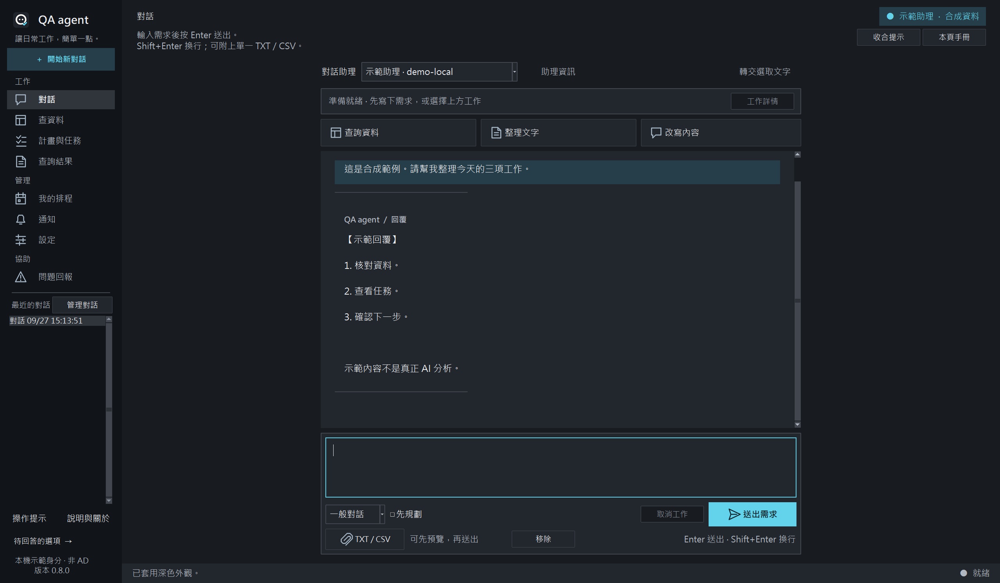
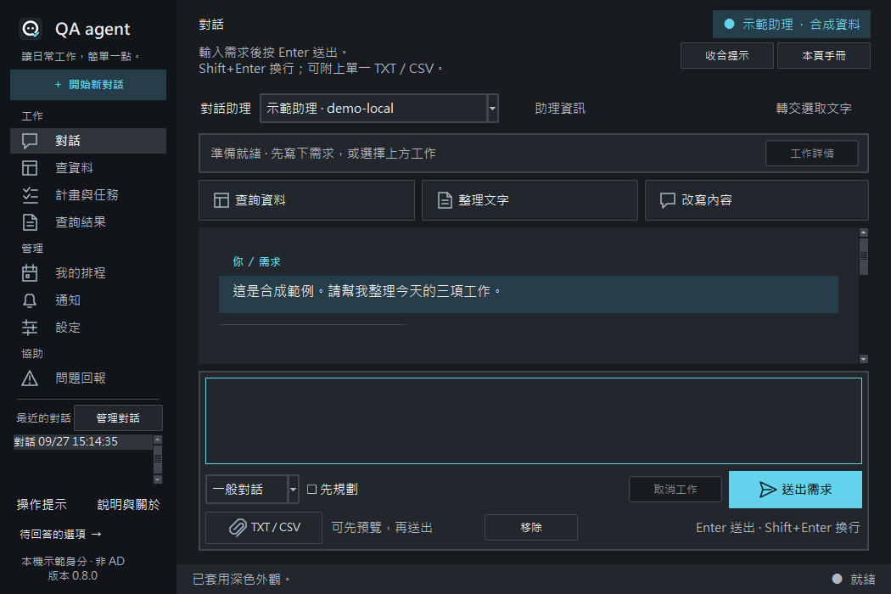
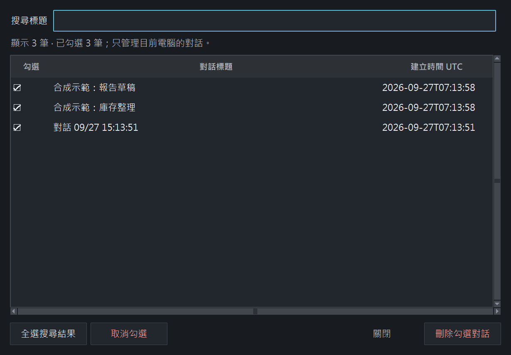
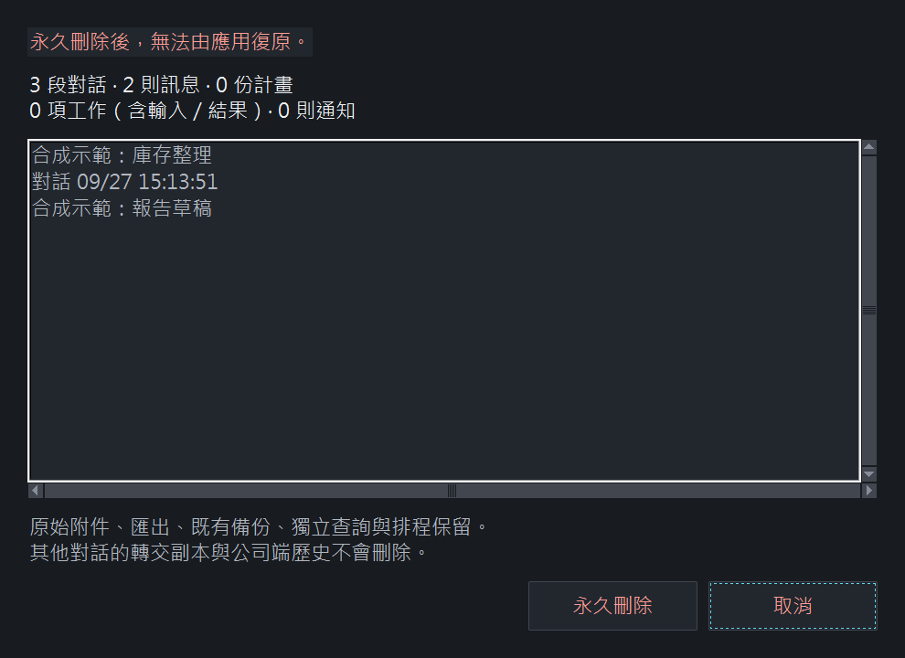
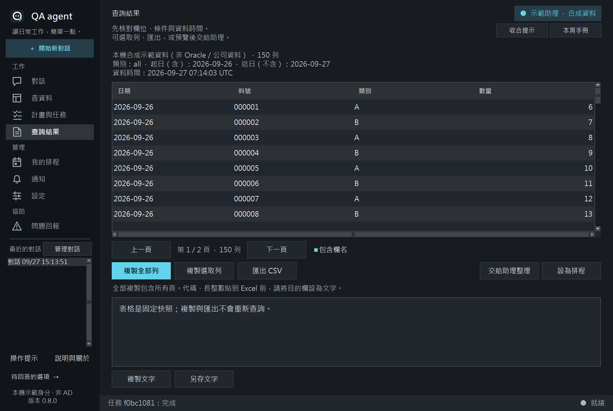
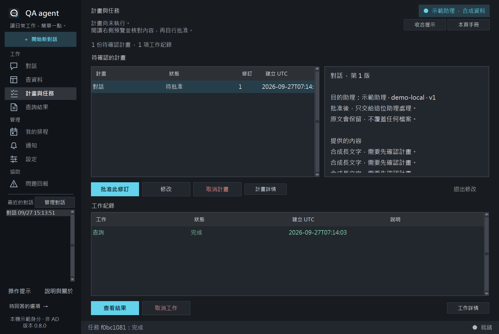
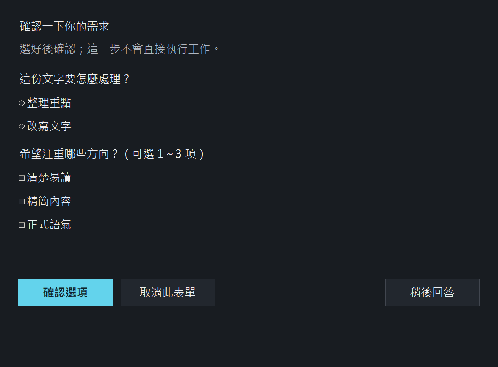

# QA agent 0.8.0 工作區

正式桌面保留 Tkinter／ttk。新版採原創線條 PNG、分組側欄、訊息層次、統一閱讀寬度、整合輸入框及真實工作狀態。A 正式圖示與深淺主題沿用。

## 0.8.0 對話清理與畫面清晰度

最近對話右鍵可刪除單筆；管理對話使用標題搜尋與勾選清單，多筆刪除前列出名稱及訊息、Plan、工作與通知數量，取消預設取得焦點。全選只選目前結果，變更搜尋清除隱藏選取；刪除完成後保持保留對話的草稿與附件，清除所選對話的過期畫面引用。

正式啟動在建立 Tk 前設定 Windows System DPI awareness，若已有更高感知模式則保留。本機舊啟動路徑為 unaware；一般與最大化的字型點數不因最大化而改變，因此 DPI 調整有明確依據，但不能保證是所有模糊現象的唯一原因。

固定尺寸以 100% 邏輯像素為基準集中換算，主要操作 11 點、聊天本文 12 點、次要提示至少 10 點；常用 24 邏輯像素圖示使用 24／30／36／48 等本機素材配合倍率，品牌圖示沿用多尺寸資源。小工作區限制視窗大小並提供必要的內容捲動，原生文字由 Tk 渲染，不將整個介面放大成圖片。

0.8.0 實際視窗、DPI 與驗證結果以 VALIDATION-LOCAL.md 為準；以下截圖均保留其原版本標示。一般、最小與最大化畫面，以及深淺主題需分別核對。100%、125%、150%、200% 尺寸計算測試不能代替真實 Windows 倍率驗收；跨螢幕即時 DPI 重排不列為本版承諾。

## 0.8.0 實際畫面

以下均為自己的 Tk 應用視窗與合成內容，未修改圖片。前三張為本機 150% 的原始像素；小視窗另列合成 100%（沒有改 Windows 設定）。完整六種深淺／大小資訊見 docs/validation/display-v080.json。文字以原尺寸檢視較準確，頁面縮圖會縮小原圖。

線條圖示由 scripts/build-ui-icons.py 的原始座標重新取樣，新增 24／30／36／48／60／72／96 像素、深淺各 10 款，共 140 張多尺寸素材；未放大小 PNG 冒充高解析。

## 0.7.1 原地操作提示（歷史截圖；功能沿用）

開啟即進入正常工作區，不再出現歡迎彈窗，也不另外開啟五步體驗。八頁沿用現有頁首說明區，加入目前狀態與下一步的簡短提示；右側可收合及開啟對應手冊。側欄「操作提示」切換當頁顯示，各頁選擇分別記住。

提示切換只更新說明，不重建頁面；草稿、附件、選取、捲動、Plan 修訂與工作狀態應保持不變。示範／身分標示、錯誤與確認操作一直可見。示範助理及合成查詢依然可用，直接在正常個人歷史保存。

本輪以真 Tk 控制項操作並擷取自身合成視窗，涵蓋深淺八頁 1050×700、1280×860 聊天及 1450×860 詳情。檢視聊天、查詢、Plan、設定、回報與收合畫面，主要按鈕保持可見。原始 20 張 Tk 截圖保存在忽略目錄 artifacts/v071-preview。以下為本次實際畫面；舊圖保留歷史。

更新後 HTML／CSS 已用本機 Chrome headless 渲染並檢視深色 1280×860 画面；不等於正式 Tk 或瀏覽器人工驗收。

## 0.7.0 工作區截圖（歷史）

以上為本應用真 Tk 視窗，資料與助理回覆均為合成。本機完整截圖放在忽略目錄 artifacts/v070-preview，選取代表畫面隨 repo 交付。未以修改圖片的方式製造介面結果。

## HTML／CSS 視覺稿

[開啟離線視覺稿](design/workspace.html)。已加入頁首操作提示，可切換深淺、五種狀態及收合提示，不連網、不存資料、不呼叫公司服務，亦不嵌入正式應用。以下圖片為 0.7.0 Chrome headless 的歷史渲染。

文字樣式、圓角及原生控制項略有差異；以桌面操作及驗證為正式交付。UI 不宣稱增加 API 能力、持續 Goal 或自動多助理分工。

## 核對界線

0.7.0 與 0.7.1 的三環境完整回歸、程式操作真 Tk 與自身截圖有歷史紀錄；0.8.0 的實際結果以 VALIDATION-LOCAL.md 為準。原生中文輸入法、公司 API／AD／Oracle／Excel 及公司螢幕倍率仍待現場驗收。防毒成效獨立記錄於 NORTON-DEVELOPMENT.md，沒有因測試通過便宣稱 Norton 不再警告。
