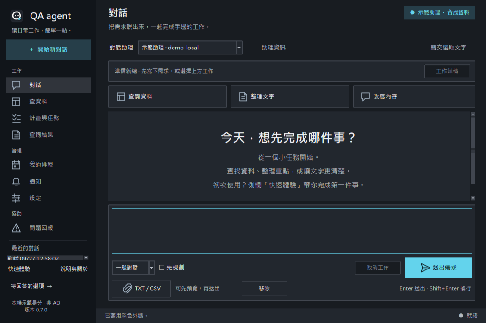
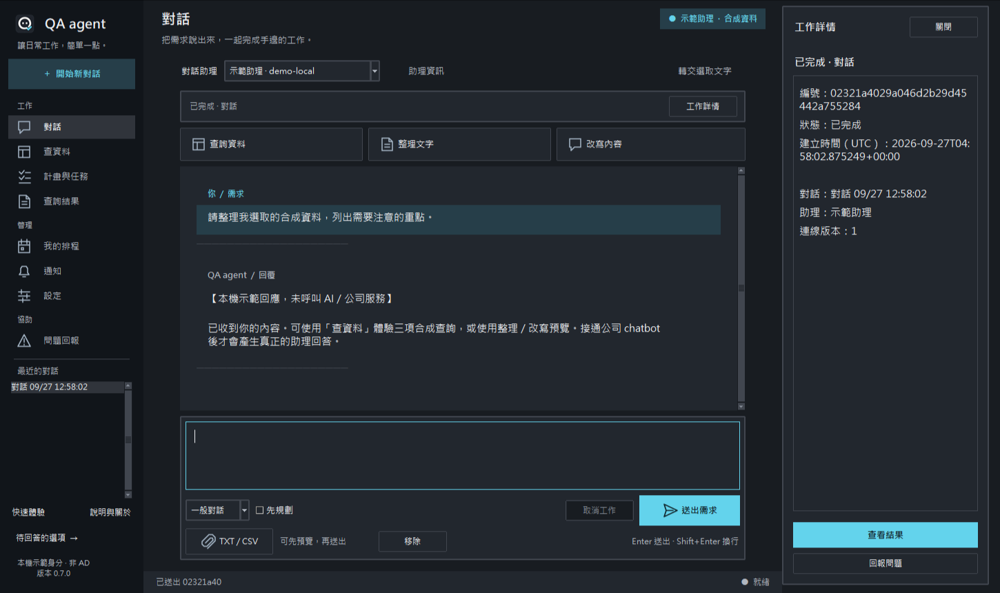
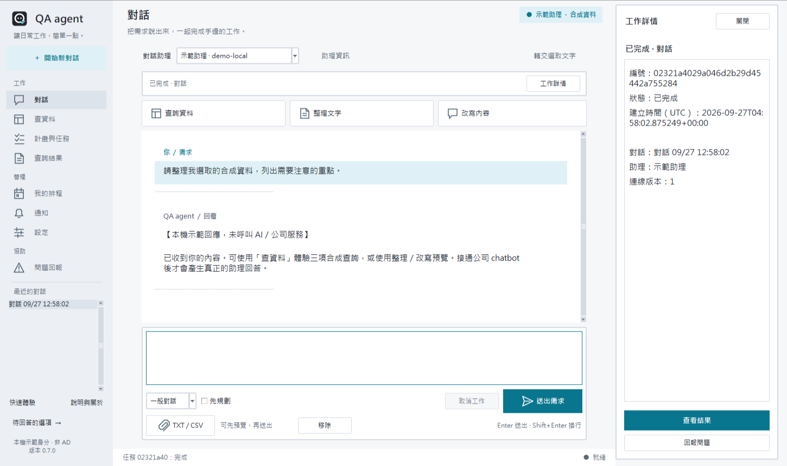
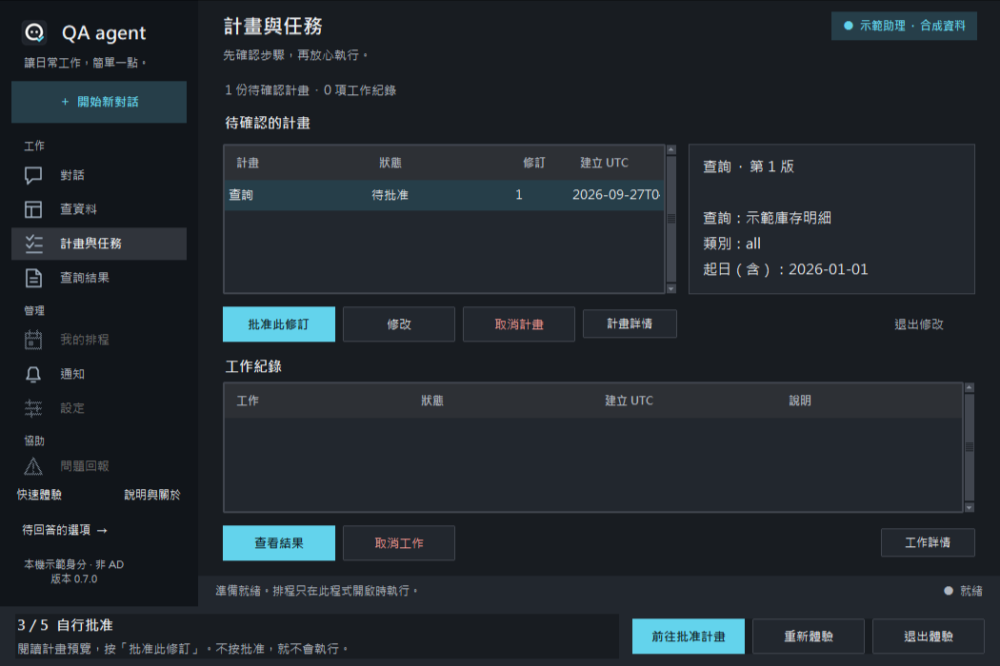
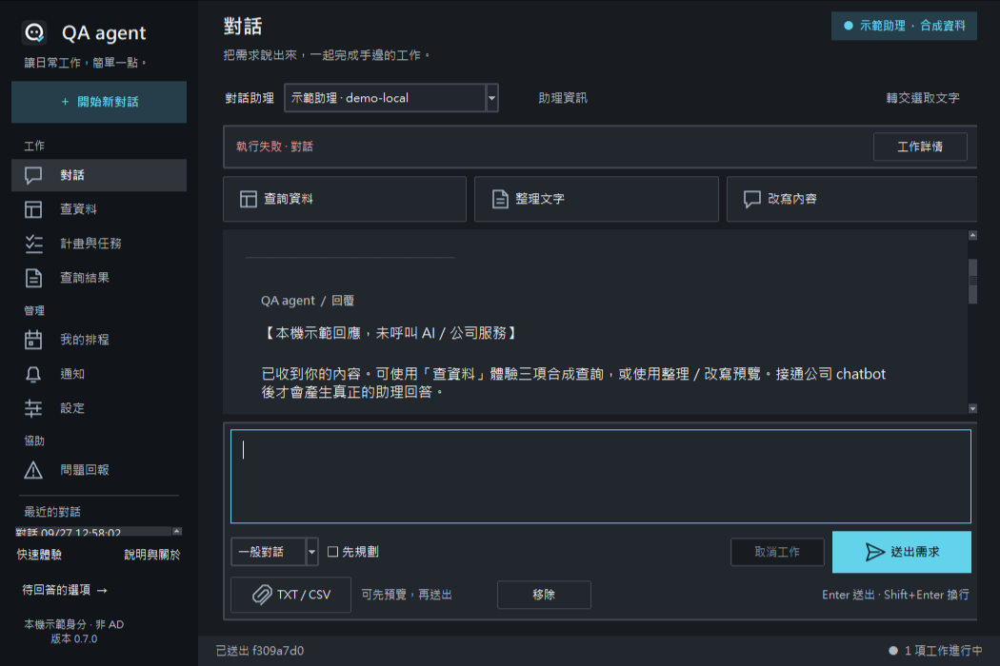
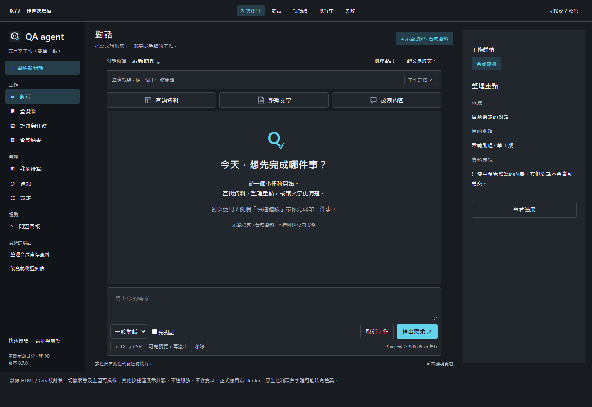
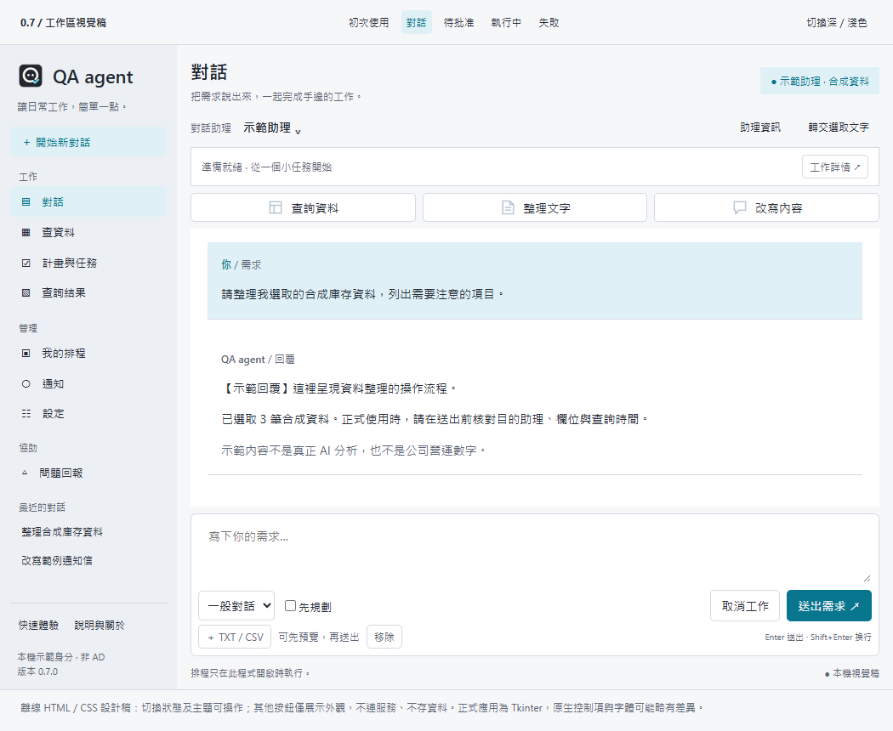

# QA agent 0.7.0 工作區

正式桌面保留 Tkinter／ttk。新版採原創線條 PNG、分組側欄、訊息層次、統一閱讀寬度、整合輸入框及真實工作狀態。A 正式圖示與深淺主題沿用。

以上為本應用真 Tk 視窗，資料與助理回覆均為合成。本機完整截圖放在忽略目錄 artifacts/v070-preview，選取代表畫面隨 repo 交付。未以修改圖片的方式製造介面結果。

## HTML／CSS 視覺稿

[開啟離線視覺稿](design/workspace.html)。可切換深淺與五種狀態，不連網、不存資料、不呼叫公司服務，亦不嵌入正式應用。以下為 Chrome headless 的實際渲染。

文字樣式、圓角及原生控制項略有差異；以桌面操作及驗證為正式交付。UI 不宣稱增加 API 能力、持續 Goal 或自動多助理分工。

## 核對界線

三環境完整回歸、程式操作真 Tk 與自身截圖已完成；原生中文輸入法、公司 API／AD／Oracle／Excel 仍待現場驗收。防毒成效獨立記錄於 NORTON-DEVELOPMENT.md，沒有因測試通過便宣稱 Norton 不再警告。
