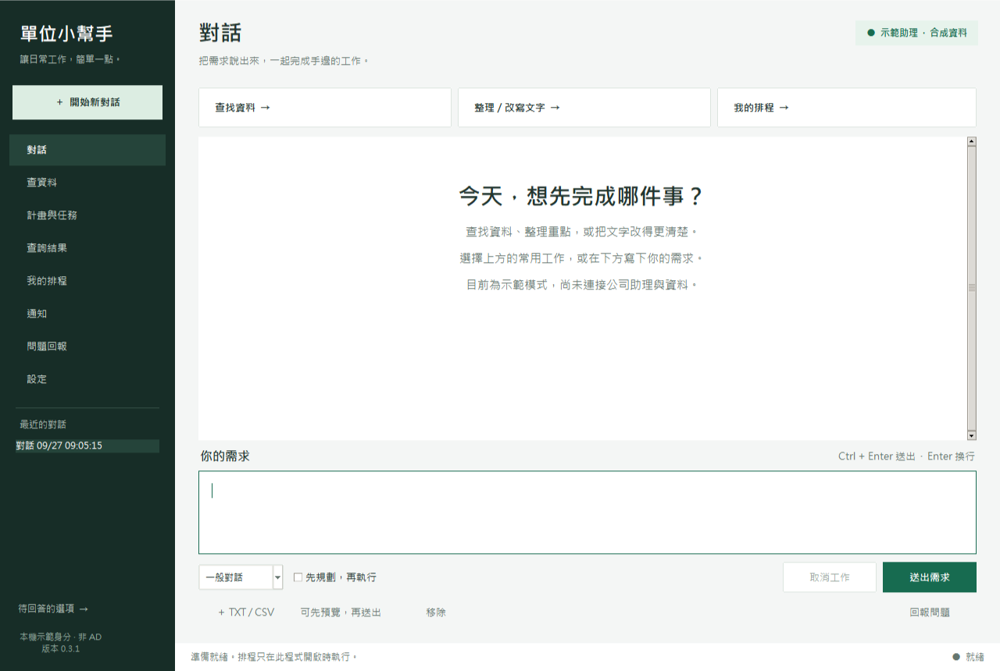
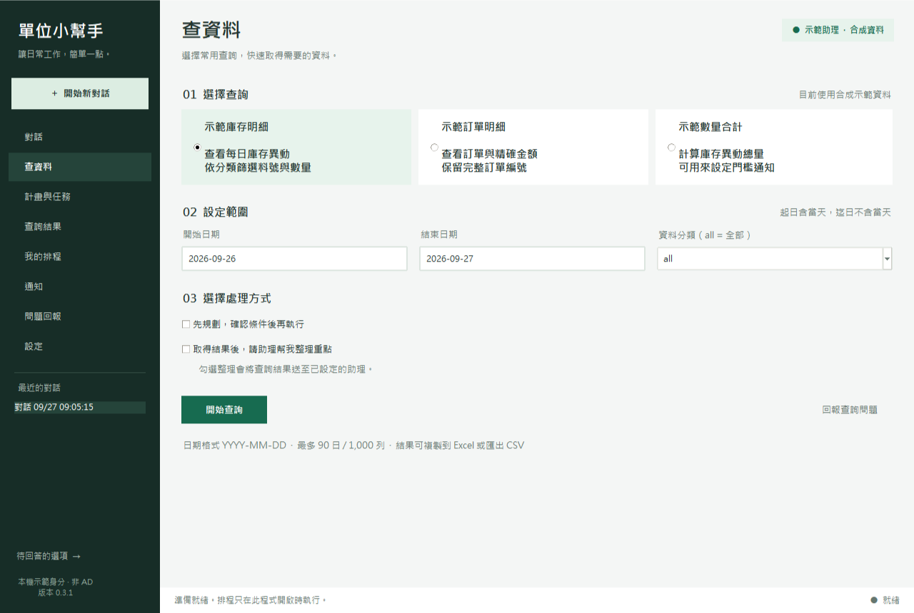
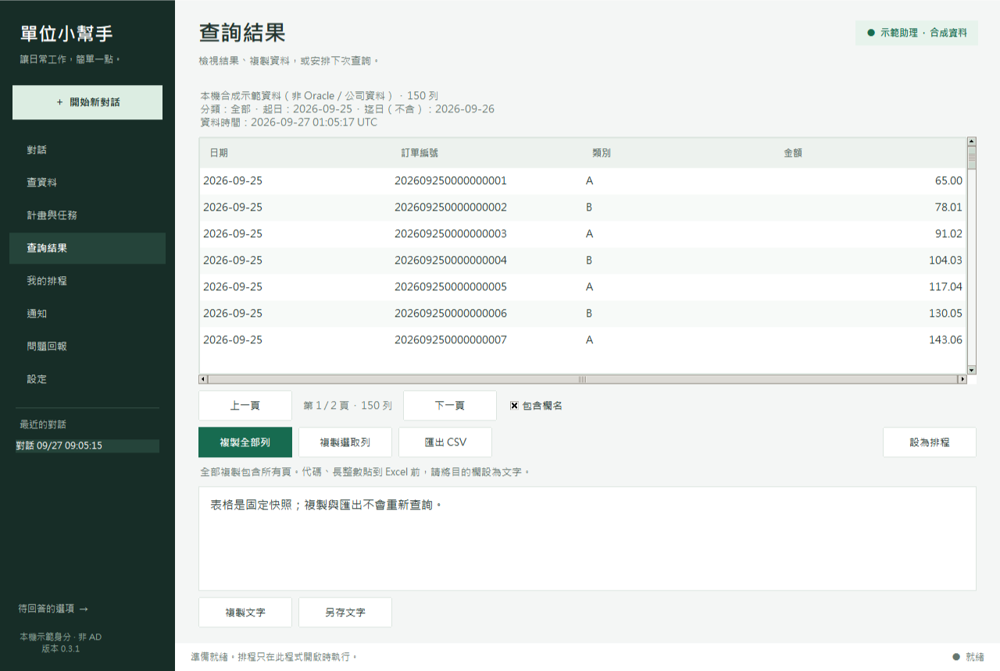

# 0.3.1 桌面介面

使用原生 Tkinter / ttk。保留 0.3.0 的流程、資料與公司接線邊界，沒有加入網頁服務或新的 GUI 套件。

- 深綠側欄、淺色工作區、統一字體與主要按鈕，八個功能可直接切換。
- 對話加入常用工作入口、歡迎引導、訊息層級與輸入操作區；工作進行時顯示狀態並限制重複送出。
- 查詢分為選擇模板、設定範圍、選擇處理方式；Plan 預覽用可讀條件與步驟，不把 raw JSON 當主要介面。
- 結果表格有交錯列、數值對齊、分頁與明確匯出操作。排程預覽與歷史、回報草稿與紀錄分區。
- 主要動作列保留位置；在最小 1050×700 視窗下檢查所有頁面的按鈕不被擠出畫面。
- Ctrl+N 新對話、Ctrl+Enter 送出、Enter 換行。快捷鍵遵守原本的 Plan 批准 gate。

## 實際畫面

以下是隔離的本機測試視窗，全部使用示範身分／合成資料；不是設計稿，也沒有公司真實資料。

## 驗證

以 Python 3.10.4 實際建立視窗並檢視 1280×860、1050×700 的應用自身截圖；測試導覽選取、按鈕完整可見、歡迎文字不寫入對話、快捷送出不跳過 Plan gate。兩個乾淨 venv 各 67 項完整測試通過，依賴鎖檔不變。

Computer Use 的 OS 自動操作工具在此環境無法啟動，因此沒有聲稱完成 OS 滑鼠／鍵盤全流程；公司不同縮放比例與 Excel 仍需依交接文件驗收。截圖只捕捉本應用的暫存測試視窗，未擷取其他視窗或使用者歷史。

樣式集中於 `desktop_app/theme.py`；頁面組合與導覽位於 `desktop_app/ui.py`。重新開啟 `start-app.bat` 即可看到新版，已開啟的舊視窗不會自動替換。
