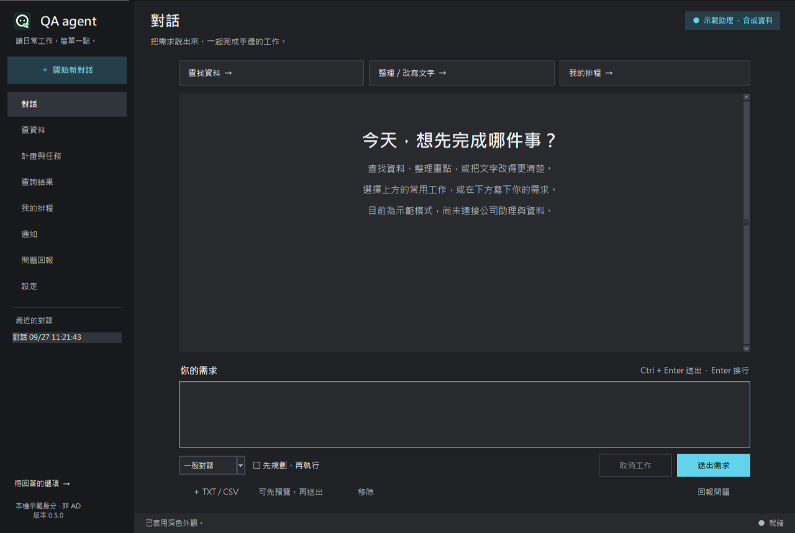
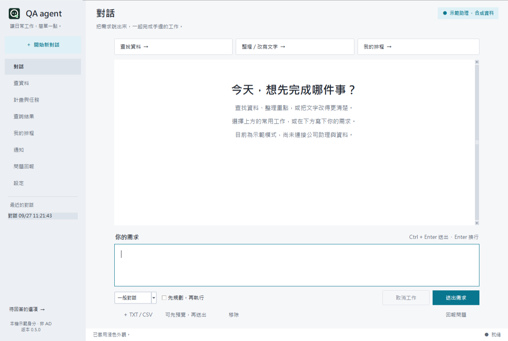
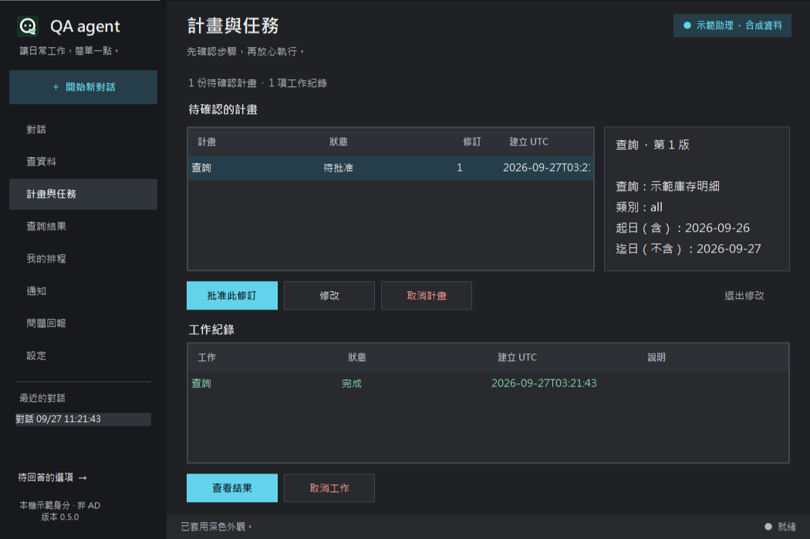
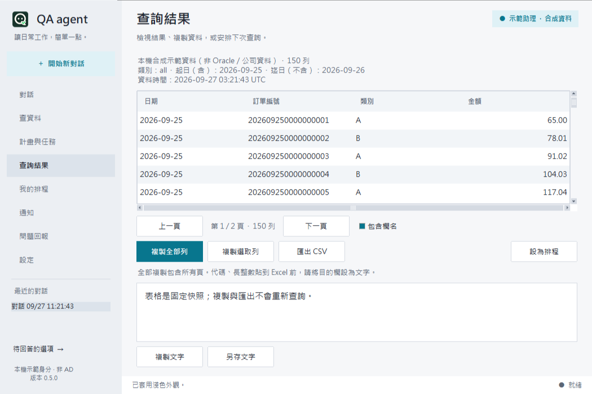
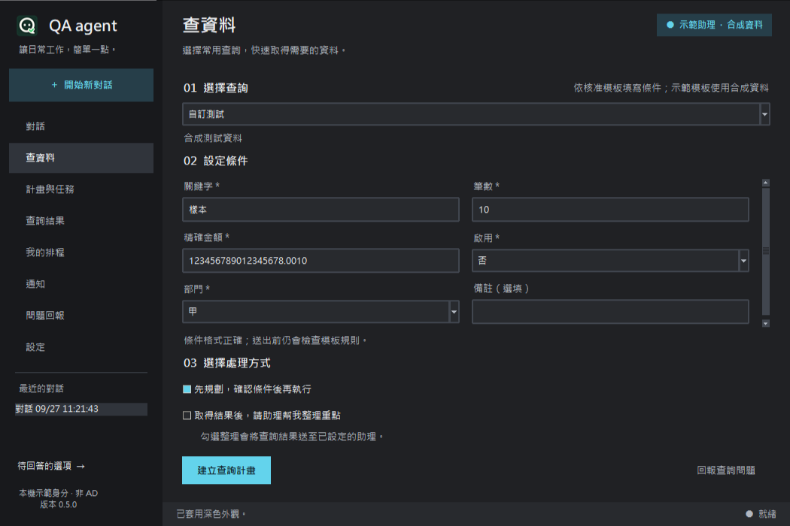
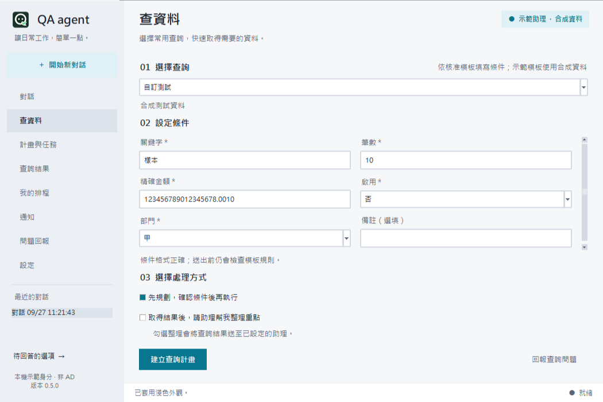
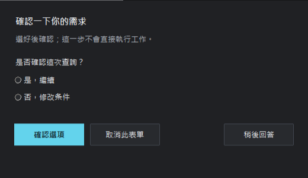
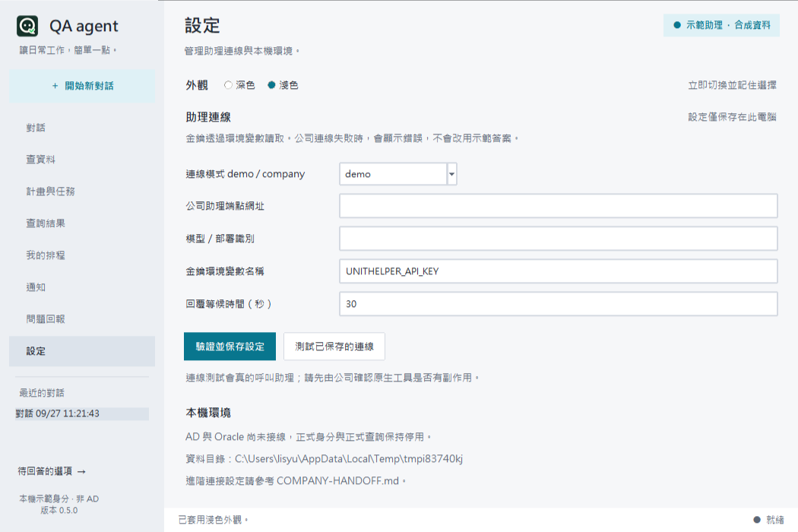

# QA agent 0.5.0 雙主題工作區

保留原生 Tkinter／ttk，首次預設石墨深色；設定 → 外觀可切換霧白淺色並保留偏好。青藍色用於主要操作及選取，細邊框區分工作層次；品牌與頁首縮小，側欄更緊湊，對話及輸入區共用閱讀寬度。

外觀獨立保存 ui-preferences.json，不改公司連線 config。缺失或損壞時深色，保存失敗時提示並保留本次切換。Appearance 每個 Tk interpreter 獨立，直接更新現有 widgets；草稿、附件、Plan 修訂、選取、游標、捲動與背景工作不重建。

## 實際畫面

以下均為此程式自行建立的隔離測試視窗，使用示範身分／合成資料，沒有公司資料。

## 維護與驗證界線

theme.py 集中背景、文字、邊框、懸停、選取、停用、成功／失敗配色；preferences.py 保存偏好；ui.py 組合頁面。八頁、表格、文字、下拉與應用對話框同步切換。Windows 原生檔案／訊息框沿用 OS 外觀。

本次實際建立 1280×860 及 1050×700 視窗，檢視聊天、Plan、六欄位動態表單、結果、排程、設定及選項對話框。程式驅動真 Tk 測試驗證工作中、Plan 待批准與對話框已開啟時切換，以及偏好重開／損壞／保存失敗。回歸證據見 [VALIDATION-LOCAL.md](../VALIDATION-LOCAL.md)。

Computer Use helper 在此環境無法啟動，因此沒有聲稱 OS 滑鼠／鍵盤人工全流程完成。畫面只捕捉本應用暫存視窗；公司縮放比例、API、AD、Oracle、Excel 的驗收仍待公司執行。Windows 工作列與真實桌面圖示外觀也未人工驗收。

重新開啟 start-app.bat 即可使用新版；舊的已開啟程式不會自動替換。正式綠色圖示保留，A～D 候選見 [ICON-CANDIDATES.md](ICON-CANDIDATES.md)。
