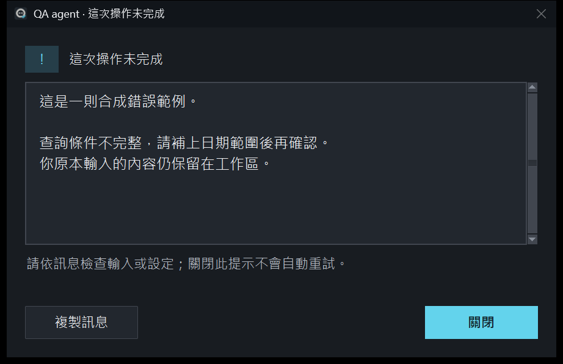
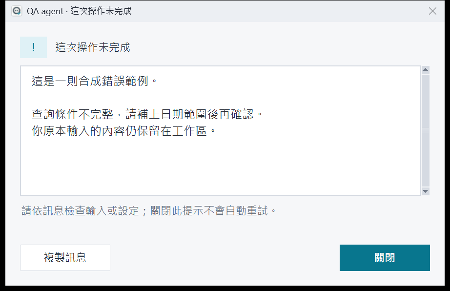

# QA agent 0.12.1 使用手冊

本手冊可在程式的「說明與關於」離線閱讀，也可從各頁的手冊入口開啟對應章節。QA agent 是 Windows 本機桌面應用，打開即進入工作區，接上公司助理或選用 Groq 外部試用後可取得真正 AI 回覆。

## 快速開始

1. 雙擊 start-app.bat 或 QA agent 捷徑；要用 Groq 真 AI 則開 start-trial.bat。
2. 在空白對話按「試查一筆資料」，帶入「查昨天 A 類數量合計」。核對後按送出。
3. 原處出現確認卡，顯示資料範圍且明示尚未執行；按「確認查詢」。不用 API key，也不用切換計畫頁。
4. 等待原卡顯示完成、筆數及前五列預覽。可查看完整表格、複製／匯出，或預覽後交助理整理。
5. 要定期查詢，按「每天自動查」，補時間及适用條件，核對後確認啟用；再按「現在測試一次」。

側欄主要是「對話、我的待辦、自動工作、活動紀錄」。「更多工具」提供查詢工具、完整結果及進階紀錄，設定與問題回報在底部。操作提示可收合，不另開體驗模式。

起手式只準備草稿，不自動送出；原本有草稿或附件時在同一助理的新對話準備範例。DEMO 表格是合成資料，示範助理回覆是固定文字；只有已接通的助理提供真 AI。查詢與排程不因出現在對話裡就自動交給模型。

若無法啟動，雙擊 diagnose.bat；已能開啟時可到「說明與關於 → 環境診斷」。環境診斷不是服務連線測試。

## 規劃工作與多助理協作

1. 試用請開 start-trial.bat；在對話助理旁選「規劃工作」，選主代理。公司入口需先完成能力驗證，沒有助理時不會偷偷轉到 Groq。
2. 輸入「查昨天 A 類數量合計，請分析助理整理，再交覆核助理檢查，最後產生日報。先試跑，成功後我再設每天八點」。按「送給主代理討論」。這一步真的會呼叫主代理，但不會查資料或派發子代理。
3. 主代理缺條件時會追問。可按「回答條件」選答案，或在輸入框補充；也可要求修改計畫，不需要先懂流程欄位。
4. 完整計畫顯示步驟、目的助理與輸入來源。按「修改步驟」可改指示、順序、助理及查詢條件；保存後重新核對。
5. 勾選本版資料傳送授權，再按「批准並試跑」。子代理依序工作，畫面顯示真實進度。可按「步驟詳情」查看來源、完整輸出及保留的數據。
6. 完成後按「設為自動工作」，填每日／每週和台北時間，勾選持續傳送授權，再按「確認啟用」。可在原處「現在測試一次」或「暫停自動工作」，也可在自動工作頁管理。

規劃與聊天模式依對話保存，切換不送出需求。規劃目前只使用貼上的文字，不會自動讀附件或其他聊天。規劃回覆與流程結果獨立保存；一般聊天不自動取得它們。只有試跑成功的版本可排程；已批准後要改需求請按「另開計畫」。

若主代理回覆格式不符，可補充需求並重新產生，不會執行半份計畫。某步失敗會保留已完成成果，按「重試未完成步驟」會明確再次呼叫失敗處及其後續步驟，不重跑成功的前置查詢。覆核有疑問同樣停下來，不代表已完成。取消後遠端請求可能仍在結束中。

自動工作重用核准計畫，不每次重新問主代理；失敗或助理版本失效會暫停並通知。排程只在 App 開啟時運作。Groq 四位角色使用同一模型與不同上下文，非四個公司助理；僅用合成資料測試。模型自由文字仍需核對。

## Groq 日報排程

1. 關閉舊版視窗，雙擊 start-trial.bat；公司入口不提供外部 Groq 日報。
2. 直接輸入「每天早上八點查昨天 A 類數量合計，整理日報」並送出。Groq 只整理建議條件，不會立即查詢或啟用。
3. 在原對話補缺少的欄位並核對。此功能固定每日查前一日；不支援公司 DB、任意程式執行或自動搜尋網頁。
4. 勾選持續傳送授權，按「確認啟用」。修改條件後需重新勾選；條件齊全時自動提供本機預覽，不需要另按解析／預覽。
5. 卡片顯示已啟用但尚未立即執行。按「現在測試一次」看進度與結果，不改原定時間；「暫停」可停止後續排程。

數字合計由程式計算，Groq 整理文字；只送合成查詢來源、條件、時間、筆數及合計，不送逐筆明細或原對話。每次完成／失敗通知；空結果不呼叫 AI。額度、解析或整理失敗不假裝成功、不自動重試，已查到的表格保留；解析失敗可直接手動補填。

App 必須開啟、電腦保持運作；不是 Windows 系統排程。重開最近 24 小時最多補跑一次，停用期間不追補。

## Groq 外部 AI 試用

這是選用的個人外部 AI 入口；正常公司入口不變，也沒有恢復強制體驗導覽。

1. 在專案根目錄 `.env` 填一行 `GROQ_API_KEY=你的Groq金鑰`。使用 UTF-8 文字，不加變數展開、不重複同名欄位。
2. 雙擊 start-trial.bat，頁首應顯示「Groq 外部 AI 試用」，助理選擇「Groq 試用助理」。原本桌面捷徑仍開公司／示範工作區。
3. 按「整理一段文字」，補上虛構筆記，例如「今天完成測試，明天整理報告；交付日期尚未確定」，按 Enter 送出。Shift+Enter 換行；「更多選項」可勾先規劃，原處批准後才會呼叫 AI。
4. 回答完成後自行核對；可選文字加入待辦，待辦不會自動執行。也可另開對話試改寫信件或整理報告。
5. 有問題到「設定」檢查 .env 或測試 Groq 連線。測試連線會送出一筆合成短句；啟動、查看設定及一般環境診斷不會呼叫模型。

固定使用 Groq 官方 OpenAI 相容端點 `https://api.groq.com/openai/v1` 與 `openai/gpt-oss-20b`，不需要填 assistant ID。不提供工具執行或搜尋；模型不會直接查 DB、寄信或執行工具；日報需經下節本機確認流程建立。每次連同本段歷史最多 6,000 字，超限要求縮小內容或另開對話，沒有默默截斷；回覆長度超限會標示失敗。

資料存在原資料目錄下的 groq-trial 子目錄，包含自己的對話、草稿、待辦及排程。查詢仍使用合成資料；轉交查詢結果需明確選 Groq 助理並預覽确认。試用工作區與正常工作區不自動互傳。

金鑰未填／格式錯誤時先修正 .env；認證失敗請確認 Groq 金鑰與帳戶權限；逾時或連線失敗請檢查網路、代理及可信憑證，勿關閉 TLS 驗證。429 表示流量或額度限制，稍後再試；免費額度與計费取決於 Groq 帳戶方案，本程式不會升級方案或改用其他模型。公司助理、AD、Oracle 仍須另行接線，外部試用成功不代表公司服務已驗證。

## 我的待辦

1. 從側欄開啟「我的待辦」，按「新增待辦」；也可在對話選取文字後按「加入待辦」或使用右鍵同名操作。
2. 核對標題與說明，選填到期日後保存。選文會完整保留於說明；標題過長時請自行修改，不會自動截斷。
3. 開始處理按「開始」，做完按「完成」，需要繼續處理按「重新開啟」。這些操作不會呼叫助理或執行查詢。
4. 點標題或「查看／編輯」改內容、開啟來源或刪除；刪除前可取消。寬視窗是三欄，窄視窗用狀態分頁，搜尋只查標題。

新增後留在原頁，想查看再按「查看待辦」。已完成預設顯示，可隱藏且會記住偏好。待處理按到期日排列、無日期放後；進行中按更新時間、已完成按完成時間。期限以台北日期顯示逾期，只是提示，不會發到期通知。

刪除來源對話不刪除另存待辦；來源顯示「來源對話已刪除」，仍可編輯。刪除待辦不影響原對話。待辦只在此電腦，沒有跨人指派或同步；看板的完成狀態由你確認，與「計畫與任務」的 AI 執行狀態分開。

## 常用工作與草稿

空白對話提供查詢範例、虛構筆記及自行輸入；「常用工作」保留整理重點、改寫與整理報告。改寫預設正式，可選精簡。先填入草稿，再補原文並自行送出；先規劃仍須批准。已有草稿或附件時會保留並在同一助理的新對話填卡片，不暗中覆蓋。

文字草稿停止輸入約一秒後保存於本機，切換及關閉時補存。看到保存失敗時，內容仍在畫面，請重試保存；不是公司端回覆失敗。重開後恢復文字、用途與先規劃選擇；附件需重新選取，不會自動讀檔。送出／建立計畫受理後清除草稿，未受理則保留。

修改既有 Plan 時請按「保存計畫修改」，自動保存不會變更或批准 Plan。恢復文字不代表原助理仍可使用；連線版本失效時原對話保持唯讀。

助理名稱旁顯示自填用途，完整 ID 在「助理資訊」。用途描述不等於已驗證能力，未設定、示範及唯讀狀態以實際標示為準。

## 設定公司助理

1. 到「設定」填入共用 endpoint，並保存 API key。
2. 在「我的助理」新增名稱、assistant ID 與備註；需要時增加多位助理。
3. 將常用助理設為預設；停用暫時不用的助理。
4. 依公司維護者確認的請求格式啟用公司連線，再以核准的測試內容實測。

API key 輸入時預設遮蔽，可切換顯示；保存後只顯示是否已設定，不回填明文。更換或移除從同一設定入口操作。金鑰儲存於 Windows 認證管理員，失敗時會顯示提示，不改存明文檔案。舊環境變數設定保留相容讀取，直到明確保存新的金鑰來源。

三個主要資訊是 endpoint、assistant ID、API key；公司端點如何接受 assistant ID 仍須依成功 API 範例設定 adapter，不能把 ID 猜成 model。看到「待確認 API 格式」代表還沒完成接線，不是帳號已失敗。請交由維護者對照公司成功呼叫。

名稱與備註可修改。endpoint 或 assistant ID 改變會建立新連線版本；舊對話仍能閱讀，但要用新對話繼續，避免把舊內容送錯目的地。

## 對話與鍵盤

1. 選擇目標助理，按「開始新對話」。
2. 輸入具體需求與條件；必要時貼入文字或附上一份 TXT／CSV。
3. Enter 送出，Shift+Enter 換行，也可用 Ctrl+Enter 或「送出需求」按鈕。
4. 回覆出現後繼續追問。從側欄最近對話可重開歷史。

中文輸入法組字或選字時，Enter 用於確認文字，不應送出整段需求。若公司輸入法行為不同，先使用送出按鈕並回報輸入法名稱及操作步驟。長按或快速重複按鍵不應建立重複工作。

每段對話綁定一位助理。切換助理會另開對話，草稿、附件與歷史不自動轉交。工作執行中切換畫面，也不改變原工作的助理。

取消會停止本機後續處理；已送出的公司請求不保證能在遠端撤回。程式關閉時會等已派發的工作收尾，避免遺失本機狀態。

## 管理對話

刪除單筆：在側欄最近對話上按右鍵，選「刪除此對話」。需要清理多筆時，開啟「管理對話」，輸入標題搜尋，再勾選對話；「全選目前搜尋結果」只勾選目前顯示的清單。改變搜尋條件時，已被隱藏的選取會清除。

1. 選妥後開啟刪除預覽，核對對話名稱與筆數，以及訊息、Plan、工作和通知的數量。
2. 預設焦點在「取消」。確定要永久清除時，才明確按刪除；應用沒有復原功能。
3. 成功後歷史清單更新。若刪的是目前對話，會顯示最近保留的對話；全部刪除後留下新的空白對話。

刪除會移除所選對話的訊息、專屬 Plan、工作輸入／結果及其通知，清除該對話未送出的草稿與附件引用，並關閉相關詳情及未送出轉交預覽。待批准 Plan 直接刪除，不會因清理而執行。其他對話的草稿與附件保留。

原始附件檔、另存／匯出檔、既有備份、另存待辦、獨立查詢與排程、回報、其他對話中的轉交副本，以及公司服務端歷史都不跟著刪除。已轉交副本可以繼續閱讀；若來源已不存在，會顯示「來源對話已刪除」。這是應用內永久移除，不是磁碟安全抹除。

若顯示工作尚未結束，整批都不會刪除，請等候後重新操作。即使已按取消，遠端請求仍可能在收尾；不要反覆按刪除。其他對話的工作不會因此停止。刪除預覽超過 10 分鐘，或預覽後內容／狀態變動時，需要重新預覽；若資料庫操作失敗，整批保持原狀，可記下錯誤再回報。

## Plan 與選項確認

1. 在對話「更多選項」勾選「先規劃，再執行」，或在進階查詢工具勾選先規劃。
2. 對話送出後在原處閱讀確認卡，這時沒有呼叫助理或執行查詢。進階工具的計畫仍可在「更多工具 → 進階紀錄」檢視。
3. 條件不對時按「修改」，保存後重新檢視。
4. 按「批准此修訂」才會建立工作；也可取消計畫。

是非、單選或多選表單用於釐清需求。未選不等於同意，選項本身也不代表授權任意工具。舊版本、過期或已取消的 Plan 不可重播執行。修改助理連線後，舊 Plan 不會自動改送新助理。

若沒有「批准」可用，先選取並預覽一份待批准計畫。這個版本没有持續自主 Goal 或跨助理自動分工。

## 文字與 TXT／CSV

1. 可直接貼文字，再選「整理重點」或「改寫文字」。
2. 按「＋ TXT / CSV」選一份檔案，先看預覽再送出；不需要的附件可移除。
3. 閱讀候選結果，確認內容後複製或另存文字；原文與原檔保留。

只支援單一 UTF-8／UTF-8 BOM 的 TXT 或 CSV，最多 2 MiB。TXT 最多 50,000 字，CSV 最多 10,000 列、100 欄。CSV 欄名空白、重複或列寬不一致會拒絕。Word／Excel 原檔排版修改、多文件合併尚未支援。

預覽只顯示部分內容，送出的是完整附件文字；超過助理上下文上限會拒絕，不默默截斷。遇到上限，請明確縮小內容。示範模式只有固定示範輸出，接通公司助理後才有真正摘要與改寫。

## 查資料與匯出

1. 進入「查資料」，選擇查詢模板。
2. 依欄位提示填日期、類別或其他條件；必填和格式錯誤會提示。
3. 可先建立 Plan，也可明確送出查詢。完成後到「計畫與任務」選工作並查看結果。
4. 核對查詢條件、資料時間、列數與截斷標記。
5. 可複製全部列、複製目前頁面的選取列，或匯出 CSV。

首版只有三項合成 DEMO 查詢，正式 Oracle 模板須由公司接線並核對人工結果；示範數字不代表公司資料。查詢採核准模板，不提供任意 SQL。

表格每頁 100 列。「全部列」包含所有頁，「選取列」只包含目前頁面；換頁會清除選取。複製與匯出使用同一份結果快照，不重新查詢。

代碼、長整數或精確小數貼到 Excel 前，先將目的欄設為文字。應用保留精確字串，但 Excel 自動判斷可能改變格式；實際 Excel 驗收仍由公司完成。剪貼簿失敗可稍後重試或改匯出 CSV。

## 將資料交給助理

1. 在結果頁選全部或目前頁面的指定列，按「交給助理整理」。
2. 選擇目的助理，填入想整理的重點。
3. 檢查預覽中的目的助理、欄位、筆數、查詢條件、資料時間及實際內容。
4. 確認後送出，系統另開指定助理的新對話並保留來源查詢關聯。

未確認不會呼叫助理。只傳選定資料及整理需求，不附帶資料庫密碼或無關歷史。超過上限時須縮小範圍。助理失敗或取消時，原查詢結果仍能查看、複製或匯出。

對話中的「轉交給其他助理」也必須選定內容、指定助理、檢查預覽並確認；它不會默默分享整段歷史。這是人決定的轉交流程，不是多 agent 自動協作。

舊版對話缺少可靠助理歸屬，只供閱讀或匯出；要續談請選助理與轉交內容，不會自動猜目的地。

## 對話中的確認與結果

查詢或自動工作在原對話顯示確認卡；條件不足先補填，條件齊全才開放確認。普通聊天不增加批准步驟。用途與先規劃在「更多選項」；未知或不支援的需求可改成一般討論，不會執行任意 SQL／程式。

每張工作卡綁定自己的需求、修訂及助理；可收合，稍後從對話事件點回查看。確認後顯示真實狀態，結果預覽只有前五列，完整表格有「返回原對話」。失敗但已取得資料時仍可查看、複製或匯出。需要再試時由你明確操作，不自動重送。

Groq 試用才啟用已驗證的結構化解析；公司模式未接解析能力時用同頁表單，不會改送外部服務。對話事件不是模型歷史，資料整理仍須核對目的助理與送出範圍。

## 我的排程與通知

側欄「通知」常駐顯示，紅底白字的「1 未讀」代表尚未查看的通知，超過 99 則顯示「99+ 未讀」。點徽章或通知入口可開啟清單，未讀列以粗體顯示。

新通知會在桌面右下角彈出約八秒；滑鼠移入可暫停倒數，離開後重新倒數。成功用綠色勾號，失敗用紅色驚嘆號與邊框，並附上文字狀態。主視窗最小化時也能顯示；多則新通知合併為一個彈窗。

按「查看通知與結果」會標記該則已讀並開啟結果或原因；多則通知則先開清單，不一次標記全部已讀。按「關閉」或等待彈窗消失，都不會標成已讀。重開 App 只恢復未讀徽章，不重播舊通知。彈窗是 App 開啟期間的本機提示，不是 Windows 背景通知服務；不增加模型呼叫或改變排程通知條件。

主要入口叫「自動工作」。從對話查詢結果按「每天自動查」，或直接提出定期查詢需求；選擇只查詢或已開放的日報整理，填台北時間，核對後確認啟用。建立後留在原對話，可現在測試一次、暫停及查看結果。

既有「更多工具 → 完整結果 → 設為排程」仍保留原先停用草稿與預覽啟用流程，供進階使用。未宣告日期映射的模板只允許固定條件。日報只支援每日查前一日。

自動工作頁集中管理時間、啟停及歷史結果；顯示時間為台北，內部保存 UTC。僅查詢依非空且內容改變、數值門檻或失敗規則通知；Groq 日報每次完成／失敗通知。活動紀錄可查看待確認、執行中、完成與未完成工作及通知。

程式關閉或電腦停止運作時不執行。重開時，最近 24 小時最多補跑一次；停用期間不追補。

## 問題回報

1. 到「問題回報」，選問題類型，填描述與預期結果。
2. 保存草稿，再依畫面操作保存本機回報並取得編號。
3. 用編號追蹤本機紀錄；需要維護者處理時，透過單位核准管道提供必要資訊。

目前回報尚未送至管理平台，也不會自動附加對話、查詢內容、附件或金鑰。請不要把 API key、密碼及不必要的私人資料貼入回報。維護聯絡方式尚未設定。

## 外觀與軟體版本

到「設定 → 外觀」切換深色／淺色，側欄、主視窗及已開啟的應用附屬視窗圖示一起更新。桌面捷徑固定使用深色版，不會隨應用主題改寫。外觀立即生效並保存選擇；既有草稿、選取、附件與工作保持原樣。外觀與各頁操作提示偏好存於獨立的 ui-preferences.json，不修改公司連線設定。提示展開／收合也不會清除草稿、附件、選取或 Plan 修訂。

偏好損壞或缺失時使用深色。保存失敗仍可使用本次選擇，但下次開啟可能恢復預設。

程式在啟動前設定 Windows DPI 感知，將固定間距、表格列高與圖示配合顯示倍率。主要操作文字為 11 點、聊天本文 12 點，次要提示至少 10 點；拉大或最大化只增加可用空間，不放大整張畫面。高倍率或小螢幕下部分內容需捲動，請使用畫面捲軸找到後續操作。

若仍覺得模糊，請記錄 Windows 顯示倍率、螢幕配置、啟動方式，以及一般／最大化哪個狀態出現；提供不含公司資料的原始截圖協助核對。不同倍率螢幕間移動後的即時重排未列為本版保證，可先在主要使用螢幕重新開啟程式再比對；不要自行改系統相容性或防毒設定當作通用解法。

錯誤、警告、資訊及一般確認提示會跟隨應用主題。長訊息可以捲動或選取，按「複製訊息」可複製完整內容；關閉不會自動重試。確認提示預設選擇取消，Escape 也會取消。

主視窗與附屬視窗的標題列配合深淺色，保留 Windows 拖曳、縮放及關閉操作。系統不支援標題列著色時保留原生外觀；檔案選擇器及主題尚未初始化的啟動錯誤沿用系統外觀。

「說明與關於 → 關於」可看版本。本版沒有遠端自動更新、EXE 打包或中央管理；更新依維護者提供的專案與環境重建流程進行。不要自行刪除資料目錄。

## 常見問題與診斷

沒有真實 AI 答案：確認是否示範模式，以及公司 adapter 的 API 格式是否已確認。公司模式失敗不會偷偷回示範答案。

不能查 Oracle：本機預設為合成查詢；公司須提供核准 SQL、欄位及授權範圍，並完成真實驗收。

不能送出：確認內容非空白、同一對話沒有工作正在執行、資料未超過上限；Plan 模式要另行批准。

找不到資料：先确认選取對話、助理與工作紀錄。切換助理不會搬動歷史；舊版本資料只讀是刻意避免誤送。

設定失敗：先等工作結束；更改公司連線前處理待批准計畫。請不要以關閉 TLS 驗證解決憑證問題。

環境有問題：按「說明與關於 → 環境診斷」或雙擊 diagnose.bat。應用內診斷結果保存在個人資料目錄 diagnostics/environment.json，狀態列會顯示位置。可分享報告只包含白名單狀態與安全錯誤代碼，不含內部網址或原始資料。環境通過不等於公司 API、AD、Oracle 或 Excel 已驗收。

## 新版工作區與工作詳情

側欄主要是「對話、我的待辦、自動工作、活動紀錄」。更多工具保留查詢工具、完整結果與進階紀錄；設定、問題回報與說明在底部。最近對話可捲動。

輸入區主要保留文字、附件與送出；用途、先規劃和常用文字工作放在「更多選項」。內容增加時輸入區隨之增高，超過上限則捲動；Enter 送出、Shift+Enter 換行。

查詢與自動工作在原對話開啟可收合的確認卡，核對條件後按「確認查詢」或「確認啟用」。舊事件可以點回查看。Plan 同樣在原處批准該修訂，修改後必須重新核對，舊卡不能批准或取消新修訂。

查詢完成只預覽前五列；複製與匯出使用完整本機結果。「完整表格」保留分頁、選取與「返回來源對話」；原對話位置保留。整理這份資料仍須選目的助理、預覽及確認，沒有自動把表格送模型。

一般聊天的工作詳情沿用真實狀態，寬視窗可在右側開啟，窄視窗使用附屬視窗。失敗保留原因；若已取得查詢表格，仍可查看。重試由使用者發起，取消不保證遠端已停止。

模型文字維持純文字，不執行 HTML；可以跨訊息選取，選取後顯示加入待辦與轉交。查看早期訊息時，新回覆不會強制拉至底部。

從桌面 QA agent 捷徑或 start-app.bat 使用本機／公司模式；start-trial.bat 使用隔離的 Groq 試用。Norton 警告請依開發指南記錄及比對，勿停用防毒。

## 介面參考

以下為 0.12.0 真 Tk 畫面，全使用合成資料。提示框內文字是合成錯誤範例。

錯誤提示使用紅色驚嘆號，警告使用琥珀色驚嘆號；資訊與確認提示使用青藍色符號，同時保留文字說明。

