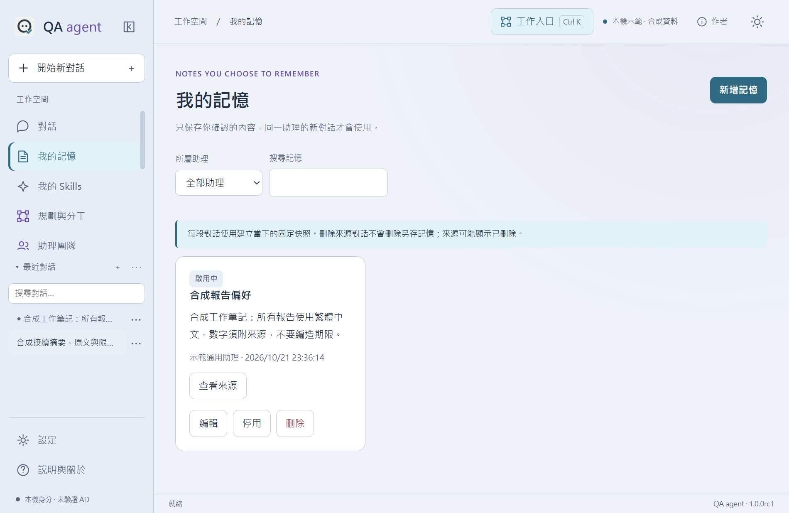
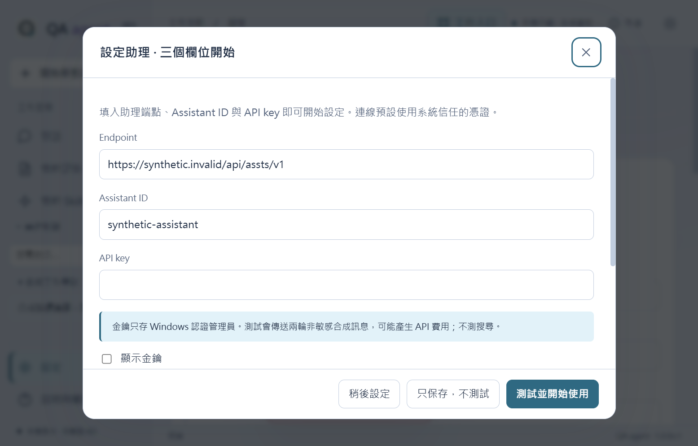
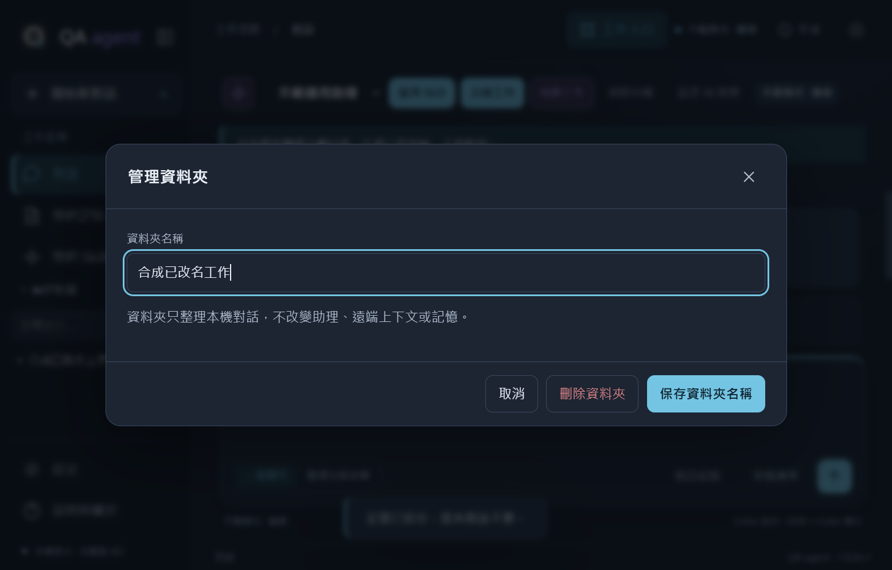

## 第一次啟用助理

按「設定助理」，填endpoint、Assistant ID及API key。CA使用系統信任，不用另外提供；金鑰只保存於Windows認證管理員。「只保存」零模型請求；「測試並開始使用」須勾選同意，使用兩輪合成訊息測試連續對話，可能產生API費用。成功後按「開始聊天」。名稱可在助理管理修改。

聊天成功不等於Skill格式或搜尋可用：Skill按「測試Skill相容性」，搜尋另需核准工具。不需要部署設定檔也能手動填三個參數；未連線時仍可使用明示的離線示範。金鑰保存失敗不改存明文。失敗依提示核對endpoint、ID、key或權限；只有憑證驗證失敗時才請維護者處理信任，不用自己改Python或關閉TLS。變更已有端點會先要求確認，撤銷舊憑證/能力，舊對話仍可閱讀。

## 回原對話與接續

主側欄搜尋最近對話，點名稱即可切回，支援重新命名、置頂與刪除。草稿停止輸入後保存；切換與正常關閉補存，保存失敗保留畫面並提示。原助理版本有效時沿用原thread；舊版本保留閱讀，不自動改送新助理。進階對話仍從原入口使用。

請求失敗先「檢查原請求」，可恢復時「取回原回覆」。未知寫入不自動重送。長對話、遠端失效或想套用新記憶，可選取原文按「整理後接續」：明確產生摘要（一次請求）或自行填摘要，修改並預覽後建立新對話。新對話只有草稿，不會自動送出；原文保留。若上次摘要結果不明，改用手動整理，不反覆派發。

## 整理對話名稱與資料夾

第一則送出的需求會在本機產生最多32字短標題，不額外呼叫模型；這是第一句的整理，不是AI摘要。舊對話也會依原輸入顯示短標題，後續追問不反覆改名。尚未送出時暫以草稿顯示。按對話旁「⋯」可手動命名，或按「恢復自動命名」。不會修改訊息原文。

在「最近對話」旁新增資料夾，例如「每日報告」「專案討論」。按對話旁「⋯」選資料夾再按「移至選定資料夾」；選「未分類」即可移出。第一版是單層分類，不含巢狀資料夾及拖曳。資料夾可收合、改名；刪除前會確認，**只刪分類，所有對話回到未分類**。真的要刪內容仍須使用對話的刪除確認。

最近對話整區及各資料夾可收合，偏好於重開後保留；保存失敗會提示。搜尋會跨所有資料夾找標題並暫時展開符合項目，不改原收合偏好。移動或改名不改助理／thread，不派發工作，也不清空目前草稿及閱讀位置。Tk備用的進階對話維持原入口。

## 我的記憶

選訊息按「記住這件事」，或到「我的記憶」新增偏好、背景、工作規則；先預覽再確認。記憶可編輯、停用、刪除，保存在目前登入者的本機資料目錄。標題最多120字、內容2000字；新對話記憶合計12,000字，超限請停用不需要項目，不會偷偷截斷。

新對話預覽目前助理記憶，可選不用；確認後固定快照，下次送出時傳至顯示的助理。後續修改影響新對話，不改現有thread。助理連線變更後請重新核對目標與預覽。Skill預設不使用記憶，只有手動選取並出現在Plan方法中才會送出。刪除記憶不撤回舊快照與服務端資料；來源對話刪除後另存記憶仍保留。

## 我的 Skills

自行建立工作方法：側欄「我的 Skills」→ 空白表單、複製範例或明確用對話起草 → 預覽保存 → 使用並規劃。先填必要條件，再請同一助理規劃；可修改指示、前置輸入及順序，預覽後一次確認執行。一般聊天不受影響。

真實助理先用旁邊「測試 Skill 相容性」；最多三次合成請求，搜尋需既有核准工具。離線示範沒有即時資料或真實AI分析。成果成功後仍須人工核對來源，再同意每日持續傳送。Skill停用／刪除先列出並暫停關聯排程，已批准工作與歷史保留。分享Markdown不含連線／批准／排程；正文的私人資訊由你自行檢查。[完整操作、三條試用旅程與格式](SKILLS.md)。

## 交辦工作與系統匣

主對話按「交辦工作」，選助理並說「每天早上八點，幫我整理台股、美股和重大總經新聞」。補齊範圍、來源、台北時間後先預覽並確認試跑；核對真實來源，再同意每日傳送並啟用。示範只展示合成成果，不能啟用真實排程。工作紀錄保留原需求、成果及失敗，不會自動重送。

WebView首次按X可選背景系統匣或真正退出；設定可更改。背景仍需電腦運作與有效登入，關機／睡眠不保證執行。`Ctrl+K`可搜尋常用入口，`qa.bat --demo`開離線CLI。[詳細操作與指令](WORKBENCH.md)。

## 離線登入展示

`start-demo-login.bat` → admin/admin → 暫存合成工作區。這不是公司管理員；「登出並關閉工作區」撤銷本次階段。資料關閉後清除，無公司服務與記住登入。公司登入與App使用资格見 LOGIN-AND-APP-ACCESS.md。

# 對話中斷、刪除與除錯

若畫面顯示「尚未送出／重試未送出」，代表本機設定檢查時就停止；可修正後按該鈕，沿用原請求。一般連線逾時不能當作未送出。錯誤卡會區分認證401、權限403、找不到404、限流429與逾時，並顯示失敗階段；不需要貼上金鑰回報。

每位助理預設使用共用 API key。如果平台分享的助理需要另一組 key，於助理編輯視窗選「個別金鑰」。金鑰只存 Windows 認證管理員；可更換、移除或回到共用。改憑證會更新連線版本，舊對話保持可讀；搜尋核准及角色驗收需要重做，不會把舊工作悄悄送往新連線。

一般聊天要上網：先讀取助理的工具宣告，由維護者核對搜尋 function 及參數，保存時另外勾選允許一般聊天使用核准搜尋。頁首會標示是否允許。未勾選不開啟；「整理任務草稿」始終停用工具。聊天有文字不代表完成搜尋，仍須核對來源。

對話傳送失敗後，已完成的訊息仍保留，未完成文字存於本機請求紀錄。畫面暫停新的送出，先按「檢查原請求」；確認可恢復後按「取回原回覆」。這會沿用原請求，不另送一份。服務端寫入結果不明、已取消或連線版本失效時不能自動重試；「另開對話保留內容」只準備草稿，需自己再送出。預設不帶已完成歷史，勾選後才會在下次送出傳給同一助理。重開從「對話紀錄」找回中斷內容。

刪除入口：

- 對話 → 對話紀錄：搜尋、選取、全選搜尋結果與刪除。
- 對話 → 草稿清單：刪除未啟用任務草稿。
- 活動紀錄 → 管理／批次刪除：清理工作、成果、待確認計畫、流程、自動工作、回報、通知及選項表單；單筆也可在對應清單刪除。
- 我的待辦、助理團隊：沿用各自刪除；刪助理設定不刪組織平台助理。

確認前會列出項目與範圍，預設焦點在取消。執行中或取消尚未收尾，整批拒絕；自動工作先暫停。刪除不可由App復原，原檔、匯出、備份及服務端保留。已完成工作刪正文與成果，保留最少防重識別；獨立對話、流程與排程不連帶移除。想一併清除要各自選取。

查資料頁依「選來源 → 填條件 → 預覽確認」使用；目前合成來源會明示，不代表已連組織DB。文字／CSV整理則由「規劃與分工」使用輸入與附件。結果表格保留分頁、選取、複製與CSV匯出。

失敗訊息附問題編號；「說明與關於 → 匯出除錯包」只輸出版本、白名單錯誤代碼、時間及專案程式位置，不含對話、URL或金鑰。它不是完整正式服務驗收報告。可另用diagnose.bat檢查環境；分享前依組織規定核對內容。

## 選擇工作區風格

進入「設定 → 外觀」，點選 **深海青藍／星霧紫／森林青綠** 預覽卡，即時套用。深色／淺色獨立切換，共六種組合；下次開啟沿用上次選擇。卡片標示「✓ 使用中」。

「恢復預設」回到深色＋深海青藍，不清除其他設定。若無法保存，本次仍可使用；按「重試保存」重試。Tk備用介面提供同名選項，保存失敗時可再次點選風格。切換不影響對話草稿或未送出的連線設定。

## 工作區顏色與通知

- 操作與選取：依風格使用青藍、紫色或青綠；一般未讀通知固定青藍，數字不代表錯誤。
- 紫色：主代理／助理團隊識別，不代表能力已驗證。
- 琥珀：待你確認、補條件或需要注意；確認前不會派發。
- 藍色：排隊、規劃或執行中，以旁邊文字區分。
- 綠色：工作完成／流程覆核通過，仍需核對來源與內容。
- 紅色驚嘆號：執行失敗或重要錯誤；取消維持中性色。

設定可切換深淺外觀。活動紀錄提供狀態圖例；通知分開顯示工作狀態與已讀／未讀。開啟通知清單不會全部標讀，按單則「查看」才標讀。

# 財經日報：先試一次，再啟用每天八點

1. 設定組織 endpoint／API key，於助理團隊加入已能搜尋的 Assistant ID。使用「連線啟用檢查」找出缺少設定；檢查搜尋助理連線只讀取 metadata，不查新聞，不代表搜尋已接通。
2. 主對話按「財經日報」，選助理，核對台股／美股／總經需求及台北時間（預設 08:00）。此入口不需要四個分工角色。
3. 按「預覽試跑」→ 核對目的助理與文字 →「現在試跑」。只有此時會送出需求；不會立即建立排程。
4. 查看全文，人工核對新聞日期、休市日期及來源。即使顯示已完成，也僅表示取得回覆；若沒有真正搜尋或來源不可靠，先不要啟用。
5. 勾選核對與每日傳送同意，再按「啟用每日」。啟用不立即再跑；可暫停或到「自動工作」管理／現在測試一次。App 必須保持開啟；失敗或未完成時會暫停。

搜尋前：設定 → 連線啟用檢查 → 檢查搜尋助理連線。清單從AI 助理設定取得，預設不勾選；請維護者核對 function 名稱、參數與唯讀用途後，再勾選工具及核准聲明保存。不能因名稱有 search 就假設安全。無法支援的參數會標示原因，不能勾選。每批最多4工具、每次最多3批及600秒；回覆超128KiB會停止，請縮小需求。

保存或移除核准會更新助理版本，舊 Plan／日報預覽需重建，舊排程遇到失效綁定會暫停；角色驗收也須更新。普通聊天預設停用工具，另行勾選核准後可使用搜尋；建立任務草稿與主代理規劃不使用工具。已確認的日報／rag 搜尋步驟才可呼叫核准項目。

成果顯示本機工具收據：結果已交回助理、已取得尚未確認提交、結果未明或尚未派發；這不是新聞事實驗證。失敗不自動重送，可到活動紀錄查看原因。關閉成果視窗不等於取消遠端請求；執行中可明確取消。未知工具、參數不符、逾時或結果不明停止，不用示範新聞代替。

多代理測試用「規劃工作」，先以 [固定資料測試題](COMPANY-IMPLEMENTATION.md#多代理第一題固定資料晨報) 驗證分析→覆核→彙整，再測組織搜尋。兩者是不同入口。

# AI 助理與 LangGraph 快速開始

1. 「設定 AI 助理」→ 保存endpoint及API key；預設採組織範例的Assistants協定，其他協定在進階選項。
2. 「助理團隊」→ 新增AI 助理名稱及 Assistant ID。角色由組織維護者驗證後才可加入分工。
3. 回到「對話」，選AI 助理再送出；頁首標示正式模式。選示範助理仍完全離線。
4. 「規劃工作」→ 選已驗證主代理 → 說需求 → 核對分工 → 按一次「確認執行」。LangGraph 依序完成工作，成果頁沿用複製、覆核與回饋。

「整理任務草稿」只存未啟用草稿，與規劃工作執行不同。每次送出草稿需求會傳本段歷史和目前欄位給指定助理，但不啟用排程。未知組織工具會停止並提示，不會暗中執行。

「對話紀錄」可重新開啟主畫面歷史再追問；失效助理版本的舊內容可讀，續談需建立新對話。請求期間可取消，已要求取消不保證服務端已停止；晚到文字不會加入對話。

## 恢復中斷的分工

重開不自動派發。可恢復工作顯示「檢查遠端狀態／繼續工作／放棄恢復」。先核對，再明確繼續；助理版本改變、來源不符或送出結果不明時停止，不自動重試。已完成步驟保留；正常關閉時被取消的工作不可直接復活。長成果與一般頁面操作見下方章節。

# 工作區快速開始

雙擊 start-app.bat 開啟 WebView2。若組織未安裝 WebView2 Runtime，先用 start-tk.bat，並交 IT 安裝核准元件。新主畫面無附件；以前的附件工具保留在進階工作區。

## 兩模式離線對話

1. 主畫面顯示「示範模式 · 離線」，一般聊天可連續追問；回覆只展示流程，不代表真正AI或即時查詢。
2. 選「建立任務」，輸入「我要每天追蹤庫存」。依序回答「A類庫存」「組織核准資料庫」「資料追蹤」「每天08:00」。
3. 條件齊全後檢視草稿。可改對象、來源、類型、每日／每週／指定日期及台北時間；修改後重新預覽。
4. 按「確認儲存（不啟用）」才會存一份任務草稿；取消不存。任務尚無資料連線與執行器，**不會在指定時間自行運作**。
5. 切換模式或示範助理會清空目前畫面、開始新對話，原歷史保留。錯誤時保留完成訊息與未送出輸入。

Enter送出、Shift+Enter換行；中文組字時不送出。正式組織連線欄位僅預留，沒有假金鑰，不能用離線測試通過當成已接通。若要使用舊版已驗證流程，選進階工作區；其既有批准與外部試用限制照常適用。

新版的訊息、成果與手冊支援安全Markdown排版；資料中的程式碼只是可閱讀文字，不會執行。

# 進階工作區與 Tkinter 備用操作

本手冊可在程式的「說明與關於」離線閱讀，也可從各頁的手冊入口開啟對應章節。以下既有功能在新版的「進階工作區」或 Tkinter 備用介面操作；接上AI 助理或明確選用 Groq 外部試用後，進階對話才可取得真正 AI 回覆。

## 快速開始

1. 雙擊 start-app.bat 或 QA agent 捷徑，再選「進階工作區」；要用 Groq 真 AI 則開 start-trial.bat 並進入同一入口。
2. 在空白對話按「試查一筆資料」，帶入「查昨天 A 類數量合計」。核對後按送出。
3. 原處出現確認卡，顯示資料範圍且明示尚未執行；按「確認查詢」。不用 API key，也不用切換計畫頁。
4. 等待原卡顯示完成、筆數及前五列預覽。可查看完整表格、複製／匯出，或預覽後交助理整理。
5. 要定期查詢，按「每天自動查」，補時間及适用條件，核對後確認啟用；再按「現在測試一次」。

側欄主要是「對話、助理團隊、我的待辦、自動工作、活動紀錄、通知」。「更多工具」提供查詢工具、完整結果及進階紀錄，設定與問題回報在底部。按「收合側欄」可切換窄圖示列，滑鼠停留或鍵盤移到按鈕可看名稱；再按展開圖示可恢復最近對話。收合偏好會保存，不清除草稿或附件。操作提示可收合，不另開體驗模式。

起手式只準備草稿，不自動送出；原本有草稿或附件時在同一助理的新對話準備範例。DEMO 表格是合成資料，示範助理回覆是固定文字；只有已接通的助理提供真 AI。查詢與排程不因出現在對話裡就自動交給模型。

若無法啟動，雙擊 diagnose.bat；已能開啟時可到「說明與關於 → 環境診斷」。環境診斷不是服務連線測試。

## 規劃工作與多助理協作

也可先到「助理團隊」，找到可參與分工的規劃助理，按「用此助理規劃工作」。這只準備新對話與主代理，不自動送出需求。

1. 試用請開 start-trial.bat；在對話助理旁選「規劃工作」，選主代理。組織入口需先完成能力驗證，沒有助理時不會偷偷轉到 Groq。
2. 輸入「查昨天 A 類數量合計，請分析助理整理，再交覆核助理檢查，最後產生日報。先試跑，成功後我再設每天八點」。按「送給主代理討論」。這一步真的會呼叫主代理，但不會查資料或派發子代理。
3. 主代理缺條件時會追問。可按「回答條件」選答案，或在輸入框補充；也可要求修改計畫，不需要先懂流程欄位。
4. 完整計畫顯示步驟、目的助理與輸入來源。按「修改步驟」可改指示、順序、助理及查詢條件；保存後重新核對。
5. 在「分工進度」核對工作、負責助理、資料來源與旁邊的傳送說明，再按一次「確認執行」。這次點擊只授權畫面上的計畫版本，子代理會依序完成，不需逐步批准。「查看這一步」可查看完整指示、實際輸入／輸出及錯誤；「完整討論與成果」保留可選取的原文。修訂後須重新確認，未確認不執行。
6. 完成後按「設為自動工作」，填每日／每週和台北時間，勾選持續傳送授權，再按「確認啟用」。可在原處「現在測試一次」或「暫停自動工作」，也可在自動工作頁管理。

規劃與聊天模式依對話保存，切換不送出需求。規劃目前只使用貼上的文字，不會自動讀附件或其他聊天。規劃回覆與流程結果獨立保存；一般聊天不自動取得它們。只有試跑成功的版本可排程；已批准後要改需求請按「另開計畫」。

若主代理回覆格式不符，可補充需求並重新產生，不會執行半份計畫。某步失敗會保留已完成成果，按「重試未完成步驟」會明確再次呼叫失敗處及其後續步驟，不重跑成功的前置查詢。覆核有疑問同樣停下來，不代表已完成。取消後遠端請求可能仍在結束中。

自動工作重用核准計畫，不每次重新問主代理；失敗或助理版本失效會暫停並通知。排程只在 App 開啟時運作。Groq 四位角色使用同一模型與不同上下文，非四個AI 助理；僅用合成資料測試。模型自由文字仍需核對。

## Groq 日報排程

1. 關閉舊版視窗，雙擊 start-trial.bat；組織入口不提供外部 Groq 日報。
2. 直接輸入「每天早上八點查昨天 A 類數量合計，整理日報」並送出。Groq 只整理建議條件，不會立即查詢或啟用。
3. 在原對話補缺少的欄位並核對。此功能固定每日查前一日；不支援組織 DB、任意程式執行或自動搜尋網頁。
4. 勾選持續傳送授權，按「確認啟用」。修改條件後需重新勾選；條件齊全時自動提供本機預覽，不需要另按解析／預覽。
5. 卡片顯示已啟用但尚未立即執行。按「現在測試一次」看進度與結果，不改原定時間；「暫停」可停止後續排程。

數字合計由程式計算，Groq 整理文字；只送合成查詢來源、條件、時間、筆數及合計，不送逐筆明細或原對話。每次完成／失敗通知；空結果不呼叫 AI。額度、解析或整理失敗不假裝成功、不自動重試，已查到的表格保留；解析失敗可直接手動補填。

App 必須開啟、電腦保持運作；不是 Windows 系統排程。重開最近 24 小時最多補跑一次，停用期間不追補。

## Groq 外部 AI 試用

這是選用的個人外部 AI 入口；正常組織入口不變，也沒有恢復強制體驗導覽。

1. 在專案根目錄 `.env` 填一行 `GROQ_API_KEY=你的Groq金鑰`。使用 UTF-8 文字，不加變數展開、不重複同名欄位。
2. 雙擊 start-trial.bat，頁首應顯示「Groq 外部 AI 試用」，助理選擇「Groq 試用助理」。原本桌面捷徑仍開組織／示範工作區。
3. 按「整理一段文字」，補上虛構筆記，例如「今天完成測試，明天整理報告；交付日期尚未確定」，按 Enter 送出。Shift+Enter 換行；「更多選項」可勾先規劃，原處批准後才會呼叫 AI。
4. 回答完成後自行核對；可選文字加入待辦，待辦不會自動執行。也可另開對話試改寫信件或整理報告。
5. 有問題到「設定」檢查 .env 或測試 Groq 連線。測試連線會送出一筆合成短句；啟動、查看設定及一般環境診斷不會呼叫模型。

固定使用 Groq 官方 OpenAI 相容端點 `https://api.groq.com/openai/v1` 與 `openai/gpt-oss-20b`，不需要填 assistant ID。不提供工具執行或搜尋；模型不會直接查 DB、寄信或執行工具；日報需經下節本機確認流程建立。每次連同本段歷史最多 6,000 字，超限要求縮小內容或另開對話，沒有默默截斷；回覆長度超限會標示失敗。

資料存在原資料目錄下的 groq-trial 子目錄，包含自己的對話、草稿、待辦及排程。查詢仍使用合成資料；轉交查詢結果需明確選 Groq 助理並預覽确认。試用工作區與正常工作區不自動互傳。

金鑰未填／格式錯誤時先修正 .env；認證失敗請確認 Groq 金鑰與帳戶權限；逾時或連線失敗請檢查網路、代理及可信憑證，勿關閉 TLS 驗證。429 表示流量或額度限制，稍後再試；免費額度與計费取決於 Groq 帳戶方案，本程式不會升級方案或改用其他模型。AI 助理、AD、Oracle 仍須另行接線，外部試用成功不代表正式服務已驗證。

## 我的待辦

WebView上半部「需要我處理」讀取真實待確認計畫、條件、未完成工作與主對話最近未解決請求。按「回來源處理／回原流程」補齊或核對，按「查看結果／阻塞」看部分成果。導航不派發；執行仍走原確認入口。主對話輸入框有未送出內容時拒絕切換，避免覆蓋。完整工作歷史從「活動紀錄」查看。

下半部「我的下一步」按新增待辦，填具體行動、阻塞及完成紀錄，可用今天／明天／清除設定期限；保存後按開始處理、完成或重新開啟。狀態由人確認，不呼叫助理、查詢或排程，也不標記AI工作成功。

預設顯示未完成；可選今天到期／逾期、全部及已完成，標題和說明皆可搜尋，按到期日優先排列。篩選保留於本次導覽，重開App恢復預設。日期以台北日曆判斷，沒有到期通知。窄視窗改單欄、內容可捲動。

既有進階對話仍可選文字加入待辦。來源刪除時保留副本並明示失效；刪除待辦不影響原對話。待辦只存此電腦，無跨人指派或同步。Tk備用保留原三欄／狀態分頁看板、標題搜尋與已完成偏好；工作結果仍從原入口查看。

## 常用工作與草稿

空白對話提供查詢範例、虛構筆記及自行輸入；「常用工作」保留整理重點、改寫與整理報告。改寫預設正式，可選精簡。先填入草稿，再補原文並自行送出；先規劃仍須批准。已有草稿或附件時會保留並在同一助理的新對話填卡片，不暗中覆蓋。

文字草稿停止輸入約一秒後保存於本機，切換及關閉時補存。看到保存失敗時，內容仍在畫面，請重試保存；不是服務端回覆失敗。重開後恢復文字、用途與先規劃選擇；附件需重新選取，不會自動讀檔。送出／建立計畫受理後清除草稿，未受理則保留。

修改既有 Plan 時請按「保存計畫修改」，自動保存不會變更或批准 Plan。恢復文字不代表原助理仍可使用；連線版本失效時原對話保持唯讀。

助理名稱旁顯示自填用途，完整 ID 在「助理資訊」。用途描述不等於已驗證能力，未設定、示範及唯讀狀態以實際標示為準。

## 設定 AI 助理

日常可从「助理團隊」管理：按名稱、用途或 ID 搜尋，或篩選「可參與分工／待設定／停用」。卡片顯示專長、角色與真實設定狀態；窄視窗單欄、寬視窗雙欄，可向下捲動。按「查看設定」可查看完整 ID／用途，再編輯、設定角色、停用或設為預設。Groq 試用角色固定唯讀，正式AI 助理須從 start-app.bat 新增。

「新增助理」不會替組織平台建立新 bot：請先取得平台的 assistant ID，再登錄到 App。用途可描述品質分析、報告覆核等專長；角色從規劃、分析、覆核、彙整、資料查找選擇。同一角色可以登錄多位不同專長助理。服務接線者完成能力與 session 隔離驗證後，主代理才會將其納入自動分工；一般使用者不需自行填驗證紀錄。

1. 到「設定」填入共用 endpoint，並保存 API key。
2. 在「我的助理」新增名稱、assistant ID 與備註；需要時增加多位助理。
3. 將常用助理設為預設；停用暫時不用的助理。
4. 依組織維護者確認的請求格式啟用組織連線，再以核准的測試內容實測。

API key 輸入時預設遮蔽，可切換顯示；保存後只顯示是否已設定，不回填明文。更換或移除從同一設定入口操作。金鑰儲存於 Windows 認證管理員，失敗時會顯示提示，不改存明文檔案。舊環境變數設定保留相容讀取，直到明確保存新的金鑰來源。

三個主要資訊是 endpoint、assistant ID、API key；服務端點如何接受 assistant ID 仍須依成功 API 範例設定 adapter，不能把 ID 猜成 model。看到「待確認 API 格式」代表還沒完成接線，不是帳號已失敗。請交由維護者對照組織成功呼叫。

名稱與備註可修改。endpoint 或 assistant ID 改變會建立新連線版本；舊對話仍能閱讀，但要用新對話繼續，避免把舊內容送錯目的地。

## 對話與鍵盤

1. 選擇目標助理，按「開始新對話」。
2. 輸入具體需求與條件；必要時貼入文字或附上一份 TXT／CSV。
3. Enter 送出，Shift+Enter 換行，也可用 Ctrl+Enter 或「送出需求」按鈕。
4. 回覆出現後繼續追問。從側欄最近對話可重開歷史。

中文輸入法組字或選字時，Enter 用於確認文字，不應送出整段需求。若組織輸入法行為不同，先使用送出按鈕並回報輸入法名稱及操作步驟。長按或快速重複按鍵不應建立重複工作。

每段對話綁定一位助理。切換助理會另開對話，草稿、附件與歷史不自動轉交。工作執行中切換畫面，也不改變原工作的助理。

取消會停止本機後續處理；已送出的組織請求不保證能在遠端撤回。程式關閉時會等已派發的工作收尾，避免遺失本機狀態。

## 管理對話

刪除單筆：在側欄最近對話上按右鍵，選「刪除此對話」。需要清理多筆時，開啟「管理對話」，輸入標題搜尋，再勾選對話；「全選目前搜尋結果」只勾選目前顯示的清單。改變搜尋條件時，已被隱藏的選取會清除。

1. 選妥後開啟刪除預覽，核對對話名稱與筆數，以及訊息、Plan、工作和通知的數量。
2. 預設焦點在「取消」。確定要永久清除時，才明確按刪除；應用沒有復原功能。
3. 成功後歷史清單更新。若刪的是目前對話，會顯示最近保留的對話；全部刪除後留下新的空白對話。

刪除會移除所選對話的訊息、專屬 Plan、工作輸入／結果及其通知，清除該對話未送出的草稿與附件引用，並關閉相關詳情及未送出轉交預覽。待批准 Plan 直接刪除，不會因清理而執行。其他對話的草稿與附件保留。

原始附件檔、另存／匯出檔、既有備份、另存待辦、獨立查詢與排程、回報、其他對話中的轉交副本，以及正式服務端歷史都不跟著刪除。已轉交副本可以繼續閱讀；若來源已不存在，會顯示「來源對話已刪除」。這是應用內永久移除，不是磁碟安全抹除。

若顯示工作尚未結束，整批都不會刪除，請等候後重新操作。即使已按取消，遠端請求仍可能在收尾；不要反覆按刪除。其他對話的工作不會因此停止。刪除預覽超過 10 分鐘，或預覽後內容／狀態變動時，需要重新預覽；若資料庫操作失敗，整批保持原狀，可記下錯誤再回報。

## Plan 與選項確認

1. 在對話「更多選項」勾選「先規劃，再執行」，或在進階查詢工具勾選先規劃。
2. 對話送出後在原處閱讀確認卡，這時沒有呼叫助理或執行查詢。進階工具的計畫仍可在「更多工具 → 進階紀錄」檢視。
3. 條件不對時按「修改」，保存後重新檢視。
4. 按「批准此修訂」才會建立工作；也可取消計畫。

是非、單選或多選表單用於釐清需求。未選不等於同意，選項本身也不代表授權任意工具。舊版本、過期或已取消的 Plan 不可重播執行。修改助理連線後，舊 Plan 不會自動改送新助理。

若沒有「批准」可用，先選取並預覽一份待批准計畫。這個版本没有持續自主 Goal 或跨助理自動分工。

## 文字與 TXT／CSV

1. 可直接貼文字，再選「整理重點」或「改寫文字」。
2. 按「＋ TXT / CSV」選一份檔案，先看預覽再送出；不需要的附件可移除。
3. 閱讀候選結果，確認內容後複製或另存文字；原文與原檔保留。

只支援單一 UTF-8／UTF-8 BOM 的 TXT 或 CSV，最多 2 MiB。TXT 最多 50,000 字，CSV 最多 10,000 列、100 欄。CSV 欄名空白、重複或列寬不一致會拒絕。Word／Excel 原檔排版修改、多文件合併尚未支援。

預覽只顯示部分內容，送出的是完整附件文字；超過助理上下文上限會拒絕，不默默截斷。遇到上限，請明確縮小內容。示範模式只有固定示範輸出，接通AI 助理後才有真正摘要與改寫。

## 查資料與匯出

1. 進入「查資料」，選擇查詢模板。
2. 依欄位提示填日期、類別或其他條件；必填和格式錯誤會提示。
3. 可先建立 Plan，也可明確送出查詢。完成後到「計畫與任務」選工作並查看結果。
4. 核對查詢條件、資料時間、列數與截斷標記。
5. 可複製全部列、複製目前頁面的選取列，或匯出 CSV。

首版只有三項合成 DEMO 查詢，正式 Oracle 模板須由服務接線並核對人工結果；示範數字不代表組織資料。查詢採核准模板，不提供任意 SQL。

表格每頁 100 列。「全部列」包含所有頁，「選取列」只包含目前頁面；換頁會清除選取。複製與匯出使用同一份結果快照，不重新查詢。

代碼、長整數或精確小數貼到 Excel 前，先將目的欄設為文字。應用保留精確字串，但 Excel 自動判斷可能改變格式；實際 Excel 驗收仍由組織完成。剪貼簿失敗可稍後重試或改匯出 CSV。

## 將資料交給助理

1. 在結果頁選全部或目前頁面的指定列，按「交給助理整理」。
2. 選擇目的助理，填入想整理的重點。
3. 檢查預覽中的目的助理、欄位、筆數、查詢條件、資料時間及實際內容。
4. 確認後送出，系統另開指定助理的新對話並保留來源查詢關聯。

未確認不會呼叫助理。只傳選定資料及整理需求，不附帶資料庫密碼或無關歷史。超過上限時須縮小範圍。助理失敗或取消時，原查詢結果仍能查看、複製或匯出。

對話中的「轉交給其他助理」也必須選定內容、指定助理、檢查預覽並確認；它不會默默分享整段歷史。這是人決定的轉交流程，不是多 agent 自動協作。

舊版對話缺少可靠助理歸屬，只供閱讀或匯出；要續談請選助理與轉交內容，不會自動猜目的地。

## 對話中的確認與結果

查詢或自動工作在原對話顯示確認卡；條件不足先補填，條件齊全才開放確認。普通聊天不增加批准步驟。用途與先規劃在「更多選項」；未知或不支援的需求可改成一般討論，不會執行任意 SQL／程式。

每張工作卡綁定自己的需求、修訂及助理；可收合，稍後從對話事件點回查看。確認後顯示真實狀態，結果預覽只有前五列，完整表格有「返回原對話」。失敗但已取得資料時仍可查看、複製或匯出。需要再試時由你明確操作，不自動重送。

Groq 試用才啟用已驗證的結構化解析；正式模式未接解析能力時用同頁表單，不會改送外部服務。對話事件不是模型歷史，資料整理仍須核對目的助理與送出範圍。

## 我的排程與通知

側欄「通知」常駐顯示，紅底白字的「1 未讀」代表尚未查看的通知，超過 99 則顯示「99+ 未讀」。點徽章或通知入口可開啟清單，未讀列以粗體顯示。

新通知會在桌面右下角彈出約八秒；滑鼠移入可暫停倒數，離開後重新倒數。成功用綠色勾號，失敗用紅色驚嘆號與邊框，並附上文字狀態。主視窗最小化時也能顯示；多則新通知合併為一個彈窗。

按「查看通知與結果」會標記該則已讀並開啟結果或原因；多則通知則先開清單，不一次標記全部已讀。按「關閉」或等待彈窗消失，都不會標成已讀。重開 App 只恢復未讀徽章，不重播舊通知。彈窗是 App 開啟期間的本機提示，不是 Windows 背景通知服務；不增加模型呼叫或改變排程通知條件。

主要入口叫「自動工作」。從對話查詢結果按「每天自動查」，或直接提出定期查詢需求；選擇只查詢或已開放的日報整理，填台北時間，核對後確認啟用。建立後留在原對話，可現在測試一次、暫停及查看結果。

既有「更多工具 → 完整結果 → 設為排程」仍保留原先停用草稿與預覽啟用流程，供進階使用。未宣告日期映射的模板只允許固定條件。日報只支援每日查前一日。

自動工作頁集中管理時間、啟停及歷史結果；顯示時間為台北，內部保存 UTC。僅查詢依非空且內容改變、數值門檻或失敗規則通知；Groq 日報每次完成／失敗通知。活動紀錄可查看待確認、執行中、完成與未完成工作及通知。

程式關閉或電腦停止運作時不執行。重開時，最近 24 小時最多補跑一次；停用期間不追補。

## 問題回報

1. 到「問題回報」，選問題類型，填描述與預期結果。
2. 保存草稿，再依畫面操作保存本機回報並取得編號。
3. 用編號追蹤本機紀錄；需要維護者處理時，透過單位核准管道提供必要資訊。

目前回報尚未送至管理平台，也不會自動附加對話、查詢內容、附件或金鑰。請不要把 API key、密碼及不必要的私人資料貼入回報。維護聯絡方式尚未設定。

## 外觀與軟體版本

到「設定 → 外觀」切換深色／淺色，側欄、主視窗及已開啟的應用附屬視窗圖示一起更新。桌面捷徑固定使用深色版，不會隨應用主題改寫。外觀立即生效並保存選擇；既有草稿、選取、附件與工作保持原樣。外觀與各頁操作提示偏好存於獨立的 ui-preferences.json，不修改組織連線設定。提示展開／收合也不會清除草稿、附件、選取或 Plan 修訂。

偏好損壞或缺失時使用深色。保存失敗仍可使用本次選擇，但下次開啟可能恢復預設。

程式在啟動前設定 Windows DPI 感知，將固定間距、表格列高與圖示配合顯示倍率。主要操作文字為 11 點、聊天本文 12 點，次要提示至少 10 點；拉大或最大化只增加可用空間，不放大整張畫面。高倍率或小螢幕下部分內容需捲動，請使用畫面捲軸找到後續操作。

若仍覺得模糊，請記錄 Windows 顯示倍率、螢幕配置、啟動方式，以及一般／最大化哪個狀態出現；提供不含組織資料的原始截圖協助核對。不同倍率螢幕間移動後的即時重排未列為本版保證，可先在主要使用螢幕重新開啟程式再比對；不要自行改系統相容性或防毒設定當作通用解法。

錯誤、警告、資訊及一般確認提示會跟隨應用主題。長訊息可以捲動或選取，按「複製訊息」可複製完整內容；關閉不會自動重試。確認提示預設選擇取消，Escape 也會取消。

主視窗與附屬視窗的標題列配合深淺色，保留 Windows 拖曳、縮放及關閉操作。系統不支援標題列著色時保留原生外觀；檔案選擇器及主題尚未初始化的啟動錯誤沿用系統外觀。

「說明與關於 → 關於」可看版本。本版沒有遠端自動更新、EXE 打包或中央管理；更新依維護者提供的專案與環境重建流程進行。不要自行刪除資料目錄。

## 常見問題與診斷

沒有真實 AI 答案：確認是否示範模式，以及組織 adapter 的 API 格式是否已確認。正式模式失敗不會偷偷回示範答案。

不能查 Oracle：本機預設為合成查詢；組織須提供核准 SQL、欄位及授權範圍，並完成真實驗收。

不能送出：確認內容非空白、同一對話沒有工作正在執行、資料未超過上限；Plan 模式要另行批准。

找不到資料：先确认選取對話、助理與工作紀錄。切換助理不會搬動歷史；舊版本資料只讀是刻意避免誤送。

設定失敗：先等工作結束；更改組織連線前處理待批准計畫。請不要以關閉 TLS 驗證解決憑證問題。

環境有問題：按「說明與關於 → 環境診斷」或雙擊 diagnose.bat。應用內診斷結果保存在個人資料目錄 diagnostics/environment.json，狀態列會顯示位置。可分享報告只包含白名單狀態與安全錯誤代碼，不含內部網址或原始資料。環境通過不等於助理 API、AD、Oracle 或 Excel 已驗收。

## 新版工作區與工作詳情

側欄主要是「對話、助理團隊、我的待辦、自動工作、活動紀錄、通知」。可收合為窄圖示列，停留或鍵盤聚焦可查看名稱。「規劃與分工」保留進階對話，查資料、問題回報在側欄；設定與說明位於底部。最近對話可捲動。

輸入區主要保留文字、附件與送出；用途、先規劃和常用文字工作放在「更多選項」。內容增加時輸入區隨之增高，超過上限則捲動；Enter 送出、Shift+Enter 換行。

查詢與自動工作在原對話開啟可收合的確認卡，核對條件後按「確認查詢」或「確認啟用」。舊事件可以點回查看。Plan 同樣在原處批准該修訂，修改後必須重新核對，舊卡不能批准或取消新修訂。

查詢完成只預覽前五列；複製與匯出使用完整本機結果。「完整表格」保留分頁、選取與「返回來源對話」；原對話位置保留。整理這份資料仍須選目的助理、預覽及確認，沒有自動把表格送模型。

一般聊天的工作詳情沿用真實狀態，寬視窗可在右側開啟，窄視窗使用附屬視窗。失敗保留原因；若已取得查詢表格，仍可查看。重試由使用者發起，取消不保證遠端已停止。

模型文字維持純文字，不執行 HTML；可以跨訊息選取，選取後顯示加入待辦與轉交。查看早期訊息時，新回覆不會強制拉至底部。

從桌面 QA agent 捷徑或 start-app.bat 使用本機／正式模式；start-trial.bat 使用隔離的 Groq 試用。Norton 警告請依開發指南記錄及比對，勿停用防毒。

## 介面參考

以下為0.20.0實際WebView畫面，全部使用合成資料。Tkinter保留備用；本輪新增的恢復與管理入口在WebView主介面使用。

錯誤提示使用紅色驚嘆號，警告使用琥珀色驚嘆號；資訊與確認提示使用青藍色符號，同時保留文字說明。

## 成果、前後比較與品質回饋

多助理工作結束後按「查看結果」。預設「成果」先顯示狀態、完成時間、覆核與成果原文；「分工紀錄」查看每步輸入輸出。失敗或取消的文字標為部分成果，不等於完成。可複製成果或查看原始表格。

切至「與上次比較」查看同流程版本、同排程或手動來源的前次成功工作。各查詢顯示條件、資料時間、上次／本次／差值；同期間重跑會註明。不比較自由文字、不判斷新增或恢復異常；空資料、截斷或無基準會說明原因。

有文字的已結束成果可點「可採用／需修改／無幫助」，即保存於本機。可改選、清除或填最多2,000字備註，修改備註後按保存。失敗保留內容並可重試；評價不重跑工作、不改執行狀態、不送模型。

## 登入與作者資訊

組織啟用AD登入後，開啟程式先輸入工號與密碼，按「登入工作區」。驗證失敗保留工號、清空密碼，不開啟工作區；AD未接線會直接說明。取消不會啟動排程。登入到期後請關閉再登入，未送出的草稿可先保存；已送出的遠端請求不保證停止。

目前本機模式不驗證AD。登入的個人資料另外保存，不會自動帶入以前本機模式的對話或助理設定。不同工號的資料識別取自組織驗證函數，不是輸入框文字。

主畫面右上角按「作者」，即可打開姓名、工號及電話／分機小卡；按 Esc、關閉鈕或點外面即可收起，不影響草稿。Tk 備用介面的「作者」入口位於側欄，收合後仍可使用。登入頁及「說明與關於」共用相同資料。

尚未設定時顯示「尚未設定」，不放假聯絡方式。維護者依[接手工作單](../COMPANY-HANDOFF.md#ad-登入與作者資訊)填寫 `publisher.json`。這是本機顯示設定，公開版本不包含真實作者資料；不需要向作者提供密碼或 API key。
